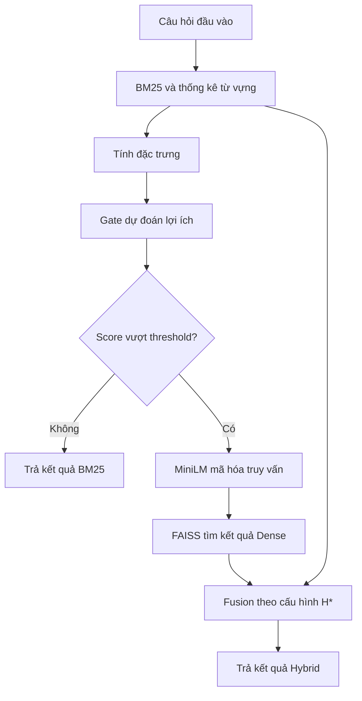

# Giới thiệu đề tài PE-GH

## 1. Bài toán và đầu ra của hệ thống

Một vấn đề về lập trình hoặc Unix/Linux có thể đã được hỏi trước đó nhưng được diễn đạt bằng những từ khác. Người dùng cần tìm lại câu hỏi tương tự để tham khảo kiến thức đã có.

Nhóm nghiên cứu **hệ thống tìm và xếp hạng những câu hỏi kỹ thuật đã có, nhằm giúp người dùng tìm lại câu hỏi đề cập cùng một vấn đề dù cách diễn đạt khác nhau**.

- **Đầu vào:** một câu hỏi bằng tiếng Anh, gọi là truy vấn, thuộc miền Programmers hoặc Unix.
- **Kho tìm kiếm:** các bài viết có sẵn trong miền tương ứng.
- **Đầu ra:** danh sách tối đa 100 câu hỏi, xếp theo mức độ phù hợp để người dùng tham khảo.

Phạm vi đề tài là tìm và xếp hạng câu hỏi. Nhóm không đánh giá khả năng tạo câu trả lời, chẩn đoán nguyên nhân lỗi hay tự sửa chương trình.

## 2. Vấn đề cần cải thiện

Vấn đề đặt ra là **giữ chất lượng tìm kiếm trong khi hạn chế chi phí xử lý mỗi câu hỏi trên CPU**. Các cách tìm kiếm có ưu điểm và chi phí khác nhau:

| Cách tiếp cận | Khả năng chính | Hạn chế liên quan đến đề tài |
|---|---|---|
| BM25 | Tìm theo từ khóa, có xét độ hiếm của từ và độ dài nội dung | Có thể bỏ sót câu hỏi cùng ý nhưng khác cách diễn đạt |
| Dense Retrieval | Tìm theo biểu diễn ngữ nghĩa của câu hỏi và bài viết | Cần thêm bước mã hóa truy vấn và tìm kiếm vector |
| Hybrid Retrieval | Kết hợp kết quả từ khóa và ngữ nghĩa | Nếu luôn chạy cả hai, mọi truy vấn đều chịu chi phí của nhánh ngữ nghĩa |

**Điều nhóm muốn cải thiện là cách phân bổ chi phí ngữ nghĩa cho từng truy vấn.** Một số câu hỏi có thể dùng kết quả BM25, trong khi những câu khác cần Hybrid để có thứ tự xếp hạng tốt hơn. Chạy thêm Dense không bảo đảm chất lượng luôn tăng.

**Giả thuyết nghiên cứu:** lợi ích của Hybrid khác nhau giữa các truy vấn, và thông tin có sẵn trước khi chạy nhánh ngữ nghĩa có thể giúp dự đoán truy vấn nào sẽ hưởng lợi. Nếu bộ quyết định đủ chính xác và ít tốn chi phí, hệ thống có thể giảm số lần chạy Dense và thời gian xử lý, đồng thời giữ chất lượng trong ngưỡng cho phép. Chọn sai truy vấn hoặc tốn quá nhiều chi phí ra quyết định có thể khiến giả thuyết này không được thực nghiệm ủng hộ.

## 3. PE-GH là gì và nhóm đóng góp gì

**PE-GH (Pre-Encoding Gated Hybrid Retrieval)** là một hệ thống truy xuất lai có bộ quyết định, gọi là **Gate**, đặt trước bước mã hóa truy vấn bằng mô hình ngữ nghĩa.

Với mỗi câu hỏi, Gate lựa chọn một trong hai hành động: trả kết quả BM25 hoặc chạy thêm nhánh ngữ nghĩa rồi kết hợp thành Hybrid. Lợi ích cần dự đoán là mức cải thiện khả năng đưa câu hỏi trùng lặp lên vị trí cao hơn khi chuyển từ BM25 sang Hybrid.

> Đóng góp chính của nhóm là nghiên cứu một gate nhẹ dự đoán lợi ích tăng thêm của Hybrid so với BM25 cho từng truy vấn, nhằm giảm số lần mã hóa Dense trong giới hạn suy giảm chất lượng cho phép.

Nhóm cần làm rõ liệu gate có chọn được những truy vấn thực sự hưởng lợi từ Hybrid và tiết kiệm được chi phí sau khi tính cả phần ra quyết định hay không. Những trường hợp bỏ qua truy vấn có lợi hoặc chạy Dense mà không cải thiện chất lượng cũng là kết quả cần phân tích.

### Vị trí so với nghiên cứu đã có

Việc chọn chiến lược truy xuất theo từng truy vấn đã xuất hiện trong nghiên cứu của [Arabzadeh và cộng sự (2021)](https://arxiv.org/abs/2109.10739). [LiteGator (2025)](https://www.atlantis-press.com/proceedings/icast-es-25/126020510) cũng nghiên cứu lựa chọn phương pháp truy xuất bằng một bộ quyết định nhẹ.

Vì vậy, riêng việc có Gate trước encoder chưa đủ để khẳng định tính mới. Phần cần kiểm chứng của PE-GH là đích học **lợi ích xếp hạng của hai hành động thực tế**, giá trị của bộ đặc trưng và hiệu quả trên câu hỏi kỹ thuật trong điều kiện CPU của nhóm. Mức đóng góp có thể bảo vệ phụ thuộc kết quả đối chứng, không mặc định PE-GH vượt các phương pháp đã có.

## 4. Phạm vi và dữ liệu

Nhóm sử dụng hai miền của **CQADupStack**, qua bản dữ liệu BEIR, gồm câu hỏi từ cộng đồng Stack Exchange:

| Miền | Nội dung | Bài viết trong kho | Truy vấn thực nghiệm |
|---|---|---:|---:|
| Programmers | Lập trình, thiết kế và phát triển phần mềm | 32.176 | 876 |
| Unix | Unix/Linux và các vấn đề kỹ thuật liên quan | 47.382 | 1.072 |
| Tổng | Hai miền được đánh giá riêng | 79.558 | 1.948 |

Nội dung tìm kiếm của mỗi bài viết gồm tiêu đề và phần mô tả. Mỗi truy vấn được tìm trong corpus của miền tương ứng. Kết quả tổng hợp không phải điểm trên toàn bộ CQADupStack.

Nhãn đánh giá, gọi là **qrels**, xác định các câu hỏi trùng lặp với truy vấn. Do đó, thực nghiệm đo khả năng tìm lại những câu hỏi được gán nhãn trùng lặp, không bao quát mọi bài viết có liên quan ngữ nghĩa. Khi truy vấn cũng có trong kho, hệ thống loại chính bài viết đó khỏi kết quả.

Phạm vi hiện tại là tiếng Anh, kho dữ liệu cố định và xử lý truy vấn trên CPU. Tiếng Việt, lĩnh vực khác và dữ liệu thay đổi liên tục cần thực nghiệm bổ sung.

## 5. Mục tiêu và tiêu chí thành công

Câu hỏi nghiên cứu chính là:

> PE-GH có giảm số lần chạy nhánh ngữ nghĩa và thời gian phản hồi trên CPU, trong khi chất lượng truy xuất vẫn nằm trong ngưỡng suy giảm cho phép hay không?

Để có đối chứng rõ ràng, nhóm dùng hai phương án tham chiếu:

- **H\*:** cấu hình Hybrid được chọn trên validation (tập dùng để lựa chọn cấu hình) và giữ cố định khi chấm test (tập đánh giá cuối).
- **S\*:** phương án tĩnh tốt nhất trên validation trong BM25, Dense và H\*. Phương án này không thay đổi cách truy xuất theo từng câu hỏi.

**nDCG@10** phản ánh mức độ đưa các câu hỏi có nhãn phù hợp lên những vị trí đầu trong 10 kết quả đầu tiên. **p95** là mức thời gian mà 95% lượt xử lý truy vấn đo được không vượt quá.

| Tiêu chí | Mục tiêu đã đặt trước thực nghiệm |
|---|---|
| Chất lượng | Cận dưới một phía 95% của chênh lệch nDCG@10 giữa PE-GH và S\* lớn hơn −0,01, xét trung bình cân bằng hai miền (macro) và từng miền |
| Số lần chạy Dense | Tỷ lệ truy vấn gọi Dense không quá 60% trên tập test gộp |
| Thời gian trung bình | Giảm ít nhất 20% so với H\* trên cùng máy và điều kiện tài nguyên, tính trên tập gộp |
| Truy vấn chậm | Báo cáo p95 và kiểm tra riêng từng miền |

Ngưỡng 0,01 là điểm nDCG tuyệt đối. Các mức trên là mục tiêu thiết kế dùng để kiểm chứng giả thuyết. Việc đạt mục tiêu ở mức gộp không có nghĩa mọi miền, mọi truy vấn hoặc mọi chỉ số đều cải thiện.

## 6. Hệ thống được triển khai như thế nào

### Chuẩn bị trước khi nhận truy vấn

Nhóm xây chỉ mục BM25 và dùng **MiniLM** để tính trước vector của các bài viết. **FAISS** lưu chỉ mục vector để tìm kiếm khi cần. Mô hình, chỉ mục và gate được nạp trước khi đo thời gian xử lý request.

MiniLM là mô hình ngữ nghĩa có sẵn được giữ cố định. Phần mô hình nhóm huấn luyện cho phương pháp chính là gate.

### Xử lý một truy vấn mới

1. BM25 chạy một lần, lấy tối đa 100 kết quả và thống kê từ vựng.
2. Hệ thống tính đặc trưng từ câu hỏi, thống kê corpus và kết quả BM25.
3. Gate tạo điểm lợi ích dự đoán (score) của việc chuyển sang H\* và so với ngưỡng quyết định (threshold) đã chọn.
4. Nếu score không vượt threshold, hệ thống trả nguyên thứ tự BM25. Nếu score vượt threshold, hệ thống mã hóa truy vấn bằng MiniLM một lần, tìm bằng FAISS và kết hợp kết quả (fusion) với BM25 đã có.

Gate nằm sau BM25 và trước Dense encoding. Mỗi lượt xử lý truy vấn (request) của PE-GH đều có chi phí BM25. Nhánh skip bỏ qua cả mã hóa truy vấn lẫn tìm kiếm vector. Thời gian tiết kiệm nhờ bỏ qua Dense phải lớn hơn thời gian tính đặc trưng và chạy gate mới giúp giảm thời gian tổng.

Với truy vấn không rỗng nhưng toàn bộ token không có trong từ vựng BM25, hệ thống buộc chạy Dense theo quy tắc dự phòng. Các lần gọi này vẫn được tính vào chi phí. Sơ đồ thể hiện luồng thông thường.

## 7. Gate học gì và threshold được chọn ra sao

Gate chính dùng **Ridge**, một mô hình hồi quy nhẹ, với 21 đặc trưng có thể tính trước Dense encoding. Ví dụ gồm độ dài câu hỏi, độ hiếm của từ, tỷ lệ từ ngoài từ vựng và chênh lệch điểm giữa các kết quả BM25 đầu tiên. Gate không cần vector ngữ nghĩa để ra quyết định.

Trên truy vấn có nhãn thuộc tập huấn luyện, nhóm tính:

`Lợi ích thực tế = nDCG@10 của H* − nDCG@10 của BM25`

Ridge học cách dự đoán đại lượng này. Lợi ích có thể dương, bằng 0 hoặc âm. Một kết quả BM25 kém chưa đủ để kết luận rằng Hybrid sẽ giúp ích.

Tham số chuẩn hóa đặc trưng và Ridge được fit trên train. Nhóm dùng validation để chọn cấu hình Hybrid và threshold, ưu tiên giảm tỷ lệ gọi Dense trong ràng buộc chất lượng. Các lựa chọn được khóa trước khi chấm test.

Khi xử lý câu hỏi mới, hệ thống dùng đặc trưng và gate đã học. Nhãn đúng của câu hỏi chỉ phục vụ đánh giá, không tham gia quyết định online.

## 8. Cách kiểm chứng hiệu quả

### Chia dữ liệu và kiểm soát rò rỉ

Nhóm chia truy vấn thành năm phần để chạy **5-fold out-of-fold**. Trong mỗi lượt, khoảng 60% dùng cho train, 20% cho validation và 20% cho test. Các truy vấn có văn bản chuẩn hóa giống nhau hoặc chia sẻ bài viết có nhãn trùng lặp được giữ cùng phần.

Mỗi truy vấn chỉ đóng góp một kết quả test từ model của lượt tương ứng. Corpus tìm kiếm vẫn giữ đầy đủ trong các lượt; phần được chia là truy vấn và nhãn để học/chọn/đánh giá gate.

### Đối chứng và phép đo

Nhóm đánh giá BM25, Dense-only, Hybrid luôn chạy và PE-GH. Các đối chứng bổ sung gồm gate theo chênh lệch điểm BM25, gate ngẫu nhiên và một adaptation LiteGator-style trong cùng hạ tầng. Adaptation này không được gọi là tái lập đầy đủ bài gốc.

- **Chất lượng:** nDCG@10 là chỉ số chính; MRR và Recall bổ sung góc nhìn về thứ hạng và độ bao phủ. Báo cáo riêng từng miền và macro cân bằng hai miền.
- **Chi phí thực tế:** số lần gọi encoder, thời gian CPU và mức RAM sử dụng.
- **Thời gian phản hồi:** mean và p95 từ request chạy thật, bao gồm BM25, đặc trưng, gate và nhánh Dense/fusion khi được gọi.

Nhóm dùng bootstrap ghép cặp theo truy vấn/nhóm để tính khoảng tin cậy chất lượng. Nhãn test không dùng để chọn lại model hoặc threshold. Đo latency dùng mã hóa truy vấn thật, không lấy thời gian từ cache ranking hay suy ra từ tỷ lệ gọi Dense.

## 9. Kết quả thực nghiệm hiện có

Lượt đo ngày **30/10/2026** trên AMD Ryzen 7 8745H, Windows 11, giới hạn bốn logical CPU đã có đủ **29.220 request**: 1.948 truy vấn, ba phương pháp online và năm lần lặp. Kết quả gộp như sau:

| Phương pháp | Macro nDCG@10 | Tỷ lệ gọi Dense | Mean latency |
|---|---:|---:|---:|
| H\* | 0,314625 | 100% | 25,950 ms |
| S\* | 0,314625 | 100% | 25,770 ms |
| PE-GH | 0,312163 | 57,75% | 17,178 ms |

PE-GH giảm mean latency **33,80% so với H\*** trong lượt đo này, với khoảng tin cậy 95% [32,01%; 35,65%]. Chênh lệch macro nDCG@10 so với S\* là −0,002462, cận dưới một phía 95% là −0,006009, đạt biên −0,01 đã đăng ký.

Hai giới hạn cần giữ khi trình bày: Programmers riêng giảm mean 19,73%, dưới mục tiêu 20%, và p95 hơi cao hơn H\*/S\*. Chất lượng Unix đạt tiêu chí nhưng cận dưới sát biên. Kết quả trên hai miền và máy này chưa đủ để kết luận ưu thế trên mọi dữ liệu hoặc phần cứng.

H\* và S\* có cùng ranking trong cả mười tổ hợp fold/miền ở lượt này. Chênh lệch latency giữa chúng phản ánh biến thiên phép đo ở các process riêng. Các gate đối chứng có kết quả quality nhưng chưa được đo online đầy đủ trong cùng lượt, nên chưa có cơ sở tuyên bố PE-GH nhanh hơn tất cả đối chứng.

## Tài liệu đối chiếu

- [Nghiên cứu liên quan về routing và fusion](paper/02a_routing_related_work.md)
- [Phương pháp PE-GH](paper/03_method.md)
- [Thiết lập thực nghiệm](paper/04_experimental_setup.md)
- [Protocol và ngưỡng chất lượng](configs/gating/protocol_v1.yaml)
- [Bảng chất lượng, CI và phân tích failure cuối](paper/05a_quality_results.md)
- [Receipt kết quả đo ngày 30/10/2026](docs/person_a/validation/2026-10-30/release.json)
