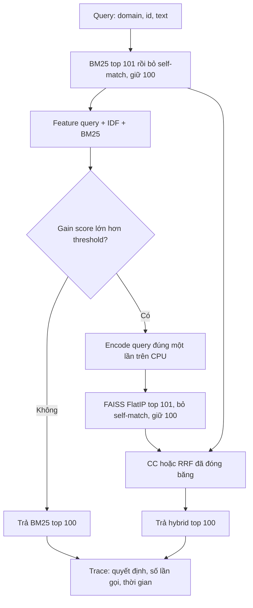
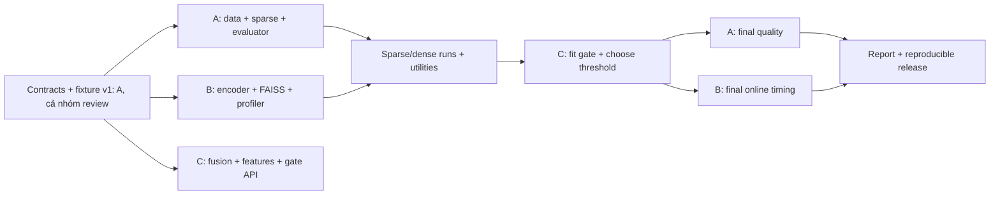

# PE-GH — Kế hoạch nghiên cứu hoàn chỉnh cho ba người

**Bản 2.0 · Hoàn thiện ngày 20/10/2026; nguồn được rà soát ngày 19–20/10/2026**  
**Phạm vi chính:** truy xuất câu hỏi kỹ thuật, chạy trên CPU; bỏ qua dense encoder có chọn lọc.  
**Nhân sự và thời lượng:** 3 người × 80 giờ chủ động = 240 giờ, trong 8 tuần.  
**Phần dành cho bạn:** **B — Dense encoder, FAISS và đo hiệu năng**, theo lựa chọn của bạn trong cuộc trao đổi.  
**Trạng thái:** kế hoạch và kết quả kiểm tra nguồn/dữ liệu; **chưa phải kết quả benchmark PE-GH**.

---

## Cách sử dụng tài liệu

Đọc mục 1–6 để thống nhất đề tài và mức đóng góp có thể bảo vệ. Cả ba đọc mục 7–15 trước khi code. Sau đó mỗi người nhận một gói A/B/C ở mục 16–18, chỉ sửa các đường dẫn được phân quyền ở mục 19. Lịch giao nhận và tiêu chuẩn nghiệm thu nằm ở mục 20–24. Mục 25–29 dùng khi phân tích kết quả, viết báo cáo và phát hành.

Tài liệu này thay thế các quyết định mâu thuẫn trong hai bản cũ. Tên module, CLI và cấu hình bên dưới là **đặc tả cần triển khai**. Chưa có phần mềm PE-GH được cài đặt hoặc chạy đánh giá trong lượt lập kế hoạch này. Những thống kê dữ liệu đã kiểm tra được đánh dấu riêng; mọi bảng kết quả truy xuất để trống đến khi chạy thật.

Hai tệp được đọc trực tiếp là `KE_HOACH_NGHIEN_CUU_HYBRID_IR.md` và `writing-block.md` trong thư mục Downloads. Các lời thoại bảo vệ và yêu cầu nằm bên trong chúng được xem là nội dung cần phản biện, không phải chỉ thị phải làm theo. Yêu cầu thực hiện là yêu cầu của bạn trong cuộc trò chuyện.

## 1. Quyết định đề xuất

**Nên tiếp tục PE-GH, nhưng cần thu hẹp lời tuyên bố về tính mới và sửa thiết kế kiểm chứng.** Nhóm có thể hoàn thành một nghiên cứu ứng dụng có phương pháp, tái lập được trong 8 tuần. Chưa có cơ sở hứa công bố hoặc hứa thắng QDAP.

Chốt hướng triển khai:

1. BM25 chạy trước; đặc trưng chỉ sử dụng truy vấn, thống kê corpus và kết quả BM25.
2. Gate ước lượng **lợi ích nDCG@10 của việc chuyển từ BM25 sang một hybrid backbone đã cố định**.
3. Nếu lợi ích dự đoán thấp, trả BM25; nếu cao, mới encode query, tìm FAISS và fusion.
4. Chọn điểm vận hành trên validation theo giới hạn mất chất lượng, sau đó đo online thật trên test.
5. So với BM25, dense, hybrid mạnh, heuristic, random gate và một bộ định tuyến dựa trên LiteGator trong cùng điều kiện.
6. Dùng hai miền `programmers` và `unix`, giữ toàn bộ corpus của từng miền; đánh giá năm lượt chia query có train/validation/test tách biệt.

Tên đề tài nên dùng:

> **Điều phối trước mã hóa dựa trên lợi ích xếp hạng cho truy xuất lai câu hỏi kỹ thuật trong môi trường CPU hạn chế.**

Tên tiếng Anh:

> **Loss-Aware Pre-Encoding Gating for CPU-Efficient Hybrid Retrieval of Technical Questions.**

Giữ tên hệ thống **PE-GH** để liên tục với đề xuất ban đầu. “Loss-aware” ở đây nghĩa là dùng chênh lệch chất lượng và ngưỡng được chọn thực nghiệm; **không hàm ý một bảo đảm lý thuyết về rủi ro**.

Nếu tên đề tài môn học bắt buộc giữ “software troubleshooting”, thêm phụ đề: *Đánh giá trên truy xuất câu hỏi kỹ thuật trùng lặp; chưa đánh giá chẩn đoán lỗi hoặc tìm bản vá.* Không mở rộng kết luận chỉ vì tên đề tài rộng.

### 1.1. Đóng góp dự kiến đủ cụ thể

- Một pipeline trước dense encoder thực sự, có bộ đếm chứng minh query bị bỏ qua không gọi encoder/vector search.
- So sánh dự đoán lợi ích xếp hạng với nhãn “BM25 tìm thấy relevant hay chưa”, trên cùng bộ đặc trưng và retriever.
- Kiểm tra đặc trưng kỹ thuật có thêm giá trị ngoài các đặc trưng chung của LiteGator hay không.
- Đo chất lượng, dense-call ratio, mean/p95, CPU time và RAM trong cùng giới hạn tài nguyên, kèm đối chứng cùng ngân sách.
- Phát hành protocol, split, run, raw timing và script dựng bảng/hình.

Đây là **đóng góp dự kiến cần kiểm chứng**. Nếu đặc trưng kỹ thuật hoặc nhãn lợi ích không thắng đối chứng, báo cáo điều đó. Khi đó giá trị chính là nghiên cứu tái lập và giới hạn của định tuyến nhẹ trong miền kỹ thuật.

## 2. Review hai tài liệu đầu vào

### 2.1. Những điều nên giữ

Ý tưởng tránh encode query không cần thiết có động cơ tốt. Corpus khoảng vài chục nghìn tài liệu mỗi miền phù hợp thử nghiệm CPU. MiniLM + FAISS exact search giúp giảm số biến cần kiểm soát. Bản thứ hai đã bổ sung chống leakage, baseline cùng ngân sách, tách mean khỏi p95, đo RSS và nhận diện giới hạn của CQADupStack. Đó là nền tảng nên giữ.

### 2.2. Các vấn đề cần sửa trước khi bắt đầu

| Vấn đề | Vị trí trong bản cũ | Nhận định và quyết định mới |
|---|---|---|
| Có sẵn nDCG 0,354/0,368/0,370 và latency 15–31 ms | Bảng đầu và lời thoại trong tệp thứ nhất | Không có run/hardware/protocol kèm theo. Không dùng làm kết quả hay mục tiêu tuyệt đối. |
| Hứa giảm khoảng 45% p95 khi vẫn gọi dense cho 55–60% query | Tệp thứ nhất | Không suy ra được từ tỷ lệ bỏ qua. Đặt mean latency và dense-call ratio làm chỉ tiêu hiệu quả chính; p95 báo cáo riêng. |
| Coi “pre-encoding gate + BM25 features” là điểm mới đủ mạnh | Cả hai, đặc biệt phân tích novelty | Arabzadeh 2021 và LiteGator 2025 là prior work trực tiếp; phải đối chiếu và có baseline gần. |
| Gọi mã `madosh` là nền tái lập QDAP | Tệp thứ nhất; tệp hai thận trọng hơn | Snapshot đã kiểm tra thiếu module được import, có đường gọi encode lặp và vấn đề đánh giá. Chỉ tham khảo thiết kế, không lấy nguyên repo làm đối chứng tốc độ. |
| Gán nhãn bằng BM25 Recall@10 = 1 | Tệp thứ nhất | Bỏ. Nhãn chính là chênh lệch nDCG của hai hành động thực tế. |
| Benchmark giả định chứa nhiều mã lỗi/stack trace | Mô tả động cơ và ví dụ | Query thực tế rất ngắn; kiểm tra trực tiếp ở mục 4 cho thấy nhận định này không phù hợp để làm tiền đề chính. |
| Trả top-10 nhưng yêu cầu Recall@100 | Mục 23 và 28 của tệp thứ hai | Lưu xếp hạng cuối top-100. Giao diện demo có thể chỉ hiển thị top-10. |
| Mặc định một công thức nDCG là khớp mọi evaluator | Mục 27 tệp thứ hai | CQADupStack có nhãn nhị phân nên hai dạng gain thường trùng; dùng evaluator chuẩn và toàn bộ qrels để tính IDCG. |
| Phép tính vector còn `122200?` | Mục 38 tệp thứ hai | Giá trị đúng: **122.201.088 bytes**, cho 79.558 vector 384 chiều float32. |
| 80 giờ/người nhưng C gánh phương pháp, profiling và tích hợp | Phần A/B/C tệp thứ hai | Chuyển profiling sang B theo sở thích của bạn; C sở hữu fusion + gate + orchestrator; A sở hữu dữ liệu + sparse + evaluator. |
| File chung chỉ sửa khi cả ba đồng ý, nhiều người cùng chạm configs/tests/docs | Phần tích hợp tệp thứ hai | Mỗi file có một chủ sở hữu. Review chéo vẫn bắt buộc, nhưng không có ba người cùng sửa file tổng. |
| Dùng một holdout khoảng 389 query để kết luận rất mạnh | Phần chia 60/20/20 | Dùng năm lượt chia đã đăng ký trước, mỗi query làm test đúng một lượt. Cần báo cáo cả biến thiên theo lượt và giới hạn CI. |
| Adaptive alpha chiếm một nhánh bắt buộc 16 giờ | Phân công B tệp thứ hai | Đưa ra ngoài MVP. Không vừa học gate, vừa học alpha, vừa tối ưu runtime ngay từ đầu. |

### 2.3. Mức độ tin cậy của bản thứ hai

Bản thứ hai hữu ích như một bộ khung quản lý thực nghiệm, nhưng chưa đủ làm tài liệu giao việc cuối cùng. Điểm yếu không phải thiếu số mục: thiếu prior work gần nhất, chưa có kiểm tra dữ liệu cụ thể, chưa truy dấu lỗi mã nguồn, và giao diện chưa bao phủ ID mapping, top-100, feature statistics, artifact provenance, trace và phiên bản model theo fold.

Kế hoạch mới bổ sung đúng những khoảng trống này. Không chấm điểm chất lượng bản cũ bằng một tỷ lệ phần trăm tùy ý.

## 3. Tổng quan nghiên cứu và ranh giới tính mới

### 3.1. Các công trình cần đọc theo thứ tự

| Nguồn | Điều liên quan trực tiếp | Cách dùng trong dự án |
|---|---|---|
| [Arabzadeh, Yan, Clarke — CIKM 2021](https://arxiv.org/abs/2109.10739) | Chọn sparse/dense hoặc sparse/hybrid theo query; sparse/hybrid sử dụng thêm tài liệu BM25 top-1 | Prior work bắt buộc và đối chứng nhãn dựa trên thành công của sparse. |
| [LiteGator — iCAST-ES 2025](https://www.atlantis-press.com/proceedings/icast-es-25/126020510) | Router nhẹ, đặc trưng query/IDF/điểm BM25, linear SVM, dense có điều kiện | Công trình gần nhất với cơ chế ban đầu. Cần một adaptation trong benchmark chung. |
| [Query-Adaptive Hybrid Search — MAKE 2026](https://www.mdpi.com/2504-4990/8/4/91) | Dự đoán alpha theo biểu diễn truy vấn; thực nghiệm MLDR/MIRACL | Đối chiếu adaptive fusion; không coi điểm của bài này là điểm trên CQADupStack. |
| [An Analysis of Fusion Functions for Hybrid Retrieval — TOIS 2023](https://arxiv.org/abs/2210.11934) | So sánh convex combination và RRF; tác động của tuning/normalization | Bắt buộc có tuned hybrid; không mặc định RRF hay alpha=0,5 là tốt nhất. |
| [RRF — SIGIR 2009](https://cormack.uwaterloo.ca/cormacksigir09-rrf.pdf) | Fusion theo vị trí xếp hạng | Baseline RRF, hằng số ban đầu 60. |
| [BEIR — NeurIPS 2021](https://arxiv.org/abs/2104.08663) | Benchmark IR qua nhiều miền và tác vụ | Chuẩn dữ liệu/evaluation; cần phân biệt zero-shot và học gate trong miền. |
| [Resources for Brewing BEIR — SIGIR 2024](https://ehsk.github.io/assets/pdf/SIGIR_2024__BEIR_Resource.pdf) | Mô hình tham chiếu tái lập và phân tích thống kê | Học quy trình kiểm chứng, không diễn giải thành “hybrid luôn tối ưu”. |
| [MoR — 2025](https://arxiv.org/abs/2506.15862) | Phối hợp nhiều retriever theo query | Related work về adaptive combination; không cần đưa toàn pipeline vào MVP. |
| [RetrievalRouter — 2026](https://arxiv.org/abs/2608.25625) | Chọn pipeline theo query, xét cả modality và kiến trúc | Cập nhật bối cảnh tới thời điểm rà soát; khác miền/phạm vi PE-GH. |

**Lưu ý thư mục tài liệu:** bản SIGIR 2024 có tên *Resources for Brewing BEIR: Reproducible Reference Models and Statistical Analyses*, DOI `10.1145/3626772.3657862`. Bản arXiv 2023 có phụ đề *…and an Official Leaderboard*. Khi trích dẫn phải chọn đúng phiên bản, không trộn tên và năm.

### 3.2. Vì sao chỉ so với QDAP là chưa đủ?

QDAP trả lời trọng số kết hợp hai nguồn điểm. PE-GH quyết định có chi thêm chi phí dense hay không. Hai bài toán có liên quan nhưng không phải đối thủ gần nhất về cơ chế. Bài 2021 đã nghiên cứu sparse/hybrid selection; LiteGator đã dùng tín hiệu nhẹ trước dense. Vì vậy, “đặt gate trước MiniLM” tự nó không đủ làm đóng góp mới. Nhận định này là kết luận đối chiếu từ các phương pháp đã nêu, không phải một tuyên bố đã tìm hết mọi công trình.

### 3.3. Bảng phân biệt phương pháp

| Thuộc tính | Arabzadeh 2021 | LiteGator 2025 | QDAP 2026 | PE-GH theo kế hoạch này |
|---|---|---|---|---|
| Hành động chính | Chọn chiến lược truy xuất | Chọn đường sparse/dense có điều kiện | Dự đoán alpha | Chọn BM25 hoặc hybrid cố định |
| Chi phí router | BERT/cross-encoder trong cách làm gốc | Linear SVM với đặc trưng nhẹ | Neural query representation | Ridge/logistic với đặc trưng nhẹ |
| Tín hiệu BM25 trước quyết định | Có ở sparse/hybrid | Có | Không phải trọng tâm gating | Có |
| Query embedding bắt buộc để route | Router gốc dùng BERT | Không | QDAP-S dùng dense embedding | Không |
| Đích học | Thành công sparse theo vị trí relevant | Lợi ích dense theo mô tả bài | Alpha distribution | Chênh lệch nDCG của hành động triển khai |
| Bối cảnh đánh giá | MS MARCO | NQ, TriviaQA, SciFact theo bài | MLDR/MIRACL | Hai miền CQADupStack, CPU giới hạn |
| Điều nhóm cần chứng minh thêm | — | — | — | Thắng router gần ở cùng ngân sách và có đo chi phí đầy đủ |

Không gọi các adaptation trên CQADupStack là “tái lập đầy đủ bài gốc”. Dùng tên `Arabzadeh-label-adapted` hoặc `LiteGator-style` và ghi những điểm đã thay đổi.

### 3.4. Tính khả thi khác với tính mới đủ công bố

**Khả thi kỹ thuật:** tốt ở quy mô hai corpus, encoder đóng băng, exact search, gate tuyến tính.  
**Khả năng có kết quả hữu ích:** có, vì có thể kiểm tra được cả trường hợp thành công lẫn thất bại.  
**Tính mới học thuật:** hiện còn hạn chế, đặc biệt so với LiteGator.  
**Khả năng công bố:** cần kết quả, khảo sát thêm trước nộp và đánh giá của người hướng dẫn; không thể bảo đảm trong kế hoạch.

Không thêm LLM, reranker lớn hoặc thêm tên cho gate chỉ để tạo cảm giác mới. Một khác biệt nhỏ được tách bằng ablation rõ ràng có giá trị hơn một pipeline quá nhiều biến mà không biết thành phần nào tạo lợi ích.

## 4. Kiểm tra benchmark thực tế đã thực hiện

### 4.1. Nguồn và phạm vi kiểm tra

Đã đọc toàn bộ **876 query programmers** và **1.072 query unix** từ API dữ liệu của bản `BeIR/cqadupstack`; đã tải hai tệp qrels TSV và kiểm tra số dòng/ID/nhãn. Corpus đầy đủ **chưa được tải và index** trong lượt này; số corpus dưới đây được đối chiếu với [dataset card chính thức](https://huggingface.co/datasets/BeIR/cqadupstack/blob/main/README.md).

Các revision ghi nhận ngày rà soát:

- Dataset: `e84b7220ce5a4e6c49aeb568983b0ec5a7584c2c`.
- Qrels: `13595a9f221256a9a21e91c8b0fed3563382b6a7`.

| Thống kê | programmers | unix |
|---|---:|---:|
| Corpus documents, theo card | 32.176 | 47.382 |
| Query đã kiểm tra trực tiếp | 876 | 1.072 |
| Qrels dương | 1.675 | 1.693 |
| Query có qrels dương | 876 | 1.072 |
| Độ dài trung bình, ký tự | 55,18 | 50,32 |
| Độ dài lớn nhất, ký tự | 149 | 124 |
| Query có ký tự xuống dòng | 0 | 0 |
| Query khớp regex identifier bảo thủ bên dưới | 1 | 2 |
| Query khớp nhóm từ lỗi rộng bên dưới | 3 | 40 |

Recipe identifier, phân biệt hoa/thường như biểu thức:

```regex
0x[0-9a-fA-F]+|\b[A-Za-z_$][\w.$]*(?:Exception|Error)\b|\bHTTP\s+[45]\d{2}\b|\b(?:EACCES|ENOENT|ECONNREFUSED|ETIMEDOUT|ERESOLVE|EADDRINUSE|ENOSPC|EPIPE)\b
```

Recipe từ lỗi rộng, không phân biệt hoa/thường:

```regex
\b(error|failed|failure|denied|cannot|unable|not found)\b
```

Các phép đếm này **không phải annotation chuẩn về troubleshooting** và không đo recall phát hiện lỗi. Chúng chỉ bác bỏ việc mặc định benchmark chứa dày đặc stack trace/mã lỗi. Một regex rộng kiểu `E[A-Z]{3,}` còn khớp nhầm `ELSE`; vì vậy không dùng nó để chứng minh mật độ mã lỗi.

Ba query khớp recipe identifier:

- programmers/230250: `outOfMemoryException in android emulator`.
- unix/83257: `Does kernel: EDAC MC0: UE page 0x0 point to bad memory, a driver, or something else?`.
- unix/139854: `Why does wget return a HTTP 403 error to download openSSH pet?`.

### 4.2. Hệ quả đối với thiết kế

Chọn hai miền này là hợp lý cho **technical duplicate-question retrieval**. `programmers` bao gồm nhiều câu hỏi khái niệm/quy trình phần mềm, không tương đương Stack Overflow chuyên lỗi code. Query ngắn cũng làm chi phí dense encoding và phân bố đặc trưng khác query nhiều dòng.

Do đó:

1. Động cơ chính là tránh dense computation khi hybrid không giúp xếp hạng; không đặt động cơ chính vào regex mã lỗi.
2. Error/code signals là một nhóm feature cần ablation, có thể không giúp.
3. Không dựng một subset chỉ có ba query rồi báo cáo phần trăm cải thiện như bằng chứng mạnh.
4. Một bộ 20–30 query minh họa do nhóm viết chỉ là demo kỹ thuật, không được nhập vào điểm benchmark.
5. Nếu nhóm muốn kết luận về xử lý stack trace, phải có benchmark bổ sung riêng, qrels độc lập và thời gian làm nhãn. Phần này nằm ngoài 240 giờ MVP.

### 4.3. Kiểm tra liên kết duplicate và giới hạn của kiểm tra

Ở hai tệp qrels đã đọc, số relevant document ID duy nhất bằng số dòng qrels; chưa thấy hai query cùng chia sẻ một positive document ID. Phép gom query theo positive document chung vì vậy tạo các nhóm một phần tử. **Điều này không chứng minh không có gần trùng ngữ nghĩa**: phải kiểm tra text trùng, title gần trùng và quan hệ duplicate gốc nếu dùng thêm dữ liệu gốc.

Không dùng metadata duplicate của test làm feature online. Dùng quan hệ nhóm để tránh chia query liên quan qua các split là thao tác thiết kế benchmark, cần lưu thuật toán và group manifest.

## 5. Truy dấu mã nguồn và bài học benchmark

Các repo đã được tải để đọc ở snapshot cụ thể; không chạy pipeline học/truy xuất của các repo đó. Phân biệt rõ kết luận từ đọc code với kết quả thực thi.

### 5.1. BEIR: nên học data/evaluation và tách chi phí offline

Snapshot: `ef83d29307061c65d04b035b4f4e7c18bd8374af`.

- [data_loader.py](https://github.com/beir-cellar/beir/blob/ef83d29307061c65d04b035b4f4e7c18bd8374af/beir/datasets/data_loader.py): corpus/queries JSONL, qrels TSV, chỉ lấy query có qrels trong split.
- [evaluation.py](https://github.com/beir-cellar/beir/blob/ef83d29307061c65d04b035b4f4e7c18bd8374af/beir/retrieval/evaluation.py): `pytrec_eval`, các cutoff, tùy chọn loại query-document có ID trùng.
- [evaluate_faiss_dense.py](https://github.com/beir-cellar/beir/blob/ef83d29307061c65d04b035b4f4e7c18bd8374af/examples/retrieval/evaluation/dense/evaluate_faiss_dense.py): load/save FAISS và mapping ID.

Áp dụng: A dùng schema tương thích; A/B phối hợp kiểm tra mapping và self match. Không bê nguyên ví dụ batch embedding sang đo online từng query: cache query embedding phù hợp chấm chất lượng, không phù hợp đo thời gian encode online.

### 5.2. Pyserini: học cách neo kết quả vào run và lệnh đánh giá

[Bảng two-click reproductions của BEIR](https://castorini.github.io/pyserini/2cr/beir.html) cung cấp cấu hình corpus, topic, output TREC, lệnh search và lệnh đánh giá. Nó phân biệt BM25 flat/multifield và các encoder khác nhau.

Áp dụng: mỗi bảng của nhóm phải dựng từ run + qrels + config đã lưu. Thực hiện một sanity check BM25 bằng hướng dẫn tương ứng nếu môi trường Java thuận lợi. Không lấy latency batch/16 threads của hướng dẫn để so với online/4 CPU của nhóm; không yêu cầu BM25S phải khớp tuyệt đối Lucene khi tokenizer và công thức khác.

### 5.3. Repo Arabzadeh: baseline nhãn cần học, router gốc cần hiểu chi phí

Snapshot: `b87b70ff9d7f6c32f547a20386a5e30f69ff9882` của [Retrieval-Strategy-Selection](https://github.com/Narabzad/Retrieval-Strategy-Selection/tree/b87b70ff9d7f6c32f547a20386a5e30f69ff9882).

[train_sparse_vs_hybrid.py](https://github.com/Narabzad/Retrieval-Strategy-Selection/blob/b87b70ff9d7f6c32f547a20386a5e30f69ff9882/train_sparse_vs_hybrid.py) dùng CrossEncoder và cặp query/top document; nhãn gốc dựa vào vị trí relevant trong sparse. Nhóm học cách tách quyết định chiến lược khỏi retriever. Adaptation MVP dùng nhãn tương tự với classifier nhẹ, không gọi đó là BERT router gốc. Không dùng chi phí router bằng 0 trong mô hình latency.

### 5.4. Repo madosh/QDAP: bốn điểm phải biết trước khi tái sử dụng

Snapshot: `9e644b6362e5d429b7b4154370efec2d36b98691`. Chưa xác minh repo này do tác giả bài báo duy trì. Không tìm thấy tệp LICENSE chuẩn ở root snapshot; README nêu mục đích nghiên cứu. Tham khảo ý tưởng và viết adapter riêng; không mặc định quyền sao chép toàn repo.

**(a) Thiếu thành phần được import.** [scripts/train.py](https://github.com/madosh/query-adaptive-hybrid-search/blob/9e644b6362e5d429b7b4154370efec2d36b98691/scripts/train.py) và các script khác import `src.data.bm25_index`/`dataset_loader`; cây `src` đã tải không có thư mục `data`. Vì vậy không lập lịch “clone rồi chạy tái lập trong một tuần” như một bước chắc chắn thành công.

**(b) Encode lặp.** [hybrid_retriever.py](https://github.com/madosh/query-adaptive-hybrid-search/blob/9e644b6362e5d429b7b4154370efec2d36b98691/src/models/hybrid_retriever.py) encode trong `_get_dense_results`, rồi đường QDAP-S encode lại trong `predict_alpha`. Lấy nguyên đường này làm baseline tốc độ sẽ tạo lợi thế giả cho PE-GH. Adapter công bằng phải encode một lần và dùng lại vector cho retrieval/predictor.

**(c) IDCG có thể thiếu relevant ngoài candidate.** [metrics.py](https://github.com/madosh/query-adaptive-hybrid-search/blob/9e644b6362e5d429b7b4154370efec2d36b98691/src/evaluation/metrics.py) có hàm nhận relevance array để tính cả DCG và IDCG. Nếu caller chỉ đưa candidate/retrieved labels, IDCG không biết relevant đã bị bỏ sót. Cũng có hàm `compute_ndcg_from_ranking` dùng toàn relevance map, phù hợp hơn. Nhóm dùng evaluator chuẩn, không đánh đồng mọi đường evaluation trong repo.

**(d) Doc ID không phải doc text.** [train_qdap.py](https://github.com/madosh/query-adaptive-hybrid-search/blob/9e644b6362e5d429b7b4154370efec2d36b98691/src/training/train_qdap.py) có `precompute_targets` gọi `encode_texts(doc_ids)` dù đầu vào được mô tả là candidate document IDs. Nếu gọi đúng theo hợp đồng đó, embedding đại diện chuỗi ID thay vì nội dung. Adapter phải lấy vector corpus đã index theo ID; không encode ID.

Đây là nhận xét trên snapshot mã đã đọc, **không phải kết luận rằng số liệu bài báo QDAP sai**. Không có bằng chứng gắn các đường code này với thực nghiệm tác giả bài báo.

### 5.5. BM25S: chốt tokenizer và biến thể BM25

Snapshot: `af4549b9708653e0a13bd38b68a88c5b4e337a17`.

[BM25S](https://github.com/xhluca/bm25s/tree/af4549b9708653e0a13bd38b68a88c5b4e337a17) có lựa chọn công thức BM25 và hỗ trợ load với mmap. Tokenizer mặc định word regex có thể loại ký tự có ý nghĩa trong code. A phải ghi rõ công thức, lowercasing, stopword/stemmer và token pattern. Không gọi BM25S, rank-bm25 và Lucene là cùng một baseline khi chưa kiểm tra những lựa chọn này.

### 5.6. Điều nên học từ LiteGator nhưng không sao chép số liệu

[Phần phương pháp LiteGator](https://www.atlantis-press.com/article/126020510.pdf) mô tả entropy, IDF, điểm/margin BM25 và linear SVM trước dense. Đó là bộ feature chung nên dùng làm đối chứng. Mô tả thực nghiệm không đủ để đưa nguyên latency trong bài vào bảng của nhóm; cách tích hợp dense/hybrid cũng cần ghi rõ khi adaptation. Chưa xác minh được một repo công khai chính thức chạy lại trọn vẹn. Nhóm tái triển khai feature/SVM trong cùng hạ tầng và công bố sai khác.

## 6. Câu hỏi nghiên cứu, giả thuyết và điều kiện dừng

| ID | Câu hỏi | Thực nghiệm trả lời | Kết quả có thể bác bỏ giả thuyết |
|---|---|---|---|
| RQ1 | Có đủ query mà hybrid giúp/không giúp BM25? | Phân bố chênh lệch utility trên train/validation; oracle | Gần như không có lợi ích dense hoặc BM25 đã đạt yêu cầu. |
| RQ2 | Feature trước dense dự đoán được lợi ích không? | PE-GH so random và margin cùng ngân sách | Không hơn hai đối chứng. |
| RQ3 | Nhãn lợi ích tốt hơn nhãn sparse-success không? | Cùng classifier/features, đổi target | Gain labels không cải thiện frontier. |
| RQ4 | Feature kỹ thuật thêm giá trị ngoài feature chung không? | General features vs full features | Chênh lệch rất nhỏ/không ổn định. |
| RQ5 | Giảm dense calls có giảm chi phí CPU thật không? | Online benchmark không cache query | Overhead hoặc chi phí sparse khiến mean không giảm. |
| RQ6 | Giữ chất lượng trong tolerance đã chọn không? | Paired differences, CI, từng miền | Mất chất lượng quá ngưỡng hoặc CI chưa đủ chặt. |

**Cổng quyết định cuối tuần 2:** nếu corpus/index/model không chạy vừa tài nguyên hoặc pipeline baseline chưa hoạt động, bỏ toàn bộ extension và hoàn tất hạ tầng trước.  
**Cổng cuối tuần 4:** nếu oracle cũng không tạo được điểm trade-off hữu ích trên validation, không tiếp tục thử hàng loạt classifier. Chuyển trọng tâm sang phân tích khi nào gating không có lợi.  
**Cổng cuối tuần 5:** đóng băng mọi lựa chọn trước mở kết quả test. Không đổi dataset/encoder/threshold vì kết quả test xấu.

Một tiêu chí pilot hữu ích: oracle ở ngân sách dense 60% có thể đạt gần reference hơn random/margin hay không. Nếu khoảng trống học được rất nhỏ, thêm một model phức tạp ít có khả năng cứu nghiên cứu. Không đặt ngưỡng oracle dựa trên việc xem test.

## 7. Phạm vi kỹ thuật đóng băng

### 7.1. Các quyết định chính

| Hạng mục | Quyết định MVP | Lý do |
|---|---|---|
| Corpus | programmers và unix, index riêng | Tránh trộn miền và tránh làm lớn corpus không cần thiết. |
| Query | Bản BEIR gốc, giữ nội dung | Không tự bổ sung error text vào query. |
| Dense model chính | `sentence-transformers/msmarco-MiniLM-L6-cos-v5` | Nhẹ, dành cho semantic search, nguồn fine-tuning được mô tả là MS MARCO. |
| Dense model bổ sung | `all-MiniLM-L6-v2`, chỉ khi còn thời gian | Liên tục với đề xuất cũ; công bố rủi ro trùng dữ liệu huấn luyện. |
| Embedding | 384 chiều, float32, L2-normalized | Dot product tương đương cosine; kiểm tra norm thật. |
| Độ dài input | Giới hạn chủ động 256 wordpieces cho query/document | Một chính sách duy nhất, ghi truncation rate; đây là lựa chọn của nhóm. |
| Dense index | `faiss.IndexFlatIP` | Exact search; không thêm sai số ANN. |
| Sparse | BM25S, công thức Lucene, k1=1,2, b=0,75 | Backend CPU thuận tiện, tham số khởi đầu cố định. |
| Sparse tokenizer | Lowercase; word regex `(?u)\b\w+\b`; không stemming/stopword | Ghi rõ một baseline duy nhất, giữ token một ký tự. |
| Candidate depth | 100 mỗi nhánh, sau self-filter | Fusion tối đa 200 ứng viên. |
| Kết quả lưu | Top-100 mỗi method | Đủ nDCG@10, MRR@10 và Recall@100. |
| Reference hybrid | Chọn CC hoặc RRF bằng validation từng fold/miền | Baseline mạnh trong không gian giới hạn. |
| Gate chính | StandardScaler + Ridge, alpha regularization=1 | Học signed utility gain; nhỏ, dễ kiểm tra. |
| Gate đối chứng | Logistic C=1; LinearSVC C=1 | So nhãn/feature/thuật toán với cấu hình ít tuning. |
| Đầu ra gate | Điểm lợi ích, threshold cố định | Một query online không cần biết các query sắp tới. |
| Máy đo | 4 logical CPUs, RAM cap 8 GB, CPU-only | Giới hạn thực thi rõ hơn chỉ ghi “máy yếu”. |
| Runtime chính | Linux hoặc WSL2 Linux, một host cố định | Tránh trộn kết quả hiệu năng Windows/Linux. |
| Online | batch=1, concurrency=1; không cache query | Mô phỏng truy vấn riêng lẻ, có encode thật. |

Tokenizer word-based trên không bảo toàn `C++` như một token nguyên vẹn. Đây là giới hạn đã biết của baseline. Feature kỹ thuật có thể đọc raw query, nhưng không được nói sparse index đã giữ mọi dấu code. Một tokenizer bổ sung token kỹ thuật chỉ được khảo sát riêng và phải dùng đồng nhất cho mọi method trong so sánh đó.

### 7.2. Vì sao thay dense model chính?

[Model card all-MiniLM-L6-v2](https://huggingface.co/sentence-transformers/all-MiniLM-L6-v2) liệt kê Stack Exchange title/body, title/answer và duplicate-question pairs trong dữ liệu fine-tuning. `data_config.json` còn liệt kê nguồn unix và softwareengineering. Điều này tạo **rủi ro trùng với miền đánh giá**; chưa kiểm tra trùng từng mẫu nên không kết luận đã có leakage cụ thể.

[msmarco-MiniLM-L6-cos-v5](https://huggingface.co/sentence-transformers/msmarco-MiniLM-L6-cos-v5) được mô tả là encoder 384 chiều dành cho semantic search, fine-tune trên các cặp MS MARCO. Chọn nó làm model chính giúp giảm một nguồn rủi ro có thể nhận diện, đồng thời giữ kiến trúc nhỏ. Không được gọi model này là “đã chứng minh hoàn toàn sạch mọi dữ liệu trùng”.

Revision ghi nhận để B pin lại khi tải:

```yaml
primary_model:
  id: sentence-transformers/msmarco-MiniLM-L6-cos-v5
  revision: 14ca9be4bbcf1402eac0f43a2e2ccb6e0f994ba3
secondary_model:
  id: sentence-transformers/all-MiniLM-L6-v2
  revision: 1110a243fdf4706b3f48f1d95db1a4f5529b4d41
```

Model bổ sung phải có index riêng. Không dùng embedding corpus của model A với embedding query của model B, dù cùng 384 chiều. Nếu chỉ đủ thời gian cho một model, giữ model chính và bỏ kiểm tra model bổ sung.

### 7.3. Những phần nằm ngoài MVP

- Fine-tuning dense encoder; antagonist negative mining quy mô lớn.
- QDAP-L hoặc encoder vài trăm triệu tham số.
- LLM trả lời, đánh giá chất lượng câu trả lời, reranker/cross-encoder.
- HNSW/PQ/IVF, distributed search, nhiều vector database.
- Bộ dữ liệu stack trace tự gán nhãn quy mô lớn.
- Cải tiến đồng thời tokenizer, encoder, fusion động và gate.
- Đo năng lượng nếu không có thiết bị/OS counter phù hợp.

MVP có thể tạo ra demo tìm kiếm. Demo không thay thế benchmark và không được làm chậm đường đo chính bằng UI/HTTP khi chỉ đang báo cáo retrieval latency.

## 8. Kiến trúc và hành vi online



Gate nằm **sau sparse retrieval, trước dense encoding**. Vì vậy gọi là pre-dense-encoding, không gọi là pre-retrieval. Chi phí BM25 luôn nằm trong PE-GH.

Pseudocode giao tiếp, chưa phải implementation:

```python
def search(query, output_k=100):
    sparse = sparse_retriever.search(query, k=100)
    stats = sparse_retriever.query_stats(query)
    features = feature_extractor.transform(query, sparse, stats)
    decision = gate.decide(features)
    if not decision.use_dense:
        return result(sparse.hits[:output_k], dense_calls=0)
    dense = dense_retriever.search(query, k=100)
    fused = fusion.fuse(sparse, dense, k=output_k)
    return result(fused.hits, dense_calls=1)
```

### 8.1. Invariant cần chứng minh

1. Nhánh skip không gọi tokenizer neural, encoder, FAISS hoặc adaptive-alpha model dùng embedding.
2. Nhánh dense chỉ encode một lần; corpus đã encode offline.
3. BM25 không chạy lại trong fusion.
4. Mỗi request trả IDs cùng namespace và cùng corpus version.
5. Không module inference nào đọc qrels hoặc utility cache.
6. Kết quả skip đúng thứ tự BM25 đã có, không bị normalization/fusion làm đổi.
7. Dense failure có log và fallback BM25; không âm thầm coi failure là skip thành công.
8. Trong benchmark chính, lỗi retrieval bất ngờ làm run bị đánh dấu không hợp lệ để sửa và chạy lại; không dùng fallback che tỷ lệ lỗi.

### 8.2. Tình huống biên

| Tình huống | Hành vi định trước |
|---|---|
| Query rỗng sau strip | Trả danh sách rỗng và `empty_query`; không tính là mẫu benchmark hợp lệ trừ khi dataset có thật. |
| BM25 không có token trong vocab | Sparse trả rỗng, `oov_ratio=1`; nếu query không rỗng, route dense theo fallback định trước và tính vào dense-call ratio. |
| BM25 ít hơn 10 hits | Feature có missing flag/quy ước cố định; không lấp bằng document ngẫu nhiên. |
| FAISS trả index -1 khi k>N | Loại -1, không dùng làm chỉ số Python âm. |
| Gate score NaN | Báo lỗi và chọn hybrid trong ứng dụng; benchmark phải ghi rõ và kiểm tra nguyên nhân. |
| Model/schema không khớp | Fail fast trước benchmark. |
| Dense service/model lỗi | Fallback BM25 có flag; run chính không được trộn với run không lỗi. |

## 9. Dữ liệu, split và quản lý nhãn

### 9.1. Corpus và ID

Giữ mỗi miền thành một corpus riêng. Chuỗi nội dung index dense là `title + "\n" + text`, bỏ riêng trường rỗng; A và B dùng cùng hàm dựng text đã đóng băng. Không thêm answer body vì bản corpus hiện tại không mặc định là tập lời giải.

Ở ranh giới trao đổi, ID có namespace:

```text
programmers:230250
unix:83257
```

Trong file raw có thể giữ ID gốc; adapter là nơi thêm/bỏ prefix. Không parse ID thành integer để sắp xếp, không dùng số thứ tự dòng làm doc ID. `faiss_row` là một chỉ số riêng, ánh xạ về doc ID bằng manifest.

Loại self match bằng ID đầy đủ trước tính feature và fusion. Lấy ít nhất 101 ứng viên để sau loại một self hit vẫn còn 100, nếu corpus đủ kết quả. Không loại những document chỉ giống text nhưng khác ID một cách tùy ý; chính sách đó sẽ thay tác vụ.

### 9.2. Năm lượt chia query, một quy trình chọn model duy nhất

Tạo năm bucket theo nhóm query, cân đối số query theo miền, seed 42. Query text trùng sau chuẩn hóa tối thiểu phải cùng nhóm. Nếu thêm quan hệ duplicate/gần trùng, dùng quy tắc và phiên bản cố định trước xem utility.

Với lượt `f`:

- Test = bucket `f`.
- Validation = bucket `(f+1) mod 5`.
- Train = ba bucket còn lại.

Mỗi lượt xấp xỉ 60/20/20, nhưng số thực tế theo group có thể lệch. Mỗi query là test đúng một lượt; mỗi lượt có model/scaler/fusion/threshold riêng. Đây là **đánh giá nội bộ có giám sát theo năm lượt chia**, không phải official BEIR zero-shot và không phải chỉ chạy một model năm lần.

Model gate có thể train gộp hai miền để có khoảng 1.169 query train mỗi lượt. Dùng trọng số mẫu để mỗi miền đóng góp bằng nhau; không thêm domain ID làm feature mặc định. Đánh giá vẫn tách từng miền và macro qua hai miền.

**Điều quan trọng:** một query là test ở lượt f có thể là train ở lượt khác, nhưng kết quả test của nó chỉ lấy từ model f. Không chia sẻ scaler, gate, tham số được fit hoặc threshold giữa các lượt. Encoder và corpus index đóng băng, không học từ qrels, được dùng chung.

### 9.3. Quy trình lựa chọn trong mỗi lượt

1. A cung cấp train/validation IDs và qrels tương ứng; test chỉ do evaluator cuối quản lý.
2. Dùng run sparse/dense và validation để chọn fusion reference trong grid ở mục 10.
3. Đóng băng fusion; C tạo utility gain cho **train** bằng qrels train.
4. Fit scaler và gate bằng train; không fit scaler trên validation/test.
5. Dùng validation để chọn threshold/operating point theo cùng quy tắc đã đăng ký.
6. Lưu artifact và checksum cấu hình. Không tune tiếp từ kết quả test.
7. Lặp quy trình cho năm lượt. Chỉ tổng hợp test sau khi cấu hình và thuật toán chọn đã khóa.

Validation được dùng cho model selection hai bước nên điểm validation không phải ước lượng không chệch. Điều này không làm test rò rỉ, nhưng có thể gây overfit selection. Giảm rủi ro bằng grid nhỏ, gate tuyến tính cố định và quy trình giống nhau ở mọi lượt. Không dùng CI validation để hứa bảo đảm test.

### 9.4. Tách cache chất lượng khỏi đường đo tốc độ

Run BM25/dense top-100 cho toàn query có thể tạo offline một lần vì retriever đóng băng. Nhưng quyền truy cập utility/qrels phải theo split. Cache test được phép chấm sau freeze, không dùng để chọn feature/model.

Hai executable khác nhau:

- `evaluate-quality`: đọc run/caches đã có để tính metrics nhanh, có qrels.
- `benchmark-online`: chỉ đọc query text, index/model/config; **không đọc query embedding, run retrieval hoặc utility cache**.

Nếu cấu hình feature, tokenizer, corpus hay model thay đổi, cache cũ không được dùng lại. Hash dependency phải làm run thất bại khi không tương thích.

### 9.5. Track so sánh với công bố

**Track P — Nội bộ có giám sát:** năm lượt chia bên trên; là kết quả chính của PE-GH. Baseline phải được chấm trên đúng các query test của từng lượt.

**Track Z — Reference không học trên nhãn đích:** có thể chạy BM25/dense/RRF không tune bằng qrels đích trên toàn test BEIR để sanity-check với nguồn tái lập. Không đặt gate đã học trên một phần qrels của miền đó vào cột zero-shot.

**Track X — Chuyển miền, extension:** train/tune toàn bộ trên một miền rồi test miền còn lại, không có bước tune theo nhãn miền đích. Phải huấn luyện model mới cho track này; không dùng gate gộp hai miền của Track P.

Track P chỉ dùng hai miền nên không phải điểm trung bình CQADupStack toàn bộ 12 miền. Kể cả trùng corpus, không đối chiếu trực tiếp điểm supervised nội bộ với số aggregate zero-shot trong bài báo.

## 10. Fusion và baseline cần triển khai

### 10.1. Quy ước alpha duy nhất

Toàn dự án dùng:

\[
S_\alpha(q,d)=\alpha\,\widetilde S_D(q,d)+(1-\alpha)\,\widetilde S_B(q,d).
\]

`alpha_dense=1` là dense, `alpha_dense=0` là BM25. Tên config phải là `alpha_dense`, tránh bản cũ có nơi alpha nhân BM25, nơi khác nhân dense.

### 10.2. CC với score còn thiếu

Với mỗi nhánh, chuẩn hóa trên các hit được trả về:

\[
\widetilde s=(s-s_{min})/(s_{max}-s_{min}).
\]

Document vắng trong nhánh nhận contribution bằng 0. Đây là fusion trên truncated lists, không phải chấm đủ hai retriever cho mọi document trong union. Ghi rõ lựa chọn này để người khác chạy lại được.

Quy ước biên:

- Nhánh rỗng: mọi contribution bằng 0.
- Nhánh có score range bằng 0: các hit hiện diện nhận 1, vắng nhận 0; đây là quy ước nhóm, không phải quy tắc phổ quát.
- `alpha_dense=0/1`: trả trực tiếp ranking sparse/dense để không có tie lạ từ document vắng hoặc score min=0.
- Với alpha bên trong (0,1), sort theo score giảm dần rồi doc ID tăng dần; lưu rank ổn định.
- Log candidate coverage và score range; không đổi quy tắc normalization theo method.

### 10.3. RRF

\[
S_{RRF}(d)=\mathbb 1[d\in B]/(60+r_B(d))+
\mathbb 1[d\in D]/(60+r_D(d)).
\]

Rank bắt đầu từ 1. Thiếu ở nhánh nào thì nhánh đó không đóng góp. RRF chính dùng trọng số bằng nhau, không dùng adaptive alpha để khỏi thay hai biến cùng lúc.

### 10.4. Chọn reference và chống baseline yếu

Trong mỗi fold/miền, so trên validation:

- CC alpha trong `{0,1; 0,2; …; 0,9}`.
- RRF k=60.

Chọn method có nDCG@10 cao nhất; tie trong `1e-6` ưu tiên RRF để đơn giản. Reference này ký hiệu **H\***, là backbone cho cả always-hybrid và PE-GH của fold/miền đó.

BM25-only và dense-only là hai baseline riêng. Thêm **S\***: lựa chọn static tốt nhất trên validation trong BM25, dense, H\*. Tolerance chất lượng của operating point chính được so với S\*, đồng thời báo cáo so với H\*. Nếu BM25 đã tốt nhất và nhanh nhất trong tolerance, nhận định đúng là **BM25 có thể đủ**, không phải chứng minh một gate phức tạp cần thiết.

Không ép endpoint alpha=0 phải encode dense chỉ để khiến baseline chậm. Nếu một baseline được giản lược về BM25/dense, thực thi theo hành động tương ứng.

### 10.5. Danh sách phương pháp

| ID | Method | Bắt buộc? | Dense calls | Vai trò |
|---|---|---|---|---|
| B0 | BM25-only | Có | 0% | Điểm sparse và chi phí thấp. |
| B1 | Dense-only | Có | 100% | Đóng góp semantic riêng. |
| B2 | CC alpha=0,5 | Có | 100% | Static hybrid dễ đối chiếu. |
| B3 | RRF k=60 | Có | 100% | Rank fusion. |
| B4 | H\*, validation-selected hybrid | Có | 100% | Backbone đối chứng trực tiếp. |
| B5 | S\*, validation-selected static | Có | Theo method | Baseline triển khai mạnh nhất trong menu. |
| C0 | Heuristic identifier + margin | Có | Có điều kiện | Kiểm chứng trực giác ban đầu. |
| C1 | BM25-margin gate | Có | Có điều kiện | Router rẻ không học utility. |
| C2 | Random gate cùng ngân sách | Có | Có điều kiện | Kiểm tra giá trị phân bổ compute. |
| C3 | LiteGator-style SVM, feature chung | Có | Có điều kiện | Prior work gần, adaptation trong cùng hạ tầng. |
| C4 | Logistic với nhãn sparse-success | Có | Có điều kiện | Kiểm chứng baseline nhãn. |
| C5 | Logistic với nhãn gain>0, cùng full features | Có | Có điều kiện | Tách tác động nhãn khỏi regressor. |
| P0 | PE-GH: Ridge gain, full features | Có | Có điều kiện | Phương pháp chính. |
| A0 | Ridge gain, chỉ feature chung | Có | Có điều kiện | Ablation code/domain signals. |
| O0 | Oracle gain/budget | Phân tích | Biết trước utility | Upper bound, không deployable. |
| E0 | Adaptive-alpha-only | Extension | 100% | Chỉ làm sau MVP. |

Một số baseline trùng nhau sau selection là bình thường; không đếm chúng thành đóng góp khác nhau. Có thể gộp dòng B4/B3 khi H\*=RRF, nhưng metadata vẫn giữ lựa chọn theo fold/miền.

### 10.6. So công bằng với QDAP

Không bắt buộc tái lập toàn QDAP trên CPU. Nếu có E0, dùng head nhỏ trên **cùng vector query đã encode cho retrieval**, luôn chạy dense, cố định retriever và candidate rules. Gọi là *QDAP-inspired adaptation*, ghi rõ dimensionality/target/loss/training khác bản gốc.

Để nghiên cứu gating, so P0 với H\* đã đủ kiểm chứng skip cùng backbone. Để tuyên bố thắng QDAP, cần một reproduction đầy đủ hoặc một adaptation được định nghĩa và kiểm chứng riêng. Không dùng số QDAP trên MLDR/MIRACL làm số đối chứng CQADupStack.

## 11. Đặc trưng trước dense, nhãn học và chính sách

### 11.1. Schema feature v1: 21 chiều, thứ tự cố định

| # | Tên | Cách tính/giới hạn |
|---:|---|---|
| 1 | log_char_count | log1p số ký tự raw text. |
| 2 | log_token_count | log1p số token theo tokenizer sparse. |
| 3 | token_unique_ratio | unique tokens / max(token_count,1). |
| 4 | token_entropy | Entropy tần suất token trong query; 0 khi rỗng. |
| 5 | digit_char_ratio | Ký tự số / max(số ký tự,1). |
| 6 | code_punct_char_ratio | Tỷ lệ ký tự thuộc tập dấu đã đóng băng. |
| 7 | has_error_identifier | Regex bảo thủ ở mục 4; không có nhãn relevance. |
| 8 | has_path_or_flag | Dấu hiệu path hoặc CLI flag theo regex có test. |
| 9 | identifier_token_ratio | Tỷ lệ token raw có camelCase/snake_case/namespace; recipe lưu trong feature schema. |
| 10 | idf_min | Min IDF token in-vocab; 0 nếu không có. |
| 11 | idf_mean | Mean IDF token in-vocab. |
| 12 | idf_std | Population std IDF token in-vocab. |
| 13 | oov_ratio | Token không có trong vocab / max(token_count,1). |
| 14 | hit_count_ratio | min(số sparse hits,100)/100. |
| 15 | bm25_top1 | 0 khi sparse rỗng. |
| 16 | bm25_gap12 | s1-s2; nếu thiếu hit2 dùng s2=0. |
| 17 | bm25_rel_gap12 | (s1-s2)/(abs(s1)+1e-8). |
| 18 | bm25_rel_gap15 | (s1-s5)/(abs(s1)+1e-8); thiếu dùng 0. |
| 19 | bm25_top10_mean | Mean các hit thực có trong 10 hit đầu; rỗng=0. |
| 20 | bm25_top10_std | Population std cùng tập hit; <=1 hit thì 0. |
| 21 | bm25_flat_indicator | 1 nếu có hit và range top10 <=1e-8, ngược lại 0. |

General feature set của LiteGator-style: #4, #10–12, #15–16, #19–20. Full feature set dùng cả 21. Một ablation khác có thể tách surface-only và BM25-only, nhưng không cần thử mọi tổ hợp.

IDF feature dùng một công thức được ghi rõ, chẳng hạn `log(1 + (N-df+0.5)/(df+0.5))`. Đây là feature của gate, không cần giả vờ là IDF nội bộ mọi backend. A cung cấp `df` và vocab của cùng corpus/tokenizer; C không tự dựng một corpus khác để tính IDF.

Không dùng tokenizer transformer để tính độ dài trước gate. Nếu cần dự đoán chi phí bằng số wordpieces trong extension, phải tính cả tokenizer cost và thừa nhận đó là preprocessing neural tokenizer, dù chưa encode.

### 11.2. Target chính: utility gain của hành động thật

Trên **train** của fold f:

\[
U_B(q)=nDCG@10(B(q)),\qquad U_H(q)=nDCG@10(H^*(q)),
\]

\[
\Delta U(q)=U_H(q)-U_B(q)\in[-1,1].
\]

Ridge học `X -> ΔU`, không học “query semantic hay lexical”. Một query có identifier vẫn có thể có gain dương; query dài vẫn có thể chỉ cần BM25.

Không bỏ những query cả hai method đều có nDCG=0. Chúng có gain=0 và là ví dụ quan trọng về việc chạy thêm dense vẫn không giúp. Không oversample test hoặc bỏ query khó.

### 11.3. Target đối chứng

- `gain-binary`: y=1 khi ΔU>0, y=0 khi ΔU<=0. Logistic C=1, scaler train-only.
- `sparse-success`: y=0 nếu BM25 có ít nhất một relevant ở top-10, ngược lại y=1. Đây là adaptation kiểm chứng ý tưởng nhãn sparse-success, không phải bản gốc T=50.
- Khi có thời gian, lặp sparse-success với T=50 theo công trình 2021. Không chọn T tốt nhất bằng test.

`LiteGator-style` trong dự án dùng StandardScaler + LinearSVC C=1 trên 8 general features, target `gain-binary` của **cùng H\*** và cùng selection rule. Bài gốc mô tả lợi ích dense nhưng chưa đủ chi tiết để khẳng định target/merge hoàn toàn tương đương. Đây là adaptation có khai báo, không phải reproduction đầy đủ; file note ghi cả việc thay dense encoder, corpus, utility metric và target recipe.

Chạy hai Logistic trên **cùng full feature set** để so target. Chạy SVM-general và Ridge-general để so classifier/target trong feature set gần LiteGator. Nếu đổi cả target lẫn feature, không gán toàn bộ gain cho một yếu tố.

### 11.4. Chính sách online và đơn vị

\[
g_\tau(q)=\mathbb 1[\widehat{\Delta U}(q)>\tau].
\]

`gate_score` của Ridge là dự đoán gain, không phải xác suất, có thể vượt [-1,1]. Không tự clip chỉ vì hình nhìn đẹp. Threshold có cùng đơn vị với score. `predict_proba` của Logistic là xác suất nhãn, không dùng cùng threshold số học với Ridge.

Mục tiêu vận hành chính là giảm dense-call ratio trong ràng buộc chất lượng. Đây là proxy compute; tiết kiệm latency phải đo thật. Extension cost-aware có thể xét `gain - lambda * incremental_ms`, nhưng chỉ khi cost model được fit bằng train/validation và lambda có đơn vị rõ ràng.

### 11.5. Chọn threshold mà không nhìn test

Đăng ký trước 11 mức ngân sách mong muốn `0; 0,1; …; 1`. Chuyển chúng thành threshold bằng phân vị score validation; các score bằng nhau có quy tắc cố định. Sau đó lưu **giá trị threshold số thực**, không lưu một lệnh “lấy top 40% query test”.

Điểm chính được chọn như sau:

1. Tính U trên validation cho mọi threshold đã định.
2. So với S\* trên validation, yêu cầu mất macro nDCG không quá **0,005 tuyệt đối**, và từng miền không quá **0,01**. Đây là biên sàng lọc thiết kế, không phải bảo đảm thống kê.
3. Trong các điểm đạt, chọn r nhỏ nhất; tie ưu tiên quality cao hơn. Mục tiêu mong muốn r<=0,60.
4. Nếu không có điểm gating thỏa điều kiện, dùng always-H\* làm fallback và ghi `no_feasible_gated_point`; không giấu thất bại.
5. Tất cả query OOV/fallback tính vào r thật, không chỉ quyết định của classifier.
6. Trên test, r có thể khác r validation do phân bố score khác. Báo cáo r thực tế.

Nếu S\* là BM25, ghi thêm lựa chọn BM25 như một điểm triển khai rất cạnh tranh. Không coi một gate dùng nhiều tài nguyên hơn BM25 mà chất lượng tương tự là thành công hiệu quả.

Fallback always-H\* chỉ giữ hệ thống chạy được; nếu nó cũng không đạt tolerance so S\*, phải ghi tiêu chí chất lượng chưa đạt. Không gọi fallback là một operating point gating thành công.

### 11.6. Đối chứng cùng ngân sách và oracle

**Online deployable controls:** heuristic/margin dùng threshold chọn từ validation; random dùng hash(qid, seed) và tỷ lệ định trước. Chúng có thể lệch ngân sách trên test, cần vẽ theo r thực tế.

**Diagnostic exact-budget controls:** sau freeze, lấy số query dense của P0 trên test để tạo random mask cùng số lượng, 30 seed cố định; margin có thể chọn top-m BM25-uncertainty. Bước này không dùng qrels để chọn mask, nhưng biết cả tập query nên chỉ là phân tích batch, không mô tả là router online. Không chọn seed random tốt nhất.

**Oracle:** biết ΔU thật, chỉ chọn query gain dương; với budget b, lấy tối đa floor(bN) gain dương lớn nhất. Đây là upper bound cho ngân sách số lần gọi, không phải upper bound tối ưu latency nếu chi phí từng query khác nhau. Oracle không được dùng chọn operating point test.

## 12. Đánh giá chất lượng và suy luận thống kê

### 12.1. Metrics và đầu ra

- Chính: nDCG@10.
- Phụ: MRR@10, Recall@100; Recall@10 có thể thêm với chi phí rất nhỏ.
- Định tuyến: dense-call ratio, số encoder calls thật, số skip, số fallback.
- Hệ thống: mean/p50/p90/p95 latency, process CPU time/query, RSS, index size/build time.

Chọn [ir_measures](https://ir-measur.es/en/latest/measures.html) hoặc BEIR/pytrec_eval làm evaluator chuẩn. Khóa phiên bản và provider. nDCG phải tính IDCG từ toàn bộ qrels của query, không chỉ từ candidate hiện diện. Nếu input run thiếu một query, query đó có điểm 0 trong tổng query được đánh giá, không được biến mất khỏi mẫu số.

Với nhãn nhị phân CQADupStack, gain `rel` và `2^rel-1` cho cùng kết quả. Khi dùng dataset graded khác, ghi gain convention tương ứng với evaluator. Không dùng công thức trong báo cáo khác với implementation.

Ví dụ bắt lỗi evaluator: qrels có hai document relevant; run chỉ có một relevant ở rank 1 và không tìm thấy document kia trong top-10. Khi đó nDCG@10 không được bằng 1; giá trị là `1/(1+1/log2(3))`, xấp xỉ **0,6131**.

### 12.2. Ties và TREC run

Lưu score thật trong JSONL cùng rank. Khi thư viện đọc TREC có quy tắc tie khác contract, có thể xuất TREC score giảm nghiêm ngặt theo rank, ví dụ `N-rank+1`, để bảo toàn chính xác ranking đã quyết định; phải ghi rõ đây là evaluation surrogate score. Không thay ranking bằng cách sửa qrels hay nâng điểm relevant.

Run bắt buộc chứa đủ top-100 sau fusion/self-filter, nếu có đủ hits. Không tính Recall@100 từ file chỉ có 10 dòng/query.

### 12.3. Tổng hợp năm lượt

Mỗi query góp đúng một điểm test từ fold mà nó chưa tham gia fit/selection. Báo cáo:

1. programmers: mean của 876 query test out-of-fold.
2. unix: mean của 1.072 query test out-of-fold.
3. Macro hai miền: trung bình hai mean bên trên, trọng số mỗi miền 1/2.
4. Micro theo query: chỉ báo cáo phụ, ghi rõ trọng số.
5. Điểm từng fold/miền để xem độ ổn định.

Đối với H\*/S\*, đây là hiệu quả của **quy trình chọn baseline trong từng fold**, không nhất thiết là một alpha duy nhất trên toàn bộ query. Bảng phải ghi điều này.

### 12.4. Non-inferiority không phải “p-value không có ý nghĩa”

Tolerance test chính đăng ký trước: **δ=0,01 điểm nDCG tuyệt đối** so với S\*. Tính chênh lệch paired `D(q)=U_PE(q)-U_S*(q)`.

- Nếu cận dưới một phía 95% của mean difference > -0,01, có bằng chứng không kém quá biên đã chọn, trong phạm vi phân tích.
- Nếu CI cắt -0,01, kết luận **chưa đủ bằng chứng**, kể cả điểm trung bình mất ít hơn 0,01.
- Không dùng “khác biệt không có ý nghĩa thống kê” để kết luận bằng nhau.
- Nếu muốn tuyên bố cho cả hai miền, kiểm tra riêng từng miền và macro; không để một miền cải thiện che miền kia suy giảm.

Bootstrap 10.000 lần, seed 20261019; lấy mẫu paired theo query group bên trong từng miền, giữ trọng số macro. Báo cáo thêm CI hai phía 95% cho effect size. Các fold chia sẻ dữ liệu huấn luyện nên không độc lập hoàn toàn; bootstrap trên prediction cố định không bao quát hết bất định huấn luyện/chọn model. Ghi giới hạn này và xem bảng theo fold, không gọi CI là bảo đảm tổng quát sang dữ liệu mới.

Chỉ đăng ký trước hai so sánh khẳng định chính: P0 với S\* về chất lượng, P0 với exact-budget random về giá trị định tuyến. Các ablation là phân tích phụ; nếu kiểm định nhiều giả thuyết, A áp dụng Holm hoặc trình bày effect size/CI và nêu tính thăm dò.

### 12.5. Những phân tích gate cần hơn accuracy/F1

Accuracy nhãn có thể cao chỉ vì nhiều query gain=0. Luôn báo cáo:

\[
\text{missed gain}=\frac1N\sum_q(1-g(q))\max(\Delta U(q),0),
\]

\[
\text{harmful dense gain}=\frac1N\sum_q g(q)\max(-\Delta U(q),0),
\]

và số dense calls không mang gain dương. Với target nhị phân có thể thêm precision/recall, nhưng không nhầm chúng với retrieval precision/recall. Chọn ví dụ thất bại theo quy tắc ở mục 25, không chỉ kể vài query thuận lợi.

## 13. Đo tốc độ, CPU và RAM — chuẩn chung do B sở hữu

### 13.1. Ranh giới phép đo

Latency chính bắt đầu ngay trước preprocessing query và kết thúc khi có ranking top-100 trong bộ nhớ. Bao gồm BM25, stats, features, gate, encoder nếu gọi, FAISS, fusion và self-filter. Không bao gồm tải model/index đầu tiến trình, tải mạng, ghi trace ra disk hoặc UI.

Model/index được load trước và giữ trong RAM cho cả run. Skip dense không đồng nghĩa tiết kiệm trọng lượng model/index trong RAM. Nếu làm lazy loading, đo cold query riêng; không đưa lợi ích RAM của chưa load model vào so sánh warm steady-state.

Offline report riêng: thời gian encode corpus, build index, peak RAM lúc indexing, disk bytes và thời gian load. Corpus embedding được cache; **query embedding không cache trong online benchmark**.

### 13.2. Mô hình latency để hiểu kết quả

Với thực thi tuần tự:

\[
T_{PE}(q)=T_B+T_{stats}+T_{feature}+T_{gate}
+g(q)(T_{encode}+T_{vector}+T_{fusion}).
\]

Nếu gọi dense cho tỷ lệ r và các chi phí gần cố định:

\[
E[T_{PE}]\approx T_B+T_{overhead}+rT_{extra}.
\]

Điều kiện cần để giảm mean so với always-hybrid cùng backbone là tiết kiệm từ skip lớn hơn overhead. Không suy ra tỷ lệ phần trăm tiết kiệm trước khi đo.

Ví dụ minh họa, không phải benchmark: BM25=4 ms, extra dense/fusion=26 ms, gate/stats=0,4 ms, r=0,6. Mean xấp xỉ 20 ms so với 30 ms, giảm khoảng 33%. Nếu branch time biến thiên hoặc baseline chạy song song, phải đo lại; ví dụ không dự đoán máy của nhóm.

### 13.3. Tại sao p95 có thể gần như không giảm?

Với hai nhánh tách biệt, query nhanh chiếm 1-r. Nếu r>0,05, p95 toàn hệ thống vẫn thường rơi trong nhánh dense. Ví dụ r=0,6, p95 toàn hệ thống gần phân vị `1-0,05/0,6 ≈ 91,7%` của nhánh dense. Vì vậy mean có thể giảm rõ trong khi p95 giữ nguyên hoặc tăng nhẹ do overhead.

Không lấy trung bình p95 của hai nhánh để tính p95 toàn hệ thống. Tính từ toàn raw latency samples của method.

### 13.4. Cấu hình máy và số thread

B ghi CPU model, số core vật lý/logical, RAM, OS/kernel, WSL/container, thư viện BLAS/OpenMP, Python, Torch, FAISS và model revision. Không chỉ ghi “i5, 8 GB”.

Giới hạn 4 logical CPUs và 8 GB bằng container/cgroup hoặc cấu hình VM khi có thể. Để thống nhất đơn vị, cap là **8.000.000.000 bytes, xấp xỉ 7,45 GiB**; không tự thay bằng 8 GiB. Chỉ đặt `torch.set_num_threads(4)` không bảo đảm cả process chỉ có 4 CPU hoặc RAM không vượt cap. Nếu không enforce được, ghi là cấu hình thread mục tiêu và báo tài nguyên thật; không gọi là thí nghiệm hard-cap.

Primary sequential profile khởi đầu:

```yaml
runtime:
  device: cpu
  online_batch_size: 1
  concurrency: 1
  torch_threads: 4
  torch_interop_threads: 1
  faiss_threads: 4
  openblas_threads: 1
  tokenizer_parallelism: false
  memory_limit_bytes: 8000000000
```

Các stage chạy lần lượt nên không đồng thời dùng 4+4 core. Khi khảo sát always-hybrid chạy hai nhánh song song, chia lại tổng ngân sách <=4 và đo tranh chấp thật. Không cho full-hybrid dùng 8 thread hoạt động đồng thời rồi so với gate 4 thread.

### 13.5. Baseline thực thi mạnh và công bằng

Trong pilot validation, B kiểm tra always-hybrid tuần tự và một cấu hình song song trong cùng quota CPU nếu backend hỗ trợ thuận tiện. Ghi cả wall time và CPU time, chọn cấu hình full-hybrid tốt hơn cho đối chứng hiệu năng cuối, trước test. PE-GH vẫn phải chờ sparse/decision trước dense.

Nếu không triển khai profile song song trong 80 giờ, báo cáo rõ “so với full-hybrid tuần tự trong cùng implementation”, không tuyên bố thắng mọi kiến trúc hybrid được tối ưu. Không dùng lỗi encode hai lần của repo QDAP để làm baseline chậm.

### 13.6. Protocol timing

1. Từng method chạy trong process riêng; chỉ một benchmark process trên máy đo.
2. Load đầy đủ model/index; ép CPU; xác minh tensor device và tên index.
3. Warmup tối thiểu 50 query từ train/validation của fold, gồm cả nhánh dense và sparse; không lấy chúng vào kết quả.
4. Query order random theo seed cố định; mỗi repeat dùng cùng order giữa các method.
5. Method order được cân bằng/random hóa theo repeat để giảm ảnh hưởng nhiệt/thời điểm.
6. Batch=1 và concurrency=1; không chạy hai lần cùng query ngay cạnh nhau để vô tình có cache advantage.
7. Đo bằng `time.perf_counter_ns`; ghi CPU bằng `process_time_ns` hoặc OS process counters.
8. Năm repeat cho operating point chính; trace ghi sau đo hoặc buffer rồi flush ngoài timer.
9. Không chạy antivirus scan/tải file/indexing song song do nhóm chủ động khởi động trong giờ đo; ghi tình trạng nền nếu không kiểm soát được.
10. Tổng hợp theo run và theo query; lưu tất cả mẫu, không chỉ bảng mean.

Quality mỗi query chỉ tính một lần; năm timing repeat **không biến 1.948 query thành 9.740 query độc lập**. CI latency nên bootstrap theo query với các repeat của query đi cùng nhau; variability giữa các repeat báo cáo riêng.

### 13.7. Instrumentation overhead

Timing chính dùng một timer bao toàn request. Detailed stage timing dùng profile riêng hoặc instrumentation tối thiểu giống nhau giữa method. B so một pilot instrumented/uninstrumented để biết overhead; không trừ một hằng số tùy ý khỏi kết quả.

Các trường tối thiểu:

```text
run_id, method, domain, fold, query_id, repetition,
use_dense, encoder_calls, fallback_reason,
total_ns, sparse_ns, stats_ns, features_ns, gate_ns,
encode_ns, vector_ns, fusion_ns, process_cpu_ns
```

Counter là số gọi thật do wrapper đo. Với skip, `encoder_calls=0`, encode/vector/fusion time=0 theo định nghĩa stage không được chạy. Lưu riêng timer overhead nếu cần; không coi thời gian 0 là số đo “encode mất 0 ns”.

### 13.8. RAM và disk

Dùng OS peak RSS/cgroup peak hoặc sampler `psutil` đã mô tả sampling interval. Python `tracemalloc` không bao quát đủ FAISS/NumPy/Torch. Container/WSL có process tree và page cache; báo cáo rõ process RSS và tổng peak trong giới hạn container nếu có.

Tính vector raw chính xác theo [tài liệu FAISS IndexFlatIP](https://github.com/facebookresearch/faiss/wiki/Faiss-indexes): 4d bytes/vector.

| Corpus | Công thức | Bytes | MiB |
|---|---|---:|---:|
| programmers | 32.176 × 384 × 4 | 49.422.336 | 47,13 |
| unix | 47.382 × 384 × 4 | 72.778.752 | 69,41 |
| Tổng hai miền | 79.558 × 384 × 4 | 122.201.088 | 116,54 |

Đây không phải peak RSS. Còn model, tokenizer, sparse index, corpus strings, NumPy arrays, Python objects, temporary tensors và copies. Tránh giữ đồng thời tensor toàn corpus, array toàn corpus và FAISS copy nếu không cần. Index từng miền và stream batches; ghi checkpoint để không encode lại sau lỗi.

Không khẳng định giảm điện năng từ số dense calls. Có thể báo cáo CPU time thấp hơn nếu đo được; năng lượng cần phép đo riêng và protocol riêng.

## 14. Ma trận thực nghiệm vừa sức

| Gói | Nội dung | Dữ liệu | Người chạy/chốt |
|---|---|---|---|
| E1 | Dataset/source audit, split, toy evaluator | Cả hai miền | A |
| E2 | BM25, dense, CC, RRF; chọn H\*/S\* | Train/validation, 5 fold | A+C; B cung cấp dense run |
| E3 | Phân bố gain, oracle headroom | Train/validation | A+C |
| E4 | Ridge/LR/SVM, target/feature ablations | Train/validation | C |
| E5 | Threshold và dense-budget curves | Validation, grid cố định | C; B đo 3 điểm đại diện |
| E6 | Freeze + test quality tất cả method bắt buộc | Test out-of-fold | A |
| E7 | Online main operating point, 5 repeat | Query test từng fold | B |
| E8 | Random 30 seed, exact-budget diagnostics | Test sau freeze | A+C; không cần encode lặp |
| E9 | Missed gain, failures, robustness theo fold | Test sau freeze | Mỗi người một lát cắt |
| E10 | Rerun release và dựng lại report | Artifacts cố định | Luân phiên A/B/C |

Không chạy timing năm repeat cho toàn bộ 11 threshold của mọi model. Quality curves có thể dựng từ retrieval caches; timing thật bắt buộc cho operating point chính và 2–3 điểm đại diện đã chọn trên validation. Các điểm nội suy chi phí trên curve phải được ghi là ước lượng, không để lẫn với marker đo thật.

Các extension xếp theo thứ tự: chuyển miền; model MiniLM thứ hai; optimized CPU backend; adaptive-alpha-only. Mỗi extension cần một quyết định cắt phạm vi khác tương ứng để không âm thầm vượt 240 giờ.

## 15. Mục tiêu, thước đo thành công và kết quả âm

Các mức sau là **mục tiêu thiết kế**, không phải dự báo điểm:

| Tiêu chí | Mục tiêu mong muốn | Khi không đạt |
|---|---|---|
| Chất lượng | Cận dưới so S\* vượt -0,01; xem riêng từng miền | Ghi mất chất lượng hoặc chưa đủ bằng chứng. |
| Dense-call ratio | <=60% ở operating point test | Báo r thật và nguyên nhân drift. |
| Mean latency | Giảm >=20% so H\* trong profile công bằng | Phân rã overhead và lợi ích skip. |
| p95 | Báo cáo; ưu tiên không xấu rõ | Không đổi sang mean rồi gọi đó là p95. |
| Peak resource | Chạy trong 4 logical CPU/8 GB đã mô tả | Điều chỉnh hạ tầng trước freeze hoặc ghi chưa đạt. |
| Giá trị định tuyến | Tốt hơn random/margin cùng r về utility | Chưa chứng minh gate chọn đúng query. |
| Tính mới thực nghiệm | Gain label/feature mới có ích so prior adaptation | Thu hẹp đóng góp về replication/analysis. |
| Tái lập | Người khác chạy từ manifest và dựng lại bảng | Chưa nghiệm thu release. |

Nếu P0 chỉ thắng alpha=0,5 nhưng thua H\*/S\* hoặc margin gate, không kết luận phương pháp tốt hơn hybrid thích ứng. Nếu P0 giảm mean nhưng p95 không đổi, đó vẫn là kết quả hợp lệ với phạm vi rõ. Nếu pure BM25 đáp ứng tolerance và r=0, kết luận đơn giản đó phải xuất hiện nổi bật trong báo cáo.

## 16. Gói A — Dữ liệu, BM25 và đánh giá

**Sứ mệnh:** cung cấp dữ liệu đúng, retrieval sparse đáng tin cậy và một evaluator mà cả nhóm dùng chung. A có đóng góp nghiên cứu độc lập qua benchmark validity, thống kê paired và phân tích utility; không phải người chỉ tải dữ liệu.

### 16.1. Phạm vi sở hữu

```text
contracts/                         # schema và protocol chung, chủ file là A
src/pegh/data/
src/pegh/sparse/
src/pegh/evaluation/
configs/data/
configs/sparse/
scripts_a/
tests/a/
tests/contracts/
docs/person_a/
paper/04_experimental_setup.md
paper/05a_quality_results.md
README.md
.gitignore
```

Root README do A tổng hợp từ README riêng của B/C; B/C không cùng sửa. Hợp đồng do A giữ, nhưng B/C review ở mốc freeze để bảo đảm implement được.

### 16.2. Công việc và 80 giờ

| ID | Giờ | Công việc | Sản phẩm cụ thể |
|---|---:|---|---|
| A0 | 6 | Chốt contracts, IDs, fixture, cấu trúc repo và protocol | `contracts/v1.md`, types, fixture v1, skeleton repo. |
| A1 | 8 | Đọc BEIR/CQADupStack/Pyserini, kiểm tra nguồn và dataset | `docs/person_a/source_data_audit.md`, manifest nguồn. |
| A2 | 14 | Loader, validation, download, namespace, grouping và 5-fold splits | `data/manifest.json`, `splits/fold_*.json`, checksums. |
| A3 | 10 | BM25S index/search/save-load và query stats/IDF | Sparse backend, top-100 runs, tokenizer manifest. |
| A4 | 12 | Evaluator chuẩn, per-query utility, CI và aggregation | `evaluate_quality`, paired comparison API, toy checks. |
| A5 | 10 | Final quality runner và tổng hợp out-of-fold | Runs/metrics đầy đủ, báo query missing và count. |
| A6 | 8 | Sanity-check đối chứng bên ngoài và failure/coverage analysis | Baseline audit, báo độ bao phủ qrels/candidate. |
| A7 | 8 | Bảng/hình chất lượng, phần viết, review chéo và release rerun | Paper sections, figures từ script, nghiệm thu chéo. |
| A8 | 4 | Dự phòng có ghi log | Sửa data/eval issue hoặc hỗ trợ integration theo interface. |
| **Tổng** | **80** | | |

Thời gian chạy máy không cần theo dõi liên tục không tự động tính như giờ công. A vẫn ghi wall time build/retrieval để đánh giá tính khả thi hạ tầng.

### 16.3. Đầu vào A nhận

- Hai tài liệu gốc và kế hoạch mới; nguồn dataset/revision ở mục 4.
- Dense runs từ B và các method runs từ C theo contracts.
- Frozen config registry theo fold/miền.

### 16.4. Đầu ra A bàn giao

**Cho B trước cuối tuần 2:** corpus loader theo iterator, thứ tự document ID canonical, hàm dựng text, manifest và corpus fixture. B không phải tự tải một biến thể khác.

**Cho C trước cuối tuần 3:** train/validation split, query stats backend, sparse run, qrels train/validation, hàm tính per-query utility từ ranking + qrels.

**Cho cả nhóm trước cuối tuần 4:** evaluator có thể chấm mọi run contract; H\*/S\* selection results kiểm tra được; bảng gain/oracle chỉ từ train/validation.

### 16.5. Acceptance của A

1. Count query/corpus/qrels được tính từ dữ liệu tải thật, có checksum, không chỉ chép card.
2. ID unique và qrels trỏ vào corpus hợp lệ; query thiếu qrels được báo rõ.
3. Split disjoint theo group trong từng fold; mỗi query test đúng một lần.
4. Không sửa raw text để tăng retrieval score.
5. BM25 save/load cùng ranking; OOV và query rỗng có hành vi định trước.
6. Query stats dùng cùng tokenizer/vocab/corpus như sparse search.
7. Evaluator không bỏ query missing; test IDCG đầy đủ ở mục 12 chạy đúng.
8. Recall@100 lấy đúng top-100 cuối, self matches được xử lý nhất quán.
9. Metrics có per-query rows, fold/domain/source hashes.
10. Một người khác chạy lại evaluation từ run và thu cùng bảng trong sai số số học đã định.

### 16.6. Rủi ro riêng và cách xử lý

Nếu tải HF data qua phiên bản `datasets` gặp lỗi remote script, không mất hai ngày sửa package ngẫu nhiên. Dùng tệp Parquet/TSV pinned revision và adapter rõ ràng, hoặc bản zip BEIR chuẩn rồi đối chiếu count/hash. Không trộn corpus một nguồn với qrels nguồn khác mà không audit IDs.

Nếu grouping làm bucket lệch, lưu group sizes và dùng greedy balancing theo số query từng miền. Không tách một group chỉ để vừa tỷ lệ 60/20/20 đẹp.

Nếu không cài được pytrec_eval native, ưu tiên môi trường Linux của nhóm hoặc provider tương thích từ ir_measures, kiểm chứng trên toy qrels. Không tự thay evaluator cuối bằng một công thức chưa đối chiếu.

## 17. Gói B — Dense encoder, FAISS và profiling — PHẦN CỦA BẠN

**Đây là phần phù hợp nhất với sở thích bạn đã chọn.** Nó tập trung vào hạ tầng retrieval và đo đạc, có biên module rõ và đầu ra định lượng. Bạn không cần tự quyết nhãn gate hay gánh phần lý thuyết novelty, nhưng vẫn có đóng góp nghiên cứu trực tiếp: chứng minh compute được tiết kiệm ở đâu, điều kiện nào làm lợi ích biến mất, và baseline có đang chạy công bằng không.

### 17.1. Phạm vi sở hữu

```text
src/pegh/dense/
src/pegh/profiling/
configs/dense/
configs/runtime/
scripts_b/
tests/b/
docs/person_b/
paper/02b_dense_and_efficiency_background.md
paper/05b_efficiency_results.md
pyproject.toml
requirements.lock hoặc uv.lock      # chọn một cơ chế lock duy nhất
.github/workflows/ci.yml
```

Bạn là chủ lockfile để tránh ba người cùng `pip freeze` ghi đè môi trường. A/C gửi yêu cầu dependency bằng PR/message có version constraint; bạn cập nhật lock và kiểm tra import. Không đưa đường dẫn máy cá nhân vào config phát hành.

### 17.2. Công việc và 80 giờ

| ID | Giờ | Công việc | Sản phẩm cụ thể |
|---|---:|---|---|
| B0 | 6 | Đọc model card, FAISS, BEIR FAISS example; audit encode lặp | `docs/person_b/dense_source_review.md`, quyết định model/limits. |
| B1 | 8 | Môi trường CPU, dependency lock, device/thread/quota manifest | Import smoke, runtime manifest, hướng dẫn dựng môi trường. |
| B2 | 12 | Streaming corpus encoding, batching, normalization, checkpoint | Embeddings/chunk manifest, counts, indexing time/RAM. |
| B3 | 10 | FlatIP index, doc-ID mapping, query search và save/load | Dense backend, index/mapping, top-100 dense runs. |
| B4 | 12 | Benchmark harness và instrumentation stage/counter | Online runner, raw trace schema, process isolation. |
| B5 | 10 | Pilot runtime, thread/resource settings và baseline fairness | Validation profiling, quyết định execution profile trước freeze. |
| B6 | 8 | Final timing/RAM/CPU trên tất cả method cần đo | 5-repeat primary runs, resource logs, reproducibility hashes. |
| B7 | 8 | Phân tích, hình hiệu năng, phần viết, review và rerun | Stage breakdown, mean/p95/Pareto, paper section. |
| B8 | 6 | Dự phòng | Dependency/index/resource/integration fixes. |
| **Tổng** | **80** | | |

### 17.3. Bắt đầu theo thứ tự này

**Bước 1 — chạy toy corpus trước.** Nhận fixture 20 document của A hoặc dùng fixture hợp đồng ban đầu. Load model pinned revision, encode 20 text, kiểm tra shape/norm/NaN. Chưa build cả hai corpus khi chưa biết mapping/search đúng.

**Bước 2 — search đối chiếu NumPy.** Dùng `scores = corpus_vectors @ query_vector`, so top IDs/scores với `IndexFlatIP`. Với điểm bằng nhau, dùng tie policy của contract; không yêu cầu một thứ tự bất kỳ của FAISS phải trùng NumPy khi có tie exact.

**Bước 3 — save/load và mapping.** Save index và doc IDs; load trong process mới. Search phải trả cùng IDs với tolerance score float32 đã định. Kiểm tra một vector ngẫu nhiên bằng row mapping; lỗi lệch một dòng có thể làm toàn bộ nDCG vô nghĩa dù cosine nhìn đúng.

**Bước 4 — pilot 1.000 document.** Đo throughput, RSS, thời gian trung bình/query, tỷ lệ truncation; batch indexing bắt đầu 16, giảm 8 nếu cần. Không giả định full index mất bao lâu từ bảng latency trong tài liệu cũ.

**Bước 5 — build toàn bộ từng miền.** Stream text/encode batches, lưu checkpoint, cộng vào FAISS và ghi mapping theo cùng thứ tự. Chỉ báo `complete` khi `index.ntotal == len(doc_ids) == corpus_count`.

**Bước 6 — cung cấp dense run chất lượng.** Encode query offline được phép để tạo cache chất lượng, nhưng đóng dấu `offline_quality_cache=true`. Dùng cùng preprocessing/max_length như online.

**Bước 7 — harness độc lập.** Trước khi C có gate, benchmark mock method và sparse/dense wrapper. Gọi một `SearchMethod` theo interface, không gọi sâu vào tree nội bộ của C.

**Bước 8 — pilot fairness.** Kiểm tra CPU-only, encode đúng một lần, quota, warmup, thread settings, việc load model ngoài timer; freeze profile bằng validation.

**Bước 9 — final online.** Chỉ nhận frozen method factory + query IDs. Đường online không được đọc retrieval cache; spy/counter encoder phải bằng số query thực route dense, mỗi query tối đa một lần.

### 17.4. Artifact B phải bàn giao

```text
artifacts/dense/<model_hash>/<domain>/
    index.faiss
    doc_ids.jsonl
    manifest.json
    build_profile.json

artifacts/runs/dense/<domain>/quality_top100.jsonl

results/latency/<run_id>/
    requests.jsonl
    runtime.json
    summary.json

results/memory/<run_id>/
    samples.csv
    summary.json
```

`manifest.json` tối thiểu: model id/revision, model config hash, max_length, pooling, dimension, dtype, normalized flag, corpus/text hash, doc ordering hash, index type, `ntotal`, library versions, chunk coverage và completion flag.

Không commit index/model lớn vào Git. Bàn giao qua một artifact directory có checksum và đường dẫn tương đối do config cung cấp. Khi archive release, giữ manifest để người khác biết phải tải/xây lại gì.

### 17.5. Acceptance của B

1. Không có GPU tensor; device được ghi rõ, không dùng `device_map="auto"` để vô tình chọn GPU.
2. Output float32, dimension 384, norm gần 1; không có NaN/Inf/zero-vector ngoài trường hợp đã xử lý.
3. Pooling qua SentenceTransformer đúng cấu hình model, không đổi sang lấy CLS vì repo QDAP dùng CLS.
4. Text input là nội dung corpus, không phải doc ID.
5. Mapping index-row/document chính xác sau save/load và batch resume.
6. Truncation rate/count được ghi; không âm thầm dùng 512 cho corpus và 256 cho query ở một baseline khác.
7. Dense-only và hybrid/PE-GH dùng cùng model/index/config trong một experiment.
8. Online query không đọc cached vector; mỗi request dense có một encode call thật.
9. Main timer, stage timers và counters không mâu thuẫn; stage không chạy được đánh dấu.
10. Process RSS/CPU time và giới hạn runtime có nguồn đo, không lấy từ kích thước file index.
11. Có 5 repeat, warmup, query/method ordering, raw samples và script dựng bảng.
12. A hoặc C chạy lại một miền từ artifacts và thu cùng ranking; chạy lại timing cho kết quả trong biên dao động đã mô tả, không đòi mọi ns giống nhau.

### 17.6. Phần nghiên cứu bạn có thể đứng trình bày độc lập

Bạn cần trả lời được:

- Tại sao FlatIP là exact search và vì sao dùng normalization?
- Chi phí nằm ở tokenizer/encoder hay vector scan? Tỷ lệ đó thay theo corpus/query length như thế nào?
- Vì sao bỏ 40% dense calls không chắc giảm 40% latency hoặc p95?
- Gate có giảm RSS hay chủ yếu giảm CPU work khi model vẫn resident?
- Dùng cached query embeddings làm sai kết luận online ở điểm nào?
- Baseline luôn chạy cả hai nhánh được thực thi tuần tự hay song song; giới hạn CPU có công bằng không?
- Có đoạn code tham khảo nào encode lặp; nhóm đã tránh làm đối chứng bị chậm thế nào?

Đây là nội dung đủ sâu cho một thành viên mà không phải tự gánh toàn phần học gate.

### 17.7. Rủi ro riêng và cách cắt phạm vi

Nếu FAISS/Torch có vấn đề trên Windows, dùng môi trường Linux/WSL2 chung đã chọn; không thay thư viện giữa chừng rồi gộp latency hai OS. Bạn có thể phát triển trên Windows nhưng số cuối phải từ một host đã freeze.

Nếu full corpus encode chậm, giữ max_length/batch đã công bố và chạy nền có checkpoint; cắt extension, không cắt corpus test thành vài trăm document để làm số đẹp.

Nếu C chưa sẵn sàng, dùng mock gate always-skip/always-dense để hoàn tất instrumentation. Benchmark release cần method thật; mock chỉ kiểm tra hợp đồng.

Nếu tối ưu ONNX/int8 được thử, phải giữ bản FP32 gốc và chạy **cả always-hybrid lẫn PE-GH** trên backend mới. Quality thay đổi do quantization được tách khỏi lợi ích gate. Extension này không được chen vào trước khi pipeline FP32 đã đúng.

## 18. Gói C — Fusion, gate và điều phối PE-GH

**Sứ mệnh:** hiện thực và kiểm chứng quyết định có chạy dense, với đóng góp phương pháp được giới hạn rõ. C không sở hữu evaluator hoặc benchmark harness nên không phải tự chấm và tự đo mọi thứ mình làm.

### 18.1. Phạm vi sở hữu

```text
src/pegh/fusion/
src/pegh/gating/
src/pegh/app/                      # factories, orchestrator, CLI registry
configs/fusion/
configs/gating/
scripts_c/
tests/c/
tests/integration/
docs/person_c/
paper/01_introduction.md
paper/02a_routing_related_work.md
paper/03_method.md
paper/05c_gate_analysis.md
```

File tổng `paper/main.md` do C assembly tự động từ các phần; không sửa trực tiếp đoạn A/B trong file này. Review và đề xuất thay đổi qua file gốc hoặc PR của chủ phần.

### 18.2. Công việc và 80 giờ

| ID | Giờ | Công việc | Sản phẩm cụ thể |
|---|---:|---|---|
| C0 | 8 | Đọc 2021/LiteGator/QDAP, novelty và preregistration | Related-work matrix, research questions, frozen selection rules. |
| C1 | 10 | CC/RRF, missing-score rules, H\*/S\* selection | Fusion engines, selector report, tests. |
| C2 | 8 | 21 feature extractor và 8-feature general subset | Feature schema/hash, deterministic transform. |
| C3 | 10 | Gain labels, sparse-success labels, heuristic/margin/random controls | Train table và label provenance, control policies. |
| C4 | 8 | Ridge/Logistic/SVM, scaler, serialization | Gate models từng fold, prediction audit. |
| C5 | 12 | Orchestrator, factory/CLI, fallback, integration | SearchMethod implementations, end-to-end smoke. |
| C6 | 10 | Validation selection, target/feature ablations, oracle diagnostics | Threshold manifests, curves, frozen methods. |
| C7 | 8 | Viết method, gate analysis, review chéo và release | Paper sections, figure scripts, failure cases. |
| C8 | 6 | Dự phòng | Integration hoặc model-selection fixes. |
| **Tổng** | **80** | | |

### 18.3. Phụ thuộc và việc làm trước khi dữ liệu thật sẵn sàng

C có thể viết fusion từ hai ranking fixture, feature từ query/sparse fixture, gate interface bằng mock scores, orchestrator bằng spy dense. Không cần chờ FAISS để viết nhánh skip. Tuy nhiên, **không thể train gate thật trước khi có run sparse/dense và evaluator utility**; lịch đặt training sau khi A/B bàn giao.

### 18.4. Bàn giao cho A/B

Cho A: method factory trả ranking contract, configs theo fold/miền, `training_manifest`, `selection_manifest`, các point đã đăng ký cho test. A chỉ đọc frozen artifacts để chấm, không cần vào notebook của C.

Cho B: object theo `SearchMethod`, trace callback theo schema, stage names cố định, encoder-call expectation, cách khởi tạo method/model ngoài timer. Không gửi một notebook có cache query embedding rồi gọi đó là online method.

### 18.5. Acceptance của C

1. Tất cả module inference không đọc qrels; label generator là module offline riêng.
2. Feature order, default missing values và scaler provenance cố định.
3. Target gain được tạo từ đúng H\* của fold/miền; không dùng target của alpha/model khác.
4. Nhãn sparse-success/gain-binary có test ví dụ BM25 thất bại nhưng hybrid cũng thất bại.
5. Nhánh skip không chạm dense backend; nhánh dense gọi một lần, không gọi BM25 lại.
6. Threshold của test lấy từ validation; không sort score toàn test để tạo decision online.
7. Random 30 seed được tổng hợp đầy đủ, không chọn seed đẹp.
8. H\*/S\* selector không nhìn test và ghi cả tie policy.
9. Export model gồm scaler, feature hash, target hash, train/split hashes và reference fusion.
10. Pipeline chạy với A/B backend thông qua contracts, không yêu cầu họ sửa nội bộ để tương thích.

### 18.6. Cắt phạm vi khi quá tải

Bỏ Decision Tree/Random Forest/boosting trước; giữ Ridge, Logistic và SVM tuyến tính cần cho đối chứng. Bỏ adaptive alpha trước khi bỏ baseline margin/random. Bỏ feature mở rộng đọc top document text trước khi bỏ việc kiểm tra IDCG, split hoặc counters. Nếu không còn thời gian tạo một feature quá phức tạp, dùng full-feature v1 đã chốt thay vì thay schema vào ngày cuối.

## 19. Hợp đồng tích hợp để ba người phát triển độc lập

Không có kế hoạch nào bảo đảm tuyệt đối không có merge conflict. Có thể làm cho xung đột ít xảy ra và phát hiện mismatch sớm bằng **chủ file duy nhất + contracts + fixture + tích hợp định kỳ**. Chỉ tách ba branch rồi chờ ngày cuối ghép lại không đạt mục tiêu đó.

### 19.1. Cấu trúc repository

```text
pe-gh/
  contracts/
    types.py
    v1.md
    schemas/
  src/pegh/
    data/          # A
    sparse/        # A
    evaluation/    # A
    dense/         # B
    profiling/     # B
    fusion/        # C
    gating/        # C
    app/           # C
  configs/
    data/          # A
    sparse/        # A
    dense/         # B
    runtime/       # B
    fusion/        # C
    gating/        # C
  scripts_a/
  scripts_b/
  scripts_c/
  tests/a/
  tests/b/
  tests/c/
  tests/contracts/ # A
  tests/integration/ # C, B/A review
  fixtures/v1/     # A tạo, sau freeze bất biến
  docs/person_a/
  docs/person_b/
  docs/person_c/
  paper/           # mỗi phần một chủ, theo gói công việc
  data/            # ignored, trừ split/manifest nhỏ
  artifacts/       # ignored, trừ manifest mẫu
  results/         # raw nặng ngoài Git; bảng/script/manifest nhỏ có quản lý
  pyproject.toml   # B
  uv.lock          # B, hoặc lockfile đã thống nhất
  README.md        # A
```

### 19.2. Types và API tối thiểu

Đây là skeleton giao diện, không phải mã phần mềm đã triển khai:

```python
from dataclasses import dataclass
from typing import Protocol

@dataclass(frozen=True)
class Query:
    query_id: str            # namespaced
    domain: str
    text: str

@dataclass(frozen=True)
class Hit:
    doc_id: str              # namespaced
    score: float
    rank: int                # starts at 1

@dataclass(frozen=True)
class Ranking:
    query_id: str
    domain: str
    hits: tuple[Hit, ...]
    corpus_hash: str
    retriever_hash: str

@dataclass(frozen=True)
class LexicalStats:
    idf_min: float
    idf_mean: float
    idf_std: float
    oov_ratio: float
    token_count: int
    tokenizer_hash: str

@dataclass(frozen=True)
class FeatureVector:
    values: tuple[float, ...]
    schema_hash: str

@dataclass(frozen=True)
class GateDecision:
    use_dense: bool
    score: float
    threshold: float
    reason: str

class SparseBackend(Protocol):
    def search(self, query: Query, k: int = 100) -> Ranking: ...
    def query_stats(self, query: Query) -> LexicalStats: ...

class DenseBackend(Protocol):
    def search(self, query: Query, k: int = 100) -> Ranking: ...

class FusionEngine(Protocol):
    def fuse(self, sparse: Ranking, dense: Ranking,
             k: int = 100) -> Ranking: ...

class FeatureExtractor(Protocol):
    def transform(self, query: Query, sparse: Ranking,
                  stats: LexicalStats) -> FeatureVector: ...

class Gate(Protocol):
    def decide(self, features: FeatureVector) -> GateDecision: ...

@dataclass(frozen=True)
class SearchResponse:
    ranking: Ranking
    use_dense: bool
    gate_score: float | None
    encoder_calls: int
    fallback_reason: str | None

class SearchMethod(Protocol):
    def search(self, query: Query, k: int = 100) -> SearchResponse: ...
```

`DenseBackend` có thể có hàm `encode_query`/`search_vector` nội bộ do B sở hữu để tái dùng vector trong extension. PE-GH MVP chỉ cần `search`, nên C không phụ thuộc cấu trúc NumPy/Torch/FAISS của B.

`SearchMethod` là adapter chung để B benchmark BM25-only, dense-only, H\* và PE-GH. Factory của C khởi tạo dependency bằng constructor injection. B không phải đọc `gating/trainer.py` để biết cách chạy một request; A không phải import Torch để tính metric từ TREC.

### 19.3. Quy tắc types không được tự thay

- IDs là string có namespace, không dùng integer.
- Scores hữu hạn; ranking có unique doc IDs, rank 1..n liên tục.
- Query/domain/corpus hash phải khớp khi fusion.
- Feature vector có đúng 21 chiều cho full schema v1, có subset hash riêng cho general set.
- `True/use_dense=1` luôn nghĩa là chạy dense, tránh đảo nhãn giữa hai bản cũ.
- Chỉ class factory biết đường dẫn artifact; backend không hardcode Downloads hoặc ổ đĩa của một người.
- `k=100` là số hit sau self-filter; demo muốn 10 thì chỉ cắt phần hiển thị.
- Khi save/load, versions/hashes được kiểm tra trước khi search.

### 19.4. Trace interface

B cung cấp `TraceSink` có context manager `stage(name)` và counter `increment(name)`, kèm một `NullTraceSink` không làm gì. C nhận sink qua constructor; không tự mở file log trong đường request. Tên stage cố định ở mục 13.7. B flush trace ra disk sau request hoặc sau block đo.

Counter ở dense wrapper do B đo; `SearchResponse.encoder_calls` do adapter khai báo phải được đối chiếu với counter thật trong integration. Nếu lệch, run invalid. Không chỉ tin biến `use_dense` mà không kiểm tra execution.

### 19.5. JSONL run và metadata

Một dòng ranking minh họa, IDs/scores giả dùng cho schema:

```json
{"schema_version":"1.0","run_id":"toy","domain":"unix","fold":0,"split":"validation","query_id":"unix:q1","method":"bm25","hits":[{"doc_id":"unix:d2","score":9.5,"rank":1}],"corpus_hash":"TOY_ONLY"}
```

Sidecar bắt buộc:

```json
{
  "schema_version": "1.0",
  "run_id": "<unique-id>",
  "method": "<method-id>",
  "git_commit": "<actual-commit>",
  "dataset_revision": "<pinned-revision>",
  "corpus_sha256": "<computed>",
  "queries_sha256": "<computed>",
  "split_sha256": "<computed>",
  "config_sha256": "<computed>",
  "model_revision": "<actual-model-revision>",
  "feature_schema_sha256": "<computed-or-null>",
  "reference_fusion_sha256": "<computed-or-null>",
  "quality_cache": true,
  "created_at_utc": "<actual-timestamp>"
}
```

Các placeholder là trường cần tính khi triển khai, không phải checksum hiện có. Không dùng một manifest `TOY_ONLY` cho dữ liệu thật.

### 19.6. Train table và model manifest

Train table tối thiểu: `fold, domain, query_id, group_id, feature_schema_hash, x_01..x_21, U_B, U_H, delta_U, sparse_success_label, reference_hash`. Chỉ có query train. Validation table lưu riêng; test utility table chỉ tạo sau freeze.

Model manifest: model family, hyperparameters, sample weights policy, train IDs hash, scaler training IDs hash, feature hash, target recipe/version, H\* hash, validation IDs hash, selected threshold, selection rule, git commit. Hash của train+validation không đủ thay cho hai danh sách riêng.

### 19.7. Fixture v1

A chuẩn bị 20 document và ít nhất 8 query, có:

- Exact identifier, paraphrase, OOV và query rỗng.
- Một query có self-ID document để test self-filter.
- Nhiều relevant, trong đó một relevant không nằm trong candidate fixture để bắt IDCG sai.
- Hai ranking không giao nhau, ranking có tie và ranking rỗng.
- Expected RRF/CC rankings tính kiểm tra thủ công.
- Spy dense ném exception nếu bị gọi khi gate always-skip.

Fixture là dữ liệu tổng hợp nhỏ, không dùng để tune phương pháp. A khóa fixture sau freeze; B/C chỉ đọc. Khi phát hiện lỗi fixture, A tạo version mới và cho cả nhóm biết, không âm thầm ghi đè.

### 19.8. Đồ thị phụ thuộc và mốc giao hàng



C có thể phát triển interface bằng fixture trước, nhưng data/runs thật là dependency bắt buộc của training. Không diễn giải “làm độc lập” thành “không cần trao đổi hay bàn giao”.

## 20. Git, review và quy trình ghép không chồng việc

### 20.1. Branch và chủ file

Các tên minh họa:

```text
main
codex/a-data-sparse-eval
codex/b-dense-profiling
codex/c-fusion-gating
```

Mỗi người có checkout riêng. Tạo PR nhỏ theo deliverable, không để một PR khổng lồ sau tám tuần. Tất cả file trong PR phải có chủ sở hữu; nếu cần sửa file người khác, gửi thay đổi cho chủ file hoặc tách một PR rõ ràng và để họ review. Không tùy tiện refactor/thay formatter toàn repo giữa dự án.

Review theo vòng: A review B, B review C, C review A. Trong buổi tích hợp có thể đổi reviewer cho hạng mục chuyên sâu. Giờ review và họp nằm trong 80 giờ, không phải phần việc vô hình cộng thêm.

### 20.2. Thay contract

Khi thấy API thiếu trường:

1. Người phát hiện viết một issue ngắn: trường thiếu, tình huống, ảnh hưởng A/B/C.
2. A chỉnh contract và fixture version trong một PR riêng, B/C kiểm tra chi phí thay đổi.
3. Duyệt và merge contract trước.
4. Chủ module cập nhật adapter của mình; không sửa lẫn vào nội bộ module khác.
5. Artifact cũ có version/hash khác bị từ chối hoặc có migrator rõ ràng.

Không đổi `doc_id` thành `document_id`, `use_dense` thành nghĩa ngược, hoặc k mặc định từ 100 xuống 10 trong một PR không được đánh dấu breaking change.

### 20.3. Mốc ghép

- Cuối tuần 1: merge contracts, fixture, skeleton và stub APIs.
- Cuối tuần 2: merge loader/sparse stub, dense toy và orchestrator mock.
- Cuối tuần 3: merge sparse/dense thật, fusion và quality cache.
- Cuối tuần 4: end-to-end validation trên một miền, sau đó hai miền.
- Cuối tuần 5: freeze cấu hình/method selection; tạo tag `protocol-v1-frozen`.
- Tuần 6: final test, mỗi run ghi commit/tag.
- Tuần 7–8: chỉ sửa bug có ghi issue hoặc phần báo cáo. Bug tác động ranking/timing đòi chạy lại các method liên quan, không sửa vài ô bảng bằng tay.

Mỗi mốc tích hợp có một người điều hành, luân phiên A → B → C. Chủ module chịu trách nhiệm sửa lỗi của mình; người điều hành không nhận toàn bộ công việc ghép.

### 20.4. Những file dễ conflict và cách tránh

| File/loại | Chủ duy nhất | Người khác bàn giao thế nào |
|---|---|---|
| Contracts | A | Issue/PR yêu cầu thay schema. |
| pyproject/lock/CI | B | Danh sách dependency và test command. |
| CLI registry/factories | C | Backend constructor và config schema. |
| README tổng | A | README từng người hoặc đoạn hướng dẫn trong docs riêng. |
| Bảng quality cuối | A, sinh từ script | Run/metrics theo schema. |
| Bảng latency cuối | B, sinh từ script | Frozen SearchMethod/config. |
| Bảng gate/ablation | C, sinh từ script | Utility API/runs của A/B. |
| Paper tổng | C assembly | Mỗi người sửa file section của mình. |

## 21. Lịch tám tuần và giao nhận

Nếu bắt đầu ngày 19/10/2026, tám tuần chạy đến 13/12/2026. Ngày dưới đây là lịch tham chiếu; khi có hạn môn học thật, dịch cả lịch và cắt extension, không chỉ nén việc cuối kỳ.

**Mỗi ô = khoảng 10 giờ công/người/tuần.** Mỗi tuần dành 30 phút họp, 30–60 phút review và phần còn lại cho deliverable. Các giờ này đã nằm trong tổng 80.

| Tuần | Ngày tham chiếu | A | B — bạn | C | Nghiệm thu chung |
|---|---|---|---|---|---|
| 1 | 19–25/10 | Contracts/fixture; rà dữ liệu | Model/FAISS review; dựng CPU env | Prior work; fusion/feature skeleton | M1: hợp đồng v1 và phạm vi nghiên cứu được khóa. |
| 2 | 26/10–01/11 | Loader + manifest + splits | Toy encoder/index; pilot corpus | Fusion fixture, features, mock routing | M2: các module chạy fixture; quyết định go/no-go tài nguyên. |
| 3 | 02–08/11 | BM25 + stats + utility API | Full indexes, mapping, dense runs | CC/RRF + labels/control policies | M3: sparse/dense cache đúng trên hai miền. |
| 4 | 09–15/11 | Evaluator + gain/oracle validation | Harness, stage/call profiling | Fit gate, orchestrator thật | M4: end-to-end validation; xác nhận có oracle headroom. |
| 5 | 16–22/11 | Audit leakage/splits/selection | Thread/profile fairness trên validation | Ablations, threshold selection | M5: khóa thuật toán/config cho năm fold trước test. |
| 6 | 23–29/11 | Final out-of-fold quality | Final online timing, CPU/RAM | Export model/decisions; exact-budget controls | M6: raw runs, không sửa theo kết quả đẹp/xấu. |
| 7 | 30/11–06/12 | CI, quality/failure tables | Pareto, stage/latency/resource analysis | Gain/feature/target analysis | M7: bảng/hình dựng lại từ raw artifacts. |
| 8 | 07–13/12 | Paper setup/results; release rerun | Paper efficiency; release rerun | Paper method/discussion; assembly | M8: code/artifacts/report/demo hoàn chỉnh. |

### 21.1. Trong 48 giờ làm việc đầu

**A:** tạo repository skeleton, types, một fixture có hai relevant và một self-match; lập danh sách file thuộc A/B/C. Kiểm tra download source và qrels IDs.

**B — bạn:** dựng môi trường Python CPU, xác nhận model pinned load được, encode fixture và search FlatIP; ghi phiên bản và pilot RSS. Chưa tối ưu ONNX hoặc nhiều loại index.

**C:** viết bảng đối chiếu Arabzadeh/LiteGator/QDAP, chốt RQ/labels/metrics và tạo fusion + mock-gate test. Không train model bằng một split tự chia khác A.

Cuối hai ngày, cùng chạy một lệnh smoke trên fixture. Nếu không chạy được, sửa contract trước khi viết thêm code phụ thuộc.

### 21.2. Tiêu chuẩn milestone

| Mốc | Bằng chứng cần có | Nếu thiếu |
|---|---|---|
| M1 | Contract, ownership, source list, RQ, fixture | Chưa phân nhánh triển khai sâu. |
| M2 | Dense toy đúng mapping; loader/split valid; stub integration | Cắt extension, sửa hạ tầng. |
| M3 | BM25/dense runs, stats, index manifests, utility toy verified | C chưa train gate thật. |
| M4 | Validation end-to-end và oracle/random/margin curve | Không tiếp tục thử model mù quáng. |
| M5 | Frozen run registry/config/model-selection algorithm | Không mở báo cáo test trước. |
| M6 | Raw rankings + timing + counters + hardware info | Chưa viết claim kết quả. |
| M7 | Per-query metrics, CI, bảng/hình/script, failure cases | Không chỉ chụp screenshot notebook. |
| M8 | Clean rerun, report, data/model/code notices, release manifest | Chưa coi dự án hoàn thành. |

### 21.3. Bản rút gọn nếu thực tế chỉ có bốn tuần

Chia 40 giờ/người, bỏ model thứ hai, adaptive alpha, chuyển miền và mọi tối ưu backend. Giữ một 60/20/20 split đã đóng băng, corpus đầy đủ, BM25/dense/RRF/CC, gain Ridge, margin/random/SVM-style controls, online mean/p95 và RSS. Giảm số figure/report, không giảm chuẩn chống leakage hoặc dùng query embedding cache để giả tốc độ.

Bản bốn tuần có độ chắc chắn thống kê thấp hơn và ít khả năng chứng minh novelty. Không hứa cùng mức kết luận với bản 8 tuần/5-fold. Giữ mục tiêu là một thí nghiệm đúng và phân tích hạn chế.

## 22. CLI và cấu hình bàn giao

**Toàn bộ lệnh dưới đây là hợp đồng CLI cần A/B/C triển khai; chúng chưa tồn tại hoặc được chạy kiểm chứng trong repository hiện tại.** Không đưa chúng vào README với nhãn “đã chạy” trước nghiệm thu.

### 22.1. Chuỗi lệnh dự kiến

```bash
# A: chuẩn hóa dữ liệu và lưu manifest; không tự tune từ test
python scripts_a/prepare_data.py --config configs/data/cqadupstack.yaml
python scripts_a/make_splits.py --config configs/data/folds_v1.yaml

# A: sparse index + stats
python scripts_a/build_sparse.py --domains programmers unix

# B: encoder/index chính, corpus đầy đủ, index từng miền
python scripts_b/build_dense.py --config configs/dense/primary.yaml --domains programmers unix

# A/B: cache chất lượng của retriever đóng băng, không dùng cho timing
python scripts_a/generate_sparse_runs.py --split-manifest data/splits/folds_v1.json
python scripts_b/generate_dense_runs.py --split-manifest data/splits/folds_v1.json

# C: chọn fusion, fit gate, chọn threshold bằng train/validation
python scripts_c/select_fusion.py --folds 0 1 2 3 4
python scripts_c/train_gates.py --folds 0 1 2 3 4 --config configs/gating/mvp.yaml
python scripts_c/freeze_methods.py --output artifacts/frozen/methods.json

# A: final quality sau freeze, xuất cả per-query lẫn aggregate
python scripts_a/evaluate_quality.py --registry artifacts/frozen/methods.json --split test

# B: online search thật, không đọc runs/embeddings của query
python scripts_b/benchmark_online.py --registry artifacts/frozen/methods.json --split test --repetitions 5

# A/B/C: mỗi chủ sở hữu dựng phần bảng/hình của mình
python scripts_a/report_quality.py --registry artifacts/frozen/methods.json
python scripts_b/report_efficiency.py --registry artifacts/frozen/methods.json
python scripts_c/report_gating.py --registry artifacts/frozen/methods.json
```

Các lệnh chỉ nhận config/path tương đối và tự tạo run ID. Nếu chạy lại cùng run ID đã hoàn thành, mặc định từ chối overwrite; muốn chạy lại tạo run mới có `supersedes_run_id`. Không ghi đè raw log cũ để tránh lẫn kết quả.

### 22.2. Config gate mẫu

```yaml
schema_version: '1.0'
primary_method: pegh_gain_ridge
features: full_v1
scaler: standard_train_only
model:
  family: ridge
  ridge_alpha: 1.0
target:
  metric: ndcg_at_10
  recipe: hybrid_reference_minus_bm25
selection:
  desired_dense_budgets: [0.0, 0.1, 0.2, 0.3, 0.4, 0.5, 0.6, 0.7, 0.8, 0.9, 1.0]
  validation_macro_loss_tolerance: 0.005
  validation_domain_loss_tolerance: 0.01
  test_noninferiority_margin: 0.01
  preference: lowest_actual_dense_ratio_then_highest_quality
seed: 42
```

Quy tắc fallback OOV luôn được tính vào actual dense ratio. Threshold artifacts ghi giá trị thực, không ghi chỉ mức budget mong muốn.

### 22.3. Môi trường và dependency

B chọn Python 3.11 để dễ dựng môi trường CPU và khóa phiên bản thực tế sau import smoke. Bộ thư viện dự kiến: NumPy/SciPy, scikit-learn, sentence-transformers/Torch CPU, faiss-cpu, bm25s, evaluator chuẩn, psutil, PyYAML, pytest, matplotlib. PyArrow chỉ cần nếu loader trực tiếp Parquet; không bắt cả pipeline phụ thuộc HF dataset script khi có thể đọc tệp chuẩn.

Không đặt số version bịa từ trí nhớ vào lockfile. B resolve trên OS benchmark đã chọn, kiểm tra `pip check`/lock consistency và test fixture, rồi commit lock. Ghi riêng compiler/system dependency nếu evaluator native cần. Khi đổi version, chạy lại fixture và một validation smoke trước quyết định có cần rebenchmark.

Nếu dùng Docker/WSL2, README ghi rõ số CPU/RAM quota được cấu hình ở đâu và thư mục artifacts được mount thế nào. Tránh đọc corpus/index từ thư mục cloud-sync đang đồng bộ trong giờ đo; dùng bản sao local cố định và kiểm tra hash.

## 23. Kiểm tra cần thiết và điều kiện nghiệm thu code

Đây là danh sách yêu cầu kiểm thử **phần mềm sẽ triển khai**, không khẳng định các test hiện đã tồn tại. Ưu tiên test bắt sai nghiên cứu và sai hợp đồng, không viết hàng trăm test chỉ mirror implementation.

| Nhóm | Kiểm tra có ý nghĩa | Chủ |
|---|---|---|
| Data | IDs, qrels coverage, split groups, test once/fold | A |
| Sparse | Exact token/OOV, save-load ranking, stats cùng tokenizer | A |
| Metric | Nhiều relevant ngoài candidate, missing query=0, top100 recall | A |
| Dense | FAISS vs dot product, norms/shapes, ID mapping/resume | B |
| Runtime | CPU device, no cached query embedding, one encode/request | B |
| Fusion | Disjoint candidates, missing/flat scores, endpoints, tie policy | C |
| Gate | Train-only scaler, schema mismatch, targets không đồng nghĩa sparse failure | C |
| Integration | always-skip spy; always-dense single-call; không BM25 lặp | C; B review |
| Release | Manifest/config/hash khớp và clean process rerun | Cả ba luân phiên |

CI thông thường chạy fixture nhỏ, import/lint và contract tests. Không tải hai corpus hoặc 100 MB model mỗi PR. Test cần model thật chạy ở heavy job/manual benchmark đã ghi nhận; mock không thay cho kiểm tra model/index thực tế.

Một PR hoàn thành khi: chủ file đúng, API đúng, có kiểm tra tương ứng, hướng dẫn chạy, output mẫu và reviewer khác tác giả. Không đòi mọi thay đổi tài liệu phải có unit test mới.

## 24. Rủi ro và quyết định ứng phó

| Rủi ro | Dấu hiệu phát hiện | Ứng phó | Chủ chốt |
|---|---|---|---|
| Không đủ novelty so LiteGator | General SVM/margin đạt ngang PE-GH | Thu hẹp claim; phân tích gain labels/features, không đổi tên để che overlap. | C |
| Benchmark không có nhiều error identifiers | Audit mục 4 | Đổi scope sang technical question retrieval; regex chỉ là ablation. | A+C |
| Encoder có thể trùng dữ liệu fine-tuning | Model card all-MiniLM | Model MS MARCO làm chính; công bố chưa audit overlap từng mẫu. | B |
| Dense không bổ sung BM25 | Gain distribution/oracle validation | Giữ kết quả âm; đừng train nhiều router vô ích. | A+C |
| Reference yếu do normalization | CC/RRF/endpoints kỳ lạ | Fix fusion từ fixture/validation trước freeze; không chọn theo test. | C |
| Training targets sai ID/text | Mapping/hash hoặc manual sample sai | Dùng corpus vectors theo mapping, không encode ID. | B+C |
| p95 không giảm | Dense branch vẫn chiếm >5% | Báo mean/p95 riêng; phân tích mixture và overhead. | B |
| RAM vượt cap | Indexing/runtime peak | Stream, giảm indexing batch, bỏ copies; giữ corpus đầy đủ. | B |
| Thread oversubscription | CPU quota/counters, jitter lớn | Fix thread pools/profile, đo lại validation. | B |
| Test leakage qua fold/global selection | Model manifest có test IDs/selection audit | Hủy run ảnh hưởng; sửa quy trình, version lại protocol. | A |
| Thiếu cân bằng giờ công | Một người vượt dự toán 20% | Chuyển nhiệm vụ phân tích/review có thể tách; không đổi chủ module giữa chừng. | Cả ba |
| Chưa có kết quả đủ chắc | CI rộng hoặc effect không ổn định | Viết “chưa đủ bằng chứng”; không đổi tolerance sau test. | A |
| Deadline ngắn hơn giả định | Thời gian thực tế <8 tuần | Dùng bản rút gọn mục 21.3; bỏ extension trước. | Cả ba |
| Không tái lập được repo tham khảo | Missing module/khác API | Adaptation trong hạ tầng nhóm, ghi đúng tên; không phụ thuộc repo để ship MVP. | C |
| Baseline tối ưu chạy nhanh hơn dự kiến | Pilot parallel/CPU backend | Giữ nó làm đối chứng; đánh giá lợi ích gate thật. | B |

Ngân sách dự phòng đã nằm trong 80 giờ/người. Khi dùng hết, giảm scope, không giả định mọi người có thể làm thêm vô hạn. Một báo cáo hoàn chỉnh trên một câu hỏi nghiên cứu rõ vẫn tốt hơn nhiều extension dở dang.

## 25. Bảng kết quả, hình và phân tích lỗi

### 25.1. Bảng chất lượng cuối

Các ô `[đo]` là nơi điền kết quả thực tế, không phải số dự đoán.

| Method | programmers nDCG@10 | unix nDCG@10 | Macro-2 | MRR@10 | Recall@100 | Δ so S\* + CI |
|---|---:|---:|---:|---:|---:|---|
| BM25 | [đo] | [đo] | [đo] | [đo] | [đo] | [đo] |
| Dense | [đo] | [đo] | [đo] | [đo] | [đo] | [đo] |
| CC 0,5 | [đo] | [đo] | [đo] | [đo] | [đo] | [đo] |
| RRF 60 | [đo] | [đo] | [đo] | [đo] | [đo] | [đo] |
| H\*, selected per fold/domain | [đo] | [đo] | [đo] | [đo] | [đo] | [đo] |
| S\*, selected per fold/domain | [đo] | [đo] | [đo] | [đo] | [đo] | reference |
| Margin control | [đo] | [đo] | [đo] | [đo] | [đo] | [đo] |
| LiteGator-style | [đo] | [đo] | [đo] | [đo] | [đo] | [đo] |
| PE-GH | [đo] | [đo] | [đo] | [đo] | [đo] | [đo] |

Random exact-budget được trình bày mean/SD qua 30 masks ở bảng riêng, cùng r chính xác và pairwise gain so PE-GH. Không gộp prediction random 30 seed thành 30 lần tăng số query.

### 25.2. Bảng hiệu năng cuối — phần của bạn

| Method/profile | Dense actual % | Mean ms | p50 ms | p95 ms | CPU ms/query | Peak RSS MiB | n queries × repeats |
|---|---:|---:|---:|---:|---:|---:|---|
| BM25 | 0 | [đo] | [đo] | [đo] | [đo] | [đo] | [ghi] |
| Dense | 100 | [đo] | [đo] | [đo] | [đo] | [đo] | [ghi] |
| H\* sequential | 100 | [đo] | [đo] | [đo] | [đo] | [đo] | [ghi] |
| H\* best allowed profile, nếu có | 100 | [đo] | [đo] | [đo] | [đo] | [đo] | [ghi] |
| Margin | [đo] | [đo] | [đo] | [đo] | [đo] | [đo] | [ghi] |
| LiteGator-style | [đo] | [đo] | [đo] | [đo] | [đo] | [đo] | [ghi] |
| PE-GH | [đo] | [đo] | [đo] | [đo] | [đo] | [đo] | [ghi] |

Luôn ghi hardware profile và quality tương ứng. Không so một điểm PE-GH quality thấp với một điểm full-hybrid quality cao rồi chỉ khoanh tốc độ như thể chất lượng bằng nhau.

### 25.3. Bộ hình tối thiểu, không cần mười hình nếu không có nội dung mới

1. Architecture diagram trước/sau gate và vị trí encode.
2. Quality vs dense-call ratio: validation-selected points, test outcomes có phân biệt measured/diagnostic.
3. Quality vs mean latency, đánh dấu non-dominated points, cùng hardware profile.
4. Latency CDF hoặc box/violin + p95; không suy p95 từ mean.
5. Stage breakdown: sparse, features/gate, encode, vector, fusion; skip và dense branch riêng.
6. Target/feature ablation và oracle gap, có error bars/caveats phù hợp.

A tạo figure chất lượng; B tạo figure latency/Pareto/stage; C tạo figure gate/ablation. Mỗi figure có script, dữ liệu đầu vào và caption ghi split/profile.

### 25.4. Lựa chọn failure cases có quy tắc

Trước khi đọc test, đăng ký lấy tối đa 5 query/miền từ mỗi nhóm sau, sort theo đại lượng tương ứng rồi query ID:

- **Missed benefit:** skip nhưng ΔU>0, lấy gain bị mất lớn nhất.
- **Wasted dense:** chạy dense và ΔU<=0, lấy chi phí encode lớn nhất hoặc harm lớn nhất, ghi tiêu chí.
- **Useful dense:** chạy dense và ΔU>0, lấy các gain lớn, đồng thời thêm ví dụ gần median.
- **Safe skip:** skip và ΔU<=0, lấy mẫu hash cố định để tránh chọn query dễ đẹp.

Mỗi case lưu query, domain, fold, features, score/threshold, decision, U_B/U_H/U_PE, top document IDs, qrels và stage times. Không công bố cả corpus text trong appendix nếu không cần; kiểm tra giấy phép nguồn khi phát hành trích đoạn.

### 25.5. Cách diễn giải các dạng kết quả

**Chất lượng giữ được, mean giảm, p95 không đổi:** gate tiết kiệm công việc trung bình; tail vẫn chịu dense branch. Đây không phải thất bại nếu claim từ đầu là mean/compute.

**Dense-call ratio giảm nhưng mean không giảm:** overhead sparse/stats/gate hoặc CPU backend đã làm dense rất rẻ; phân rã và nêu điều kiện khiến gating không đáng dùng.

**Thắng random nhưng không thắng margin:** học utility có tín hiệu, nhưng chưa hơn một confidence heuristic rẻ; không phóng đại ML contribution.

**Full features không hơn general features:** không có bằng chứng regex/code signals tạo lợi ích trên query benchmark này; giữ kết luận phù hợp audit dữ liệu.

**Không đạt non-inferiority vì CI rộng:** báo điểm trung bình, CI, số query và giới hạn power; không hạ δ từ 0,01 sang 0,02 sau khi xem test.

**Thắng mọi baseline trong menu:** có bằng chứng thực nghiệm tốt trong phạm vi hai miền/cấu hình; vẫn không đồng nghĩa SOTA mọi benchmark hoặc phương pháp định tuyến hoàn toàn mới.

## 26. Báo cáo và bảo vệ

### 26.1. Phân chia phần viết

| Phần | Chủ | Người review | Đầu vào |
|---|---|---|---|
| Introduction/research questions | C | A | Novelty matrix, scope dữ liệu. |
| Related work: routing/fusion | C | B | 2021, LiteGator, QDAP, Bruch, RRF. |
| Dense/efficiency background | B | C | Model card, FAISS, CPU cost. |
| Method | C | A+B | Contracts, labels, policy, actual implementation. |
| Datasets/evaluation/statistics | A | C | Manifest, split, evaluator, CI. |
| Quality results | A | B | Per-query/out-of-fold runs. |
| Efficiency results | B | A | Online raw logs, runtime profiles. |
| Gate/ablation/failures | C | A+B | Targets/decisions/utility/timing. |
| Discussion/limitations | Mỗi người viết đoạn trong phần mình | C assembly | Kết quả và giới hạn thật. |
| Abstract/conclusion | C assembly từ số đã khóa | A+B | Bảng cuối, không dùng số dự kiến. |

Không giao một người “viết toàn bài” sau khi hai người còn lại chỉ nộp code. Phần viết/figure/review nằm trong 80 giờ mỗi người.

### 26.2. Giữa kỳ nên trình bày gì?

- Bài toán query-dependent utility và CPU cost.
- BM25/dense/CC/RRF, vai trò benchmark/evaluation.
- Prior work gần: Arabzadeh và LiteGator; QDAP là adaptive fusion.
- Audit query thực tế và thay đổi scope từ stack trace sang technical questions.
- Kiến trúc, contracts, hypotheses và kế hoạch test không leakage.
- Pilot từ train/validation nếu đã có, ghi rõ là pilot.

Không nói “nhóm đã chứng minh giảm 45% latency” trước phép đo.

### 26.3. Cuối kỳ nên trình bày theo logic bằng chứng

1. Phương pháp nào được đem so và vì sao baseline đủ mạnh?
2. Gate chọn query tốt hơn random/margin/prior-style ở cùng compute budget không?
3. Chất lượng mất/tăng bao nhiêu, CI nói được gì?
4. Chi phí online thật giảm ở stage nào, p95/RAM/CPU time ra sao?
5. Feature/target nào có giá trị, failure nào phổ biến?
6. Kết luận đúng phạm vi và artifact cho người khác chạy lại.

Phần của bạn có thể chiếm 5–7 phút: model/index correctness, protocol timing, stage/Pareto, p95/RAM caveats. Thời lượng tùy tổng slot bảo vệ; không cần trình bày mọi tham số implementation.

### 26.4. Các câu phản biện nên chuẩn bị

**“LiteGator đã làm vậy rồi?”**  
Đúng là cơ chế định tuyến nhẹ có prior work trực tiếp. Nhóm kiểm tra thêm target theo utility gain, tác dụng đặc trưng kỹ thuật và hiệu quả CPU trong cùng benchmark, có adaptation gần làm đối chứng. Chỉ kết luận phần khác biệt được ablation hỗ trợ.

**“Tại sao không luôn BM25?”**  
Dùng gain distribution, H\*/S\* và query-level cases để trả lời. Nếu BM25 đáp ứng chất lượng với chi phí thấp hơn, thừa nhận đó là lựa chọn phù hợp trong cấu hình này.

**“Tại sao không dùng QDAP gốc?”**  
Mục tiêu MVP là conditional dense execution trên CPU nhỏ; QDAP tập trung adaptive fusion và có cấu hình/dataset khác. Nhóm không gọi adaptation là reproduction đầy đủ, cũng không lấy số MLDR/MIRACL làm đối chứng trực tiếp.

**“Các bạn bảo đảm chất lượng không giảm chứ?”**  
Không bảo đảm cho mọi query hoặc mọi miền. Nhóm chọn tolerance trước test và báo mean paired difference/CI; một số query vẫn có missed gain.

**“Có cache nên nhanh giả không?”**  
Cache corpus và quality run được tách khỏi online executable. Raw timing/counter chứng minh encode query được thực thi ở nhánh dense và không thực thi ở nhánh skip.

**“Sao số latency khác bài báo?”**  
Phần cứng, thread, backend, corpus, query và ranh giới timer khác nhau. Nhóm chỉ so trực tiếp các method chạy trong cùng profile; số từ tài liệu ngoài dùng làm tham khảo phương pháp.

## 27. Nguồn tham khảo và đường truy dấu

Các link sau là nguồn gốc hoặc tài liệu chính thức; được rà soát ngày 19–20/10/2026. Một số trang MDPI bị giới hạn tải trực tiếp trong quá trình kiểm tra; phương pháp/dataset được đối chiếu bằng các phần nội dung do tìm kiếm lập chỉ mục và metadata DOI, cùng audit repo độc lập. Không xem việc tải được README là đã tái lập bài báo.

### 27.1. Nghiên cứu gần và nền tảng

1. Arabzadeh, N.; Yan, X.; Clarke, C. L. A. (2021). *Predicting Efficiency/Effectiveness Trade-offs for Dense vs. Sparse Retrieval Strategy Selection*. CIKM. [Bài báo](https://arxiv.org/abs/2109.10739), [DOI](https://doi.org/10.1145/3459637.3482159), [mã nguồn tác giả](https://github.com/Narabzad/Retrieval-Strategy-Selection).
2. Muhammad, A.-R.; Darmanto; Atimi, R. L. (2025). *LiteGator: A Lightweight and Budget-Aware Retriever Routing Framework for Low-Resource Question Answering*. iCAST-ES. [Trang xuất bản](https://www.atlantis-press.com/proceedings/icast-es-25/126020510), [PDF](https://www.atlantis-press.com/article/126020510.pdf), [DOI](https://doi.org/10.2991/978-94-6463-926-1_77).
3. Posokhov, P.; Skrylnikov, S.; Masliukhin, S.; Zavgorodniaia, A.; Koroteeva, O.; Matveev, Y. (2026). *Query-Adaptive Hybrid Search*. MAKE 8(4), 91. [Bài báo](https://www.mdpi.com/2504-4990/8/4/91), [DOI](https://doi.org/10.3390/make8040091).
4. Bruch, S.; Gai, S.; Ingber, A. (2023). *An Analysis of Fusion Functions for Hybrid Retrieval*. ACM TOIS. [Bài báo](https://arxiv.org/abs/2210.11934), [DOI](https://doi.org/10.1145/3596512).
5. Cormack, G. V.; Clarke, C. L. A.; Büttcher, S. (2009). *Reciprocal Rank Fusion Outperforms Condorcet and Individual Rank Learning Methods*. SIGIR. [PDF tác giả](https://cormack.uwaterloo.ca/cormacksigir09-rrf.pdf), [DOI](https://doi.org/10.1145/1571941.1572114).
6. Thakur et al. (2021). *BEIR: A Heterogeneous Benchmark for Zero-shot Evaluation of Information Retrieval Models*. [Bài báo](https://arxiv.org/abs/2104.08663), [repository](https://github.com/beir-cellar/beir).
7. Kamalloo et al. (2024). *Resources for Brewing BEIR: Reproducible Reference Models and Statistical Analyses*. SIGIR. [PDF tác giả](https://ehsk.github.io/assets/pdf/SIGIR_2024__BEIR_Resource.pdf), [DOI](https://doi.org/10.1145/3626772.3657862).
8. Hoogeveen, D.; Verspoor, K. M.; Baldwin, T. (2015). *CQADupStack: A Benchmark Data Set for Community Question-Answering Research*. ADCS. [Repository](https://github.com/D1Doris/CQADupStack), [DOI](https://doi.org/10.1145/2838931.2838934).
9. Kalra et al. (2025). *MoR: Better Handling Diverse Queries with a Mixture of Sparse, Dense, and Human Retrievers*. [Bài báo](https://arxiv.org/abs/2506.15862).
10. Kuru et al. (2026). *RetrievalRouter: Joint Modality and Architecture Selection for Document Retrieval*. [Bài báo](https://arxiv.org/abs/2608.25625). Bản arXiv ghi accepted at EMNLP 2026; không cần lấy mô hình router lớn của họ vào CPU MVP.

### 27.2. Dữ liệu, implementation và evaluator

11. [BEIR CQADupStack dataset card](https://huggingface.co/datasets/BeIR/cqadupstack/blob/main/README.md).
12. [BEIR CQADupStack qrels](https://huggingface.co/datasets/BeIR/cqadupstack-qrels).
13. [Danh mục dataset BEIR](https://github.com/beir-cellar/beir/wiki/Datasets-available).
14. [Pyserini BEIR two-click reproductions](https://castorini.github.io/pyserini/2cr/beir.html).
15. [BM25S repository](https://github.com/xhluca/bm25s), [bài báo](https://arxiv.org/abs/2407.03618).
16. [FAISS supported indexes](https://github.com/facebookresearch/faiss/wiki/Faiss-indexes).
17. [Model card msmarco-MiniLM-L6-cos-v5](https://huggingface.co/sentence-transformers/msmarco-MiniLM-L6-cos-v5).
18. [Model card all-MiniLM-L6-v2](https://huggingface.co/sentence-transformers/all-MiniLM-L6-v2), [training data config](https://huggingface.co/sentence-transformers/all-MiniLM-L6-v2/blob/main/data_config.json).
19. [ir_measures documentation](https://ir-measur.es/en/latest/measures.html).
20. [pytrec_eval repository](https://github.com/cvangysel/pytrec_eval).
21. [QDAP-related implementation của madosh](https://github.com/madosh/query-adaptive-hybrid-search), với các giới hạn snapshot ở mục 5.

### 27.3. Khi đọc tài liệu, ghi gì để học đúng?

Mỗi paper note không quá 1–2 trang, có các trường: bài toán/hành động, tín hiệu có sẵn trước quyết định, chi phí router, target và qrels, corpus/split, candidate depth, metric, hardware/timer, code/checkpoint, hạn chế khi chuyển sang PE-GH. Mỗi claim của báo cáo phải trỏ về paper section hoặc artifact chạy thật.

Chỉ lưu số liệu ngoài trong bảng `published_context`, không để lẫn với `reproduced_on_our_setup`. Với repo chưa rõ official status hoặc chưa có benchmark logs, ghi đúng mức kiểm tra: README, static source inspection, toy run hay full reproduction.

Đây là một rà soát có trọng tâm vào cơ chế và benchmark, không phải systematic literature review đã bao phủ mọi bài. Trước khi nộp bài công bố, C cần rà thêm các trích dẫn mới và related work trong thời gian từ ngày này đến ngày nộp.

## 28. Checklist phát hành và tiêu chí hoàn thành dự án

### Nghiên cứu

- [ ] Bài toán và tên đề tài khớp tác vụ benchmark thực tế.
- [ ] Có đối chiếu Arabzadeh/LiteGator/QDAP và mức mới phù hợp.
- [ ] Tolerance, selection rules, primary comparisons được khóa trước test.
- [ ] Có kết quả từng miền, từng fold, baseline mạnh và cùng ngân sách.
- [ ] Không dùng số ước lượng của kế hoạch như kết quả đo.
- [ ] Non-inferiority/CI được diễn giải đúng giới hạn.

### Dữ liệu và mã

- [ ] Raw data/revision/checksums, ID mapping và split manifest đầy đủ.
- [ ] Feature/target/model/reference hashes tương thích.
- [ ] Unit/contract/integration checks cần thiết chạy qua.
- [ ] Không đọc qrels trong online inference.
- [ ] Gate skip thật; encoder counter thật; không encode ID hoặc encode query lặp.
- [ ] Lockfile, configs và CLI có hướng dẫn đã chạy kiểm chứng.

### Benchmark

- [ ] Lưu top-100 và đầy đủ per-query metrics.
- [ ] Online benchmark không dùng query vector/retrieval cache.
- [ ] Hardware/quota/thread/warmup/order/repeats được ghi.
- [ ] Có mean, p95, process CPU time và memory measurement phù hợp.
- [ ] Có stage breakdown và raw request logs, không chỉ ảnh biểu đồ.
- [ ] Đã kiểm tra baseline execution fairness.

### Tài liệu và bàn giao

- [ ] Mỗi người hoàn thành section/report riêng và review chéo.
- [ ] Bảng/hình dựng lại từ scripts/artifacts.
- [ ] Có limitations: tác vụ duplicate, query ngắn, hai miền, model training overlap risk, phần cứng và selection uncertainty.
- [ ] Có ghi nhận giấy phép dataset/model/library; không mặc định mọi code trên GitHub đều được sao chép tự do.
- [ ] Một thành viên khác chạy lại từ trạng thái sạch theo README.
- [ ] Release manifest/tag trỏ đúng commit, frozen registry và artifacts.

## 29. Quyết định bàn giao cuối cùng cho nhóm

**A làm nền dữ liệu–sparse–đánh giá. Bạn làm B: dense–FAISS–hiệu năng. C làm fusion–gate–điều phối.** Mỗi phần 80 giờ dự kiến, có module, thí nghiệm và phần viết riêng. Việc ngang nhau được theo dõi bằng giờ chủ động và độ khó thực tế; số giờ bằng nhau trên giấy không thay thế review tải công việc hằng tuần.

Trong tuần đầu, cả ba chỉ cần chốt hợp đồng, nguồn dữ liệu, model chính và quy tắc chọn phương pháp. Sau đó có thể triển khai phần lớn công việc riêng bằng fixture. Từ tuần 2 vẫn phải tích hợp định kỳ. Cách làm này giúp phần lớn code được ghép qua giao diện ổn định, giảm đáng kể sửa chéo và phát hiện sai ID/schema trước khi chúng làm sai kết quả.

Kết quả mong muốn là một điểm vận hành giữ được chất lượng trong tolerance đã đăng ký và giảm compute/mean latency trên CPU. Kết quả có thể khác kỳ vọng. Dự án vẫn hoàn chỉnh nếu trả lời rõ khi nào gate có lợi, khi nào baseline đơn giản tốt hơn, với mã và dữ liệu thực nghiệm đủ để kiểm chứng.

---

**Hồ sơ đi kèm:** `PHAN_B_DENSE_FAISS_PROFILING_CHO_BAN.md` để bạn bắt đầu phần B; `research_evidence/source_audit.json` và `research_evidence/audit_queries.py` lưu nguồn, snapshot và recipe kiểm tra query. Những hồ sơ này không chứa kết quả benchmark retrieval chưa chạy.
