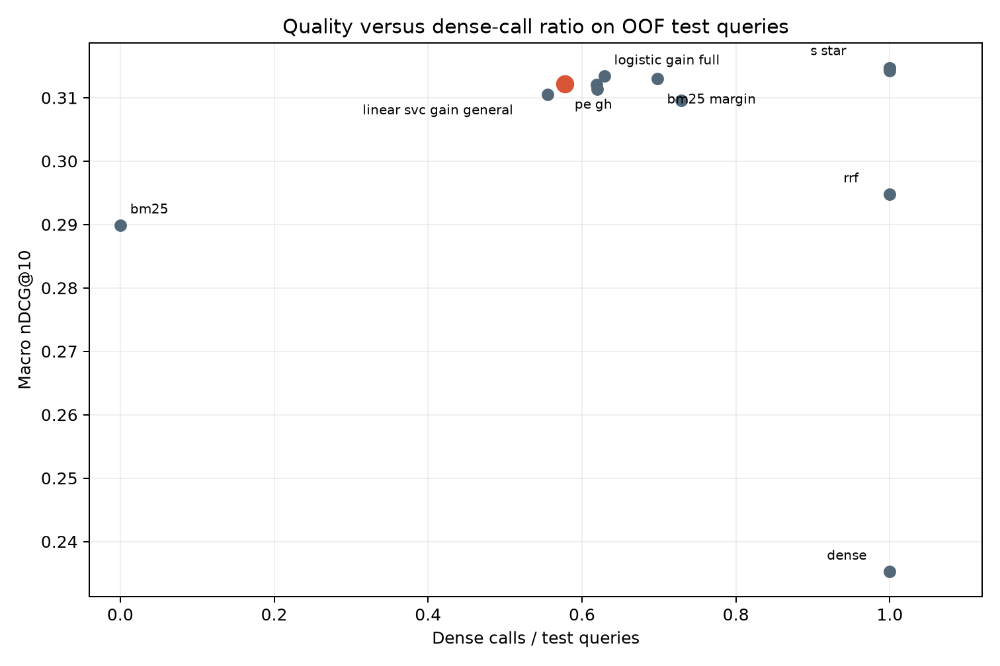

# PE-GH — kết quả tích hợp sau sửa lỗi, 26/10/2026

Đã hoàn thành lượt tái lập end-to-end từ commit `1b4c83e39ad0e89799bc3fa38478aceba0e52624` trên nhánh `thanh`. Mã thực thi được giữ cố định từ chuẩn bị dữ liệu đến báo cáo. Tác giả và committer GitHub là Trần Quang Thành (`tsunflowerr`).

**Kết quả gộp đạt ba mục tiêu chính của protocol:** mean latency thấp hơn H* **34.76%**, dense-call ratio **57.75%**, và non-inferiority nDCG@10 đạt cả macro lẫn từng domain. Đây là kết luận trên hai domain và cấu hình máy được ghi bên dưới; không phải tuyên bố thắng mọi phương pháp SOTA.

## 1. Thay đổi và ý nghĩa

- Sửa các lỗ hổng kiểm tra OOF: query chuẩn bị bỏ sót, query trùng bucket, group không khớp, retriever/sidecar sai. Utility không còn chấp nhận hai run khác split/fold hoặc thiếu query. Provider parity kiểm score thay vì chỉ kiểm thứ tự; SQLite manifest phải tự khớp hash.
- Làm dataset identity độc lập đường dẫn máy cho bản mới, đồng thời giữ nguyên byte manifest/split đã đóng băng nếu nội dung nguồn không đổi. Không sửa hash lịch sử để hợp thức hóa artifact.
- Thêm backend postings NumPy chính xác, chấm BM25 lại cho từng request. Nạp postings tĩnh ngoài timer; không cache ranking hay query embedding. Cả H*, S* và PE-GH dùng cùng backend tăng tốc.
- Cho static hybrid chạy tuần tự hoặc song song; chọn cách nhanh hơn trên validation riêng từng fold, rồi freeze trước test. Baseline song song chia ba thread cho dense và một nhánh sparse trong affinity bốn CPU. PE-GH dùng dense bốn thread sau khi gate quyết định.
- Tách lượt đo tổng latency khỏi sample stage timing. Bổ sung driver tái lập, checkpoint và kiểm source/config/artifact khi resume. CI bao gồm cả phần C.

Bốn file dense đã đóng băng (`encoder.py`, `config.py`, `corpus.py`, `index.py`) không thay đổi. Model, revision, embedding policy, công thức fusion, protocol chọn threshold và biên chất lượng giữ nguyên. Xem [hướng dẫn vận hành](../../INTEGRATION_V2.md).

## 2. Điều kiện đo

- Intel Core i7-9850H, Windows 11, 6 physical cores/12 logical CPU; mỗi process bị giới hạn affinity `[0,2,4,6]`, tương ứng bốn core đã kiểm topology.
- Giới hạn Windows Job Object 8.000.000.000 byte là **process commit memory**; RSS được đo riêng. Không mô tả đây là container/cgroup hoặc RSS cap.
- Python 3.12.14; Torch 2.14.1+cpu, FAISS 1.15.1, NumPy 2.5.4, sentence-transformers 5.7.0, transformers 4.57.6; môi trường từ `uv.lock`.
- Model `sentence-transformers/msmarco-MiniLM-L6-cos-v5`, revision `14ca9be4bbcf1402eac0f43a2e2ccb6e0f994ba3`; float32, L2, 384 chiều, max_length 256, exact FlatIP, top-100, lọc self-hit và tie-break chuẩn của nhóm.
- 79.558 document, 1.948 query thuộc programmers/unix. Năm outer fold; test mỗi query đúng một lần. Warmup cuối lấy từ validation, disjoint test; 50 warmup/process, batch=concurrency=1, năm lần lặp, method order xáo bằng seed 42.
- Pilot execution dùng validation, warmup từ train, hai lần lặp cho mỗi cấu hình. Chỉ cấu hình có ranking khớp quality cache mới được chọn. Không chọn execution bằng latency test.
- Lượt chính: 150 process mới, **29.220 request**. Sample stage timing riêng: 528 request; pilot riêng: 7.792 request. Không gộp pilot/sample vào số latency chính.
- Không chạy thêm test hay tác vụ tính toán nặng trong lúc đo online chính. Không bỏ query chậm, không chạy lại để chọn số đẹp.

## 3. Kiểm chứng tính đúng

- Backend NumPy so với SQLite trên **1948 query**: cùng toàn bộ top-100, cùng thứ tự và từng score, sai số tối đa **0**. [Receipt parity](full-fast-sparse-parity.json) ghi code/execution hash. Thời gian correctness loop trong receipt không được dùng làm latency benchmark.
- Kiểm tra toàn bộ vector đã lưu của cả hai full index: đúng count, mapping, dimension, finite và L2 norm. [Vector verification](vector-verification/).
- Bộ kiểm thử local: 119 test qua, gồm model CPU thật. Sau sửa guard CLI cuối, 35 test liên quan qua; CI của đúng commit benchmark qua trên Ubuntu/Python 3.11 và Windows/Python 3.12 (118 test không tải model). [JUnit local](full-tests.xml), [GitHub CI](https://github.com/tsunflowerr/Pre-Encoding_Gated_Hybrid_Retrieval/actions/runs/40258600763).
- Toàn bộ **29.220/29.220 ranking online khớp OOF**, số lần gọi sparse đúng một/request, encoder counts khớp quyết định gate đã freeze. Mọi method dùng cùng sparse execution identity, hardware/resource profile và package set.

## 4. Kết quả online chính

Mean và p95 được tính từ raw request; không lấy trung bình p95 của các fold. Latency gộp cân theo số query; quality macro ở mục sau cân bằng hai domain. RSS là high-water của process, gồm cả load và warmup.

| Phạm vi | Method | Mean ms | p95 ms | CPU mean ms | Peak RSS MiB | Dense calls |
|---|---|---:|---:|---:|---:|---:|
| programmers | h_star | 23.510 | 29.725 | 91.613 | 559.61 | 100.00% |
| programmers | s_star | 23.178 | 27.814 | 90.118 | 560.04 | 100.00% |
| programmers | pe_gh | 19.244 | 29.651 | 74.026 | 559.38 | 74.66% |
| unix | h_star | 26.850 | 31.814 | 103.962 | 639.29 | 100.00% |
| unix | s_star | 26.696 | 31.663 | 103.221 | 639.50 | 100.00% |
| unix | pe_gh | 14.324 | 31.411 | 54.909 | 637.97 | 43.94% |
| all | h_star | 25.348 | 31.357 | 98.409 | 639.29 | 100.00% |
| all | s_star | 25.114 | 30.657 | 97.329 | 639.50 | 100.00% |
| all | pe_gh | 16.536 | 30.972 | 63.506 | 637.97 | 57.75% |

| Phạm vi | Giảm mean so H* | 95% CI hai phía | Giảm mean so S* |
|---|---:|---|---:|
| programmers | 18.15% | [15.64%, 20.72%] | 16.98% |
| unix | 46.65% | [43.92%, 49.35%] | 46.34% |
| all | 34.76% | [32.92%, 36.65%] | 34.16% |

Bootstrap 10.000 mẫu theo query, phân tầng domain, giữ cặp ba method và toàn bộ năm lần lặp của query. CI điều kiện trên các model/profile đã chọn; không biểu diễn độ biến thiên của việc huấn luyện lại toàn bộ mô hình.

PE-GH giảm **35.47% process CPU mean** so H*. Có 1.125/1.948 query dùng dense; 823 query skip, tương ứng giảm 42,25% số lần encode. Đây là tỷ lệ tổng; programmers dùng dense 74,66%, unix 43,94%.

**Các giới hạn không được bỏ qua:** programmers giảm mean 18,15%, chưa đạt 20% nếu áp mục tiêu riêng cho domain này. p95 gộp PE-GH 30,972 ms thấp hơn H* 31,357 ms, nhưng cao hơn S* 30,657 ms khoảng 1,03%; riêng programmers p95 cao hơn S* khoảng 6,60%. Vì vậy không kết luận cải thiện đồng thời mọi chỉ số hoặc mọi domain.

## 5. Chất lượng và các đối chứng

| Phương pháp | Macro nDCG@10 | Dense-call ratio |
|---|---:|---:|
| bm25 | 0.289906 | 0.00% |
| bm25_margin | 0.312992 | 69.76% |
| cc_half | 0.314259 | 100.00% |
| dense | 0.235301 | 100.00% |
| h_star | 0.314625 | 100.00% |
| identifier_margin | 0.314625 | 100.00% |
| linear_svc_gain_general | 0.310488 | 55.54% |
| logistic_gain_full | 0.313423 | 62.89% |
| logistic_sparse_success_full | 0.312088 | 61.86% |
| pe_gh | 0.312163 | 57.75% |
| random_seed_0 | 0.309557 | 72.90% |
| ridge_gain_general | 0.311308 | 61.96% |
| rrf | 0.294806 | 100.00% |
| s_star | 0.314625 | 100.00% |

PE-GH so S*: chênh macro **-0.002462**, cận dưới một phía 95% **-0.006009 > -0.01**. Cận dưới programmers **-0.005502**, unix **-0.009601**. Cả hai đạt criterion đã đăng ký, unix sát biên; không diễn giải non-inferiority thành chất lượng bằng hệt hoặc cao hơn S*.

Random diagnostic 30 seed với đúng ngân sách test theo từng fold/domain đạt mean macro **0.305685**, PE-GH **0.312163**; oracle diagnostic **0.336730**. Random theo exact batch budget và oracle là phân tích sau freeze, không phải router online triển khai được. `random_seed_0` trong bảng là đối chứng khác, threshold chọn trên validation; không nhầm hai loại random.

PE-GH có điểm chất lượng/compute tốt hơn ridge general và logistic sparse-success trong lượt OOF này. Logistic full và BM25-margin có nDCG cao hơn nhưng dùng dense nhiều hơn. Linear SVC general dùng dense ít hơn và nDCG thấp hơn; cả hai là đánh đổi hợp lệ. Các chênh lệch nhỏ giữa nhiều gate chưa được chứng minh có ý nghĩa thống kê hoặc đủ để khẳng định tính mới của feature kỹ thuật.

**Chỉ H*, S* và PE-GH có phép đo online đầy đủ trong đợt này.** Mười bốn phương pháp đều có OOF quality và dense ratio; không suy latency của các phương pháp chưa đo từ số lần dense. Benchmark hai domain này chưa đủ để tuyên bố thắng các đối thủ SOTA trên mọi bộ dữ liệu.



## 6. Lựa chọn thực thi baseline trước test

| Fold/domain | Sequential validation ms | Parallel validation ms | Chọn |
|---|---:|---:|---|
| programmers_fold_0 | 25.357 | 37.795 | sequential |
| programmers_fold_1 | 27.094 | 22.508 | parallel |
| programmers_fold_2 | 23.522 | 26.012 | sequential |
| programmers_fold_3 | 23.363 | 22.540 | parallel |
| programmers_fold_4 | 24.157 | 23.898 | parallel |
| unix_fold_0 | 27.000 | 28.323 | sequential |
| unix_fold_1 | 26.154 | 28.611 | sequential |
| unix_fold_2 | 26.970 | 26.324 | parallel |
| unix_fold_3 | 26.456 | 26.605 | sequential |
| unix_fold_4 | 26.555 | 28.036 | sequential |

Có bốn fold chọn song song, sáu fold chọn tuần tự. Hai baseline H*/S* cùng dùng profile được chọn của fold; cả mười fold có S*=H* về ranking, nên khác biệt latency H*/S* phản ánh biến thiên giữa process/lần đo. Không lấy lượt cũ trên i3 làm mốc để tính speedup với máy i7.

## 7. Artifact, định danh và tái lập

- Source snapshot: `a5533e43082e34b1efe913bb1ee9d97eb1865fd69dac596bbc34ebc82f70cea4`.
- Freeze: `6e81b7577336277d5282ae6dabc94746865eacc5ff84a41bd68ff2a60a44324b`; [manifest](freeze.json).
- Release report object hash: `c6af7805ab32d71427008449f793f056833cf12922850be5b0d277781af78fd4`; [release.json](release.json).
- [C facts](facts.json), [primary quality](quality-primary.json), [paired quality comparison](quality-comparison.json), [14-method quality CSV](quality-controls.csv), [random30/oracle](random30-oracle.json).
- [Execution selection](execution-selection.json), [10 online manifests](online-manifests/), [10 online summaries](online-summaries/); mỗi manifest giữ SHA receipt của 15 worker và source snapshot.
- Raw request/worker/memory log và model nằm ngoài Git tại `C:/Users/quang/.cache/pegh/integration-20261026/`. Raw online: `results/benchmark/c6_full`; source input: `data/raw`; sparse compiled: `artifacts/sparse`. Không ghi đè kết quả B/C lịch sử.
- B dense artifact dùng `C:/Users/quang/.cache/pegh/artifacts/final-v1`; model cache `C:/Users/quang/.cache/pegh/models`. Các file vector được verify lại trước lượt này, không sửa manifest để bỏ kiểm revision/implementation/package.

Chạy từ checkout của commit benchmark với môi trường khóa; các stage `prepare`, `train`, `quality`, `online`, `report` có thể chạy lần lượt. Chọn thư mục results mới khi thay code/config; không tái sử dụng freeze cũ sau sửa nguồn. Các absolute path trong manifest là provenance của lượt này; tái lập trên máy khác tạo freeze mới từ cùng nguồn và quy tắc. Chi tiết tham số và resume tại [INTEGRATION_V2](../../INTEGRATION_V2.md).

```powershell
python scripts_shared/reproduce.py --stage all `
  --dense-root C:/path/to/verified-dense-indices `
  --cache-folder C:/path/to/model-cache `
  --runtime configs/runtime/cpu4.yaml
```

## 8. Kết luận nghiệm thu và phạm vi tiếp theo

Đã sửa các lỗi kiểm chứng, thống nhất execution cho A/B/C, tái lập chất lượng và chứng minh mức giảm mean latency vượt mục tiêu 20% trên tập query gộp với baseline cũng được tăng tốc. Bằng chứng này đủ cho milestone tích hợp của nhóm trên hai domain đã đăng ký.

Nghiên cứu rộng hơn vẫn cần đo online các gate đối thủ, kiểm external dataset/domain, độc lập tái lập trên máy khác và phân tích tính mới của feature ở cùng ngân sách. Nếu đổi encoder/feature/threshold hoặc tối ưu dựa trên phát hiện từ test này, phải coi đây là vòng phát triển tiếp theo và đánh giá xác nhận trên dữ liệu mới hoặc protocol tách biệt; không sửa kết quả hiện tại để tuyên bố đạt thêm mục tiêu.
