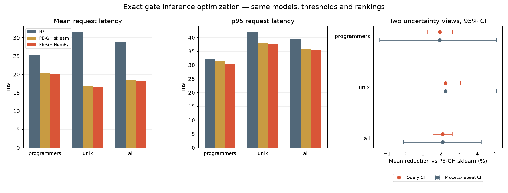

# Kết quả sửa chi phí gate inference — 26/10/2026

Đã hoàn thành benchmark đối chiếu từ commit `b02191a683c88fa5cc9cf0df1902f675182dd41b` trên nhánh `thanh`. Author/committer là Trần Quang Thành (`tsunflowerr`). Bản NumPy giữ nguyên model, scaler, feature schema và threshold v1; không triển khai threshold theo domain đã thử thất bại.

**Kết quả quan sát:** mean PE-GH sklearn **18.492 ms** → NumPy **18.106 ms**, giảm **2.09%**; p95 **35.908 → 35.394 ms**. Chất lượng và quyết định dense không đổi. Tuy nhiên CI theo process repetition là **[-0.09%, 4.23%]**, chứa 0; chưa khẳng định mức giảm latency request ổn định qua lượt chạy mới.

## 1. Nguyên nhân đã kiểm tra và cách sửa

Chi phí có thể loại bỏ nằm ở việc gọi `StandardScaler.transform` và API estimator cho từng query có 21 feature. Các API kiểm estimator/input nhiều lần trong khi phép tính thực chất chỉ là chuẩn hóa và nhân tuyến tính. `ModelPredictor` mới kiểm scaler/coefficient lúc load, vẫn kiểm schema/dimension/finiteness mỗi query, rồi thực hiện cùng thứ tự phép tính NumPy. Logistic vẫn dùng `scipy.special.expit`. Không gộp coefficient vào scaler vì có thể làm đổi rounding ở sát threshold.

Bản sklearn được giữ nguyên làm reference (`score_execution="sklearn"`); bản tối ưu là `score_execution="numpy"`. Factory/provenance ghi rõ execution và code hash. Không sửa bốn file dense đã đóng băng, encoder/index, model weights, ngưỡng hoặc cách tính BM25/fusion.

Nguyên nhân chất lượng chưa tăng là vấn đề khác: score dự đoán lợi ích có tương quan validation yếu, nhiều nhãn gain=0 và feature mã lỗi/đường dẫn xuất hiện rất ít. Model riêng từng domain nhưng threshold chung làm tỷ lệ route lệch nhau; thử tách threshold cho thấy validation tốt hơn không bảo đảm tổng quát hóa. Đây không phải lỗi mapping/FAISS hay rounding đã được sửa bằng một dòng threshold.

## 2. Bằng chứng giữ nguyên kết quả

- **48,700 score của 50 model khớp bit-exact**, sai số tối đa 0.0. Bao gồm Ridge, Logistic và SVM; test kiểm cả tie và giá trị ngay hai phía threshold.
- 124 test không tải model đã qua; 15 test C/statistics liên quan qua sau khi thêm guard policy. [CI commit benchmark](https://github.com/tsunflowerr/Pre-Encoding_Gated_Hybrid_Retrieval/actions/runs/40269082591) thành công trên Ubuntu và Windows. Model encoder không đổi so nghiệm thu trước.
- Stage quality bắt buộc từng tuple hit của PE-GH tối ưu trùng v1 trước khi xuất run. OOF của v1/v2 giống nhau: macro nDCG@10 **0.31216300915894646**, chênh lệch từng query bằng 0; dense **1.125/1.948 = 57,75%**.
- Đủ **150 worker / 29.220 request**; ranking online khớp OOF, sparse gọi một lần/request, encoder counts khớp policy. Cả ba method dùng cùng sparse execution và runtime/resource/package condition. Audit thêm 150 receipt kiểm execution sklearn/NumPy đúng nhánh và không có query-vector/ranking cache online.

## 3. Điều kiện đo và resume

- Intel Core i7-9850H, Windows 11, CPU affinity `[0,2,4,6]`, batch=concurrency=1, 50 warmup/process, năm lần lặp; mỗi method/repeat có process mới. H* giữ profile tuần tự/song song đã chọn bằng validation ở lượt v1.
- Windows Job Object giới hạn 8.000.000.000 byte **process commit memory**; RSS đo riêng bằng psutil/OS. Không gọi đây là RSS/cgroup cap.
- Model MiniLM CPU float32, revision `14ca9be4bbcf1402eac0f43a2e2ccb6e0f994ba3`, 384d L2, max_length=256, exact FAISS FlatIP top-100. Môi trường đúng `uv.lock` và artifact đã verify.
- Giữ hai fold programmers hoàn chỉnh trước pause quota. Fold thứ ba dở được chuyển thành `.interrupted.<timestamp>` rồi đo lại toàn fold; folder dở không tham gia thống kê. Tám fold còn lại hoàn thành sau reset. Các mốc UTC và SHA từng receipt nằm trong [resource audit](resource-audit.json).
- Không chạy tác vụ tính toán nặng khác trong lúc online chính. Không lặp benchmark để chọn lượt có số đẹp. CPU frequency/nhiệt độ/tải nền không được khóa hoàn toàn; cùng affinity/package không loại bỏ biến thiên giữa process.
- Nguồn thực thi giữ nguyên trong checkout bất biến. Scripts dựng audit/hình ở thư mục tài liệu được thêm sau benchmark; không sửa code runtime hoặc raw request.

## 4. Số đo request thật trong cùng lượt

| Domain | Method | Mean ms | p95 ms | CPU mean ms | Peak RSS MiB | Dense ratio |
|---|---|---:|---:|---:|---:|---:|
| programmers | h_star | 25.292 | 32.104 | 97.132 | 580.45 | 100.00% |
| programmers | pe_v1 | 20.525 | 31.460 | 78.646 | 559.64 | 74.66% |
| programmers | pe_v2 | 20.128 | 30.451 | 77.126 | 559.67 | 74.66% |
| unix | h_star | 31.506 | 41.930 | 120.741 | 639.75 | 100.00% |
| unix | pe_v1 | 16.831 | 37.964 | 63.806 | 638.31 | 43.94% |
| unix | pe_v2 | 16.453 | 37.553 | 62.474 | 637.50 | 43.94% |
| all | h_star | 28.712 | 39.344 | 110.124 | 639.75 | 100.00% |
| all | pe_v1 | 18.492 | 35.908 | 70.479 | 638.31 | 57.75% |
| all | pe_v2 | 18.106 | 35.394 | 69.063 | 637.50 | 57.75% |

`pe_v1` là PE-GH dùng sklearn, `pe_v2` là cùng PE-GH dùng NumPy. Mean gộp cân theo số query; p95 tính từ toàn bộ raw request, không trung bình p95 các fold. CPU là process time/request; RSS gồm load/warmup.

So H* trong **cùng lượt**, PE-GH NumPy giảm mean **36.94%**. So bản PE-GH sklearn, phần tiết kiệm thêm là **0.386 ms/request**, CPU giảm **2.01%**, p95 quan sát giảm **1.43%**.

Không ghép 16,54 ms của lượt tích hợp trước với 18,11 ms ở lượt này để suy tốc độ tăng/giảm. Cả H* và PE-GH được đo lại trong cùng lượt này. S* không được đo riêng ở lượt refinement; dù ranking S*=H*, không khẳng định số p95 S* của lượt cũ đã được cải thiện.

## 5. Hai cách nhìn bất định, tránh phóng đại

**Query bootstrap:** 10.000 mẫu, phân tầng domain, giữ cặp method và năm repeats/query. CI 95% của mức giảm mean so PE-GH sklearn là **[1.54%, 2.61%]**. Nó điều kiện trên các timing repeat đã quan sát và không bao trùm hết biến thiên process/thermal.

**Paired process-repetition bootstrap:** mỗi fold lấy lại năm repetition có hoàn lại, giữ ba method ghép cặp và cân theo số query. CI 95% là **[-0.09%, 4.23%]**. Đây là phân tích độ nhạy bổ sung sau benchmark, không phải tiêu chí chọn model. Khoảng có chứa 0: bằng chứng về giảm chi phí tính score rõ, nhưng mức cải thiện request 2,09% còn nhỏ so với nhiễu runtime.

Có 5/10 fold có mean NumPy cao hơn sklearn, 5/10 thấp hơn; không chọn riêng các fold thắng để báo cáo. Không có CI cho p95 trong đợt này, nên mức giảm p95 là mô tả số đo, không phải bảo đảm tail latency. Hai bootstrap trả lời hai nguồn biến thiên khác nhau; chưa mô hình hóa đồng thời mọi nguồn nhiễu.



## 6. Microbenchmark không thay thế phép đo request

Median năm lượt đo score-only: sklearn **272.22 µs**, NumPy **9.44 µs**. Đây là phép đo riêng, không có toàn bộ sparse/encoder/FAISS và không phải benchmark resource profile request. Không gọi mức tăng tốc này là speedup toàn hệ thống.

## 7. Vì sao không triển khai threshold riêng

Candidate theo domain chỉ chọn trên validation, có guard không giảm quality validation từng domain. Khi chấm lại tập cũ, nDCG macro còn **0,308927**, programmers có cận dưới 95% so H* **−0,013157**, vượt mức mất chất lượng cho phép. Candidate được lưu đầy đủ nhưng không đưa vào default. [Kết quả bất lợi](../threshold-experiment-2026-10-26/decision.json), [chi tiết giả thuyết và protocol](../../GATE_REFINEMENT_V2.md).

Test v1 đã được xem; phần thử policy mới chỉ là reassessment thăm dò, không phải xác nhận độc lập. Phần score-only giữ nguyên từng ranking nên không tuyên bố cải thiện quality hay novelty. Vấn đề chọn sai query của gate chưa có bản sửa chất lượng được xác nhận. Muốn nghiên cứu tiếp cần dữ liệu/holdout mới và quy trình chọn model hiệu chỉnh đủ chống overfit; không tiếp tục đổi ngưỡng trên tập này để làm điểm đẹp hơn.

## 8. Artifact và cách dựng lại

- Source commit: `b02191a683c88fa5cc9cf0df1902f675182dd41b`; source snapshot `bec368c6813a7bd6a735818e7ead85c6706e9bce83b84429a59ec916b677fa13`.
- Freeze `0bdc6d7b42b64fa58c4826d4820dac2aa8c07a11ad4a96a6e2e68f977cad61a2`; [freeze.json](freeze.json).
- Report object hash `f964a0528fe01cdb2f536a488fee77ef0156f6502adbfb560972d51b597e48db`; [report.json](report.json).
- [Parity](parity.json), [quality](quality.json), [quality vs H*](comparison-vs-h-star.json), [quality vs v1](comparison-vs-v1.json), [resource audit](resource-audit.json).
- [10 manifest](online-manifests/) giữ SHA receipt từng worker và source; [10 summary](online-summaries/). Raw request/receipt/memory log và folder dở giữ ngoài Git tại `C:/Users/quang/.cache/pegh/gate-inference-20261026/`.
- [analyze_receipts.py](analyze_receipts.py) dựng audit CPU/RSS, hai bootstrap và hình từ raw đã giữ. File hash của analysis script nằm trong resource audit; evidence manifest ghi SHA của toàn bộ snapshot nhỏ.

Chạy lại pipeline score-only bằng `python -m scripts_c.refine_gate` theo [hướng dẫn](../../GATE_REFINEMENT_V2.md), dùng source commit bất biến và output directory mới. Để dựng lại audit/hình sau khi đã có raw, từ repo root dùng:

```powershell
python -m docs.refinement.inference-2026-10-26.analyze_receipts `
  --raw-root C:/Users/quang/.cache/pegh/gate-inference-20261026
```

Giữ nguyên các receipt B/C và kết quả tích hợp trước; bản này chỉ bổ sung kết quả của lần sửa inference và phân tích tại sao thử threshold không được nhận.
