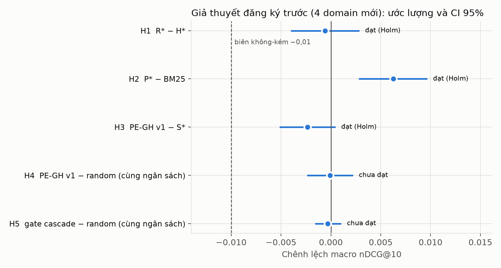
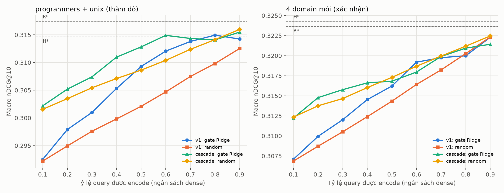
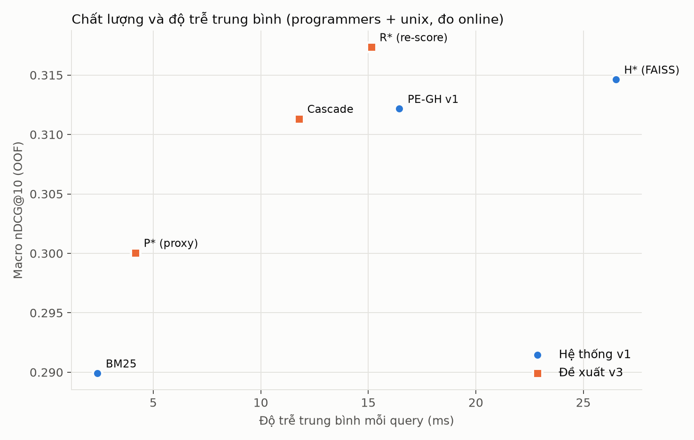
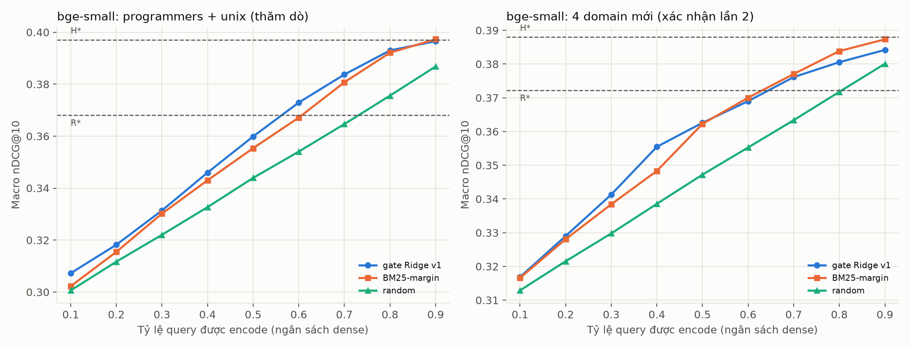

# PE-GH v3 — vòng phát triển thứ hai, 28/10/2026

**Tóm tắt.** Vòng v3 thử cải thiện PE-GH theo ba hướng: tín hiệu gate mới, thiết kế lại hai nhánh rẻ/đắt, và encoder mạnh hơn. Mọi kết luận được kiểm chứng trên bốn subforum CQADupStack chưa dùng, bằng hai giao thức đăng ký trước (MiniLM, rồi bge-small).

- **Gate học không đứng được như một đóng góp.**
  - Với MiniLM, gate không có tín hiệu trên domain mới (AUC 0,503, không hơn random).
  - Với bge-small, gate hơn random (+0,0028, p = 0,002) nhưng không hơn quy tắc BM25-margin không học (−0,0014 [−0,0034; 0,0004]), và chỉ bỏ được 4,6% lượt encode.
  - Đặc trưng QPP và proxy không giúp gate.
- **P\* là kết quả dương bền nhất.** P\* là proxy tĩnh xếp hạng lại BM25 top-100, không gọi encoder. Trên domain mới, nó tăng BM25 +0,0063 (MiniLM) và +0,0146 (bge-small), cả hai đều đã đăng ký trước. Chi phí thêm khoảng 1,8 ms mỗi query.
- **Đánh đổi chất lượng/chi phí phụ thuộc vào việc encoder mạnh hay yếu hơn BM25.**
  - Encoder yếu hơn BM25 (MiniLM): chấm lại ứng viên BM25 bằng vector query (R\*, tức Fast-Forward) giữ chất lượng của H\*, nhanh hơn 42,9% và trội hơn PE-GH v1.
  - Encoder mạnh hơn (bge-small): R\* kém H\* 0,016–0,029. Cách giảm chi phí đúng là tìm kiếm xấp xỉ HNSW, giữ nguyên chất lượng H\* mà tìm nhanh hơn 2–10 lần tùy ef.
- **Phạm vi:** một máy Windows 4 lõi, hai encoder 384 chiều, sáu subforum CQADupStack. Tái lập trên Linux và trên các tập BEIR khác là việc tiếp theo (§9).

## 1. Vì sao có vòng v3

Đánh giá lại kết quả v1 cho thấy: so ở **cùng số lần gọi dense**, gate Ridge của PE-GH không tốt hơn có ý nghĩa thống kê so với quy tắc BM25-margin (không học) hay gate kiểu LiteGator; nhãn utility gain không hơn nhãn sparse-success; đặc trưng kỹ thuật không hơn tám đặc trưng chung. Gate có tín hiệu (thắng random), nhưng yếu: Spearman giữa điểm gate và gain thật ≈ 0,09, AUC ≈ 0,56. Theo §15 và §25.5 của kế hoạch, đóng góp v1 cần thu hẹp về nghiên cứu hiệu năng/tái lập. Vòng v3 thử ba hướng cải thiện và kiểm chứng trên dữ liệu chưa từng dùng:

1. **Tín hiệu mới cho gate**: đặc trưng dự báo hiệu năng truy vấn (QPP) trên danh sách BM25 và một *semantic proxy* tĩnh.
2. **Thiết kế lại các nhánh** (cascade): nhánh rẻ dùng proxy để xếp hạng lại BM25 top-100, nhánh đắt encode query rồi chấm lại đúng các ứng viên BM25 — không tìm FAISS.
3. **Xác nhận độc lập** trên bốn subforum CQADupStack chưa dùng (android, gis, mathematica, webmasters), với giả thuyết đăng ký trước; và thử encoder mạnh hơn (bge-small-en-v1.5).

Không sửa artifact, receipt hay mã đã đóng băng của v1. Mọi thứ mới nằm trong `src/pegh/v3/`, `scripts_shared/experiment_v3.py`, `configs/v3/`, `tests/v3/`; dữ liệu lớn ở `~/.cache/pegh/v3` (ngoài Git).

## 2. Thành phần mới

**Semantic proxy tĩnh.** Mỗi token WordPiece trong từ điển của encoder đã pin được đưa riêng qua chính encoder đó (`[CLS] t [SEP]`), lấy sentence embedding (cách làm kiểu model2vec). Vector proxy của query là trung bình có trọng số SIF `a/(a+p(t))` (p ước lượng từ corpus của domain, a = 1e-3) của các vector token, rồi chuẩn hóa L2. Không chạy transformer cho query, không dùng nhãn relevance. Proxy được so với vector tài liệu đã lưu sẵn trong index của đúng các ứng viên BM25.

**Đặc trưng v3** (thêm vào 21 đặc trưng v1): bảy đặc trưng QPP (NQC, WIG, SMV trên top-100 BM25, tỷ lệ điểm, IDF max/tổng) và chín đặc trưng proxy (cosine với hit BM25 hạng 1, max/mean top-10, khoảng cách giữa ứng viên tốt nhất dưới top-10 và trong top-10, hạng của ứng viên proxy tốt nhất, độ trùng top-10 với thứ tự proxy và với RRF(BM25, proxy), Spearman, độ phân tán).

**Hai tầng của cascade**, đều chỉ trên BM25 top-100, fusion CC cùng công thức v1:

- **P\*** = BM25 ⊕ proxy, alpha ∈ {0,1…0,9} hoặc BM25 thuần — chọn trên validation theo từng fold/domain. Không gọi encoder.
- **R\*** = BM25 ⊕ cosine với vector query thật, alpha ∈ {0,1…0,9} — chọn trên validation. Encode đúng một lần, **không tìm FAISS**.
- **Cascade** = gate quyết định P\* (skip) hay R\* (encode). Cùng quy tắc chọn ngưỡng v1; mốc so sánh là S\*_all = phương án tĩnh tốt nhất trên validation trong {BM25, P\*, dense, H\*, R\*}.

## 3. Quy trình và chống rò rỉ

- Pipeline v3 tái hiện quy tắc v1 cho mọi tập domain: năm fold theo nhóm, H\*/S\* chọn trên validation với cùng lưới và luật hòa, scaler/model fit chỉ trên train, một ngưỡng mỗi fold chọn trên validation gộp, 0,005 macro / 0,01 mỗi domain so S\*, điểm bằng ngưỡng thì skip, query OOV buộc dense. **Kiểm tra tái lập:** chạy lại trên programmers/unix cho đúng từng con số đã công bố của v1 (PE-GH 0,312163 / 1.125 lần dense; logistic 0,313423; margin 0,312992; LiteGator 0,310488; random 0,309557). Đặc trưng v1 tính lại khớp bản đã freeze với sai số 0,0.
- **Phát triển** chỉ dùng validation của programmers/unix (`develop_minilm.json`, `test_labels_used: false`). Số test của programmers/unix ở v3 là *đánh giá lại thăm dò* vì tập này đã được xem ở v1.
- **Xác nhận**: giao thức `configs/v3/preregistration_fresh.yaml` (SHA-256 `6691da18d913d09ef8f61971a0e50369a38d8420d50a138be753039959ca78db`) được ghi nhận lúc 15:45 UTC 28/10/2026, *trước* khi tính bất kỳ đặc trưng, tầng hay nhãn nào của bốn domain mới. Năm giả thuyết H1–H5, hiệu chỉnh Holm, bootstrap 10.000 mẫu theo nhóm trong từng domain.
- Ranking online của mọi phương thức mới được đối chiếu với ranking tính offline (cùng đường mã) theo hash từng request; quyết định định tuyến của cascade được đối chiếu với quyết định offline.

## 4. Xác nhận trên bốn domain mới (đăng ký trước)

android 699, gis 885, mathematica 804, webmasters 506 query (2.894 query; 95.693 tài liệu). Cùng encoder MiniLM, cùng revision dữ liệu. Macro = trung bình đều bốn domain. CI là bootstrap 10.000 mẫu theo nhóm trong từng domain.

| Giả thuyết đăng ký | Ước lượng | CI 95% hai phía | Ngưỡng Holm | Kết luận |
|---|---:|---|---:|---|
| H1: R\* không kém H\* (biên 0,01) | −0,00059 | [−0,00393; 0,00277] | 0,0100 | **đạt** |
| H2: P\* tốt hơn BM25 | +0,00626 | [0,00287; 0,00958] | 0,0125 | **đạt** |
| H3: PE-GH v1 không kém S\* (tái lập v1) | −0,00233 | [−0,00506; 0,00037] | 0,0167 | **đạt** |
| H4: gate v1 hơn random ở cùng số lần dense | −0,00007 | [−0,00230; 0,00214] | 0,0250 | **không đạt** (p = 0,53) |
| H5: gate cascade hơn random ở cùng số lần dense | −0,00030 | [−0,00152; 0,00095] | 0,0500 | **không đạt** (p = 0,68) |



| Phương án tĩnh (OOF test) | android | gis | mathematica | webmasters | Macro |
|---|---:|---:|---:|---:|---:|
| BM25 | 0,3883 | 0,2985 | 0,2104 | 0,3219 | 0,3048 |
| Dense MiniLM | 0,2964 | 0,2338 | 0,1482 | 0,2319 | 0,2275 |
| **P\*** BM25 ⊕ proxy, không encode | 0,4005 | 0,2992 | 0,2205 | 0,3240 | **0,3110** |
| H\* hybrid FAISS (v1) | 0,4064 | 0,3187 | 0,2328 | 0,3389 | 0,3242 |
| **R\*** encode + chấm lại BM25 top-100, không FAISS | 0,4083 | 0,3237 | 0,2297 | 0,3327 | **0,3236** |

Đọc kết quả:

- **R\* thay được H\*.** Bỏ hẳn bước tìm FAISS trên toàn corpus, chỉ chấm lại 100 ứng viên BM25 bằng vector query, chất lượng không kém H\* trong biên 0,01 (cận dưới −0,0034). Với encoder yếu hơn BM25 như MiniLM-msmarco, ứng viên mới mà FAISS mang về hầu như không giúp.
- **P\* cải thiện BM25 gần như miễn phí:** +0,0063 macro, cả bốn domain đều tăng, không gọi encoder.
- **PE-GH v1 tái lập phần chất lượng** (H3), nhưng ngưỡng chọn trên validation dẫn tới 81,0% query gọi dense (so 57,75% ở programmers/unix), nên tiết kiệm ít hơn nhiều.
- **Gate học không mang tín hiệu trên domain mới.** AUC dự đoán gain > 0 của Ridge v1 là 0,503, Spearman 0,007. Mọi gate học nằm sát đường random trên toàn dải ngân sách. BM25-margin (AUC 0,549) và nhãn sparse-success (0,543) chỉ nhỉnh hơn một chút. Ở chế độ cascade, 3/5 fold không có điểm gate khả thi nên rơi về luôn R\*. Đây là kết quả âm đã đăng ký trước và được báo cáo nguyên trạng.



## 5. Phát triển trên programmers/unix (thăm dò, tập test đã xem ở v1)

| Phương án | Macro nDCG@10 | Tỷ lệ encode |
|---|---:|---:|
| BM25 | 0,2899 | 0% |
| P\* (proxy) | 0,3001 | 0% |
| PE-GH v1 (tái tạo đúng bản công bố) | 0,3122 | 57,75% |
| Cascade, gate Ridge v1 | 0,3113 | 59,3% |
| H\* (FAISS) | 0,3146 | 100% |
| R\* (chấm lại, không FAISS) | 0,3174 | 100% |

- Chỉ dùng validation để chọn: đặc trưng proxy **không** cải thiện gate (diện tích validation 0,3069 so 0,3086 của v1), QPP chỉ +0,0002; gate cascade được chọn vẫn là Ridge trên 21 đặc trưng v1. Proxy có giá trị khi dùng làm **tầng xếp hạng**, không phải làm đặc trưng định tuyến.
- Cùng bộ kiểm định H1–H5 chạy trên dev (chỉ để đối chiếu, không phải xác nhận): H1 +0,0027, H2 +0,0101, H3 −0,0025 đạt; **H4 đạt trên dev** (gate v1 hơn random cùng ngân sách +0,0065, CI [0,0033; 0,0098]) nhưng **không đạt trên domain mới** (−0,0001); H5 không đạt ở cả hai. Tín hiệu định tuyến mà v1 thấy trên programmers/unix không lặp lại trên domain khác, kể cả khi gate được huấn luyện lại trên fold train của chính domain đó.
- Độ trung thực của proxy (không dùng nhãn): tương quan Pearson giữa cosine proxy và cosine dense thật trên 100 ứng viên BM25 là 0,70 (programmers), 0,67 (unix), 0,67 (android), 0,64 (webmasters); trùng top-10 ≈ 45%.

## 6. Hiệu năng online (programmers + unix)

Cùng harness và cấu hình với lần đo tích hợp v1 (`windows-physical4-local.yaml`: 4 lõi vật lý được pin, torch 4 luồng, 50 query khởi động, 5 lần lặp). 10 lượt (2 domain × 5 fold), mỗi phương thức 9.740 request đo. **Đối chiếu:** 58.440/58.440 request có ranking (và quyết định định tuyến của cascade) khớp với kết quả offline, 0 lệch. Chất lượng là OOF test của programmers/unix (thăm dò, xem §5).

| Phương thức | nDCG@10 | Tỷ lệ encode | Trung bình (ms) | p50 | p95 | CPU (ms/query) | Giảm trung bình so H\* (CI 95%) | RSS đỉnh (MiB) |
|---|---:|---:|---:|---:|---:|---:|---:|---:|
| BM25 | 0,2899 | 0% | 2,41 | 2,21 | 4,39 | 2,4 | −90,9% | 285 |
| **P\*** (proxy) | 0,3001 | 0% | **4,17** | 3,88 | 6,99 | 4,2 | −84,3% [−84,5; −84,1] | 624 |
| H\* (FAISS, v1) | 0,3146 | 100% | 26,51 | 24,79 | 35,33 | 99,7 | — | 639 |
| PE-GH v1 | 0,3122 | 57,75% | 16,45 | 22,63 | 30,75 | 62,1 | −38,0% [−40,0; −36,0] | 637 |
| **R\*** (chấm lại, không FAISS) | **0,3174** | 100% | **15,14** | 13,99 | 22,01 | 58,5 | **−42,9%** [−43,5; −42,3] | 652 |
| Cascade (P\*/R\*, gate Ridge v1) | 0,3113 | 59,3% | **11,78** | 13,18 | 20,69 | 44,6 | **−55,6%** [−56,7; −54,4] | 697 |

CI của mức giảm: bootstrap 10.000 mẫu theo query trên tổng độ trễ 5 lần lặp. Phân rã theo stage (fold 0, 1 lần lặp, bật đo chi tiết; ms trung bình):

| Nhánh | BM25 | Đặc trưng + gate | Encode | Tìm FAISS | Fusion / chấm lại | Tổng |
|---|---:|---:|---:|---:|---:|---:|
| H\* | 2,45 | — | 10,97 | 8,49 | 0,96 | 23,55 |
| R\* | 2,35 | — | 8,80 | 0 | 1,45 | 12,64 |
| P\* | 1,96 | — | 0 | 0 | 1,35 | 3,34 |
| Cascade → R\* | 2,48 | 0,46 | 8,90 | 0 | 1,46 | 13,36 |
| Cascade → P\* | 1,79 | 0,43 | 0 | 0 | 1,63 | 3,90 |



Đọc kết quả:

- **Tìm FAISS chiếm ~36% thời gian của H\*** (8,5 ms trên 23,6 ms). R\* bỏ hẳn bước này, chấm 100 ứng viên BM25 bằng vector tài liệu đã lưu, nên nhanh hơn H\* 42,9% mà chất lượng không thấp hơn (dev 0,3174 so 0,3146; domain mới không kém trong biên 0,01, H1).
- **R\* trội hơn PE-GH v1 trên cả hai trục**: chất lượng cao hơn (0,3174 so 0,3122) và nhanh hơn (15,1 so 16,5 ms; p95 22,0 so 30,8 ms) dù encode 100% query. Trên domain mới, PE-GH v1 encode 81% query mà chỉ đạt 0,3209, còn R\* đạt 0,3236. Nói cách khác, *bỏ tìm kiếm vector toàn corpus* tiết kiệm nhiều hơn *bỏ encode cho một phần query*.
- **R\* không phải phương pháp mới.** Đây là nội suy điểm sparse với điểm dense tra từ chỉ mục vector lưu sẵn trên ứng viên BM25, đúng ý tưởng *Fast-Forward indexes* (Leonhardt và cộng sự, WWW 2022). Đóng góp ở đây là phát hiện thực nghiệm: trong thiết lập này, một baseline đã biết mà v1 chưa đưa vào lại trội hơn hệ thống có gate.
- **P\*** thêm 1,8 ms so BM25 (tra bảng token + chấm 100 ứng viên) để được +0,010 nDCG (dev) / +0,006 (domain mới). Đây là điểm vận hành tốt khi không thể chạy transformer cho query.
- **Cascade** nhanh nhất trong các phương án có encode (−55,6% so H\*), nhưng H5 cho thấy gate không hơn định tuyến ngẫu nhiên ở cùng ngân sách. Vì vậy cascade nên được hiểu là *một núm chỉnh ngân sách giữa P\* và R\**, phần lợi đến từ kiến trúc hai tầng chứ không phải từ gate học.
- RSS của P\*/R\*/cascade (624–697 MiB) chủ yếu là ma trận vector tài liệu giữ trong RAM, tương đương H\* giữ chỉ mục FAISS. P\* chỉ cần tokenizer và bảng token, không nạp trọng số encoder.

### Thông lượng khi phục vụ đồng thời

Đo độ trễ ở trên phục vụ từng request một với 4 luồng. Để biết một ngân sách CPU cố định phục vụ được bao nhiêu query mỗi giây, `throughput` chạy 4 tiến trình server đơn luồng trên đúng 4 lõi đã pin. Mỗi tiến trình xử lý toàn bộ query test của fold theo thứ tự xáo trộn riêng (20 query khởi động, sau đó đồng bộ bằng barrier), trên fold 0–1 của cả hai domain.

| Phương thức | Query/giây | So H\* | CPU (ms/query) | Tỷ lệ encode trên các fold này |
|---|---:|---:|---:|---:|
| BM25 | ≈1.650 | ×15,6 | 2,4 | 0% |
| P\* | ≈850 | ×8,0 | 4,3 | 0% |
| H\* | 106 | ×1,0 | 36,3 | 100% |
| PE-GH v1 | 179 | ×1,69 | 21,9 | 63,6% |
| R\* | 197 | ×1,86 | 19,7 | 100% |
| Cascade | 234 | ×2,21 | 16,8 | 76,7% |

- Thứ tự giữ nguyên như khi đo độ trễ: R\* encode mọi query mà vẫn phục vụ nhiều hơn PE-GH v1. Cascade đạt ×2,21 dù hai fold này có tỷ lệ encode cao (76,7%, so 59,3% trung bình 5 fold).
- Phục vụ đơn luồng tốn ít CPU hơn nhiều so với một request 4 luồng (H\*: 36 so 100 ms CPU/query), vì luồng phụ của torch/FAISS chờ quay vòng. Khi tải cao, nên chạy nhiều tiến trình đơn luồng thay vì một tiến trình đa luồng.
- Mỗi lượt BM25 và P\* chỉ kéo dài 0,4–1,3 giây nên hai con số đó chỉ là ước lượng thô. Các phương thức có encode chạy 3–9 giây mỗi lượt.

## 7. Encoder mạnh hơn: bge-small-en-v1.5

Cùng pipeline, chỉ thay encoder (BAAI/bge-small-en-v1.5, revision `5c38ec7c…`, 384 chiều, 12 lớp). Encode một query mất 13,8 ms (trung vị, 4 lõi pin), MiniLM mất 7,6 ms, tức đắt gấp ~1,8 lần. FAISS FlatIP có cùng số chiều nên chi phí tìm kiếm như cũ.

**Trên programmers/unix (thăm dò):**

| Phương án | MiniLM | bge-small |
|---|---:|---:|
| BM25 | 0,2899 | 0,2899 |
| Dense đơn | 0,2353 | **0,3683** |
| P\* (proxy) | 0,3001 | 0,3009 |
| R\* (chấm lại BM25 top-100) | 0,3174 | 0,3681 |
| H\* (FAISS) | 0,3146 | **0,3971** |
| PE-GH v1 (tỷ lệ encode) | 0,3122 (57,75%) | 0,3969 (87,0%) |
| Gate v1 − random, cùng ngân sách | +0,0065 | +0,0137 |
| Gate v1 − BM25-margin, cùng ngân sách | +0,0021 [−0,0014; 0,0057] | +0,0003 [−0,0031; 0,0036] |

- **Khi encoder mạnh hơn BM25, R\* mất tác dụng:** R\* − H\* = −0,029 (CI [−0,037; −0,021]). Tài liệu liên quan mà BM25 không đưa vào top-100 chỉ FAISS mới tìm thấy. R\* lúc này chỉ ngang dense đơn.
- **P\* vẫn giúp BM25** (+0,011) dù bảng token rút từ encoder khác.
- **Gate có tín hiệu mạnh hơn** (AUC 0,588, Spearman 0,161, so 0,56 / 0,09 với MiniLM) nhưng vẫn **không hơn quy tắc BM25-margin**. Ngưỡng chọn trên validation encode 87% query, nên chỉ tiết kiệm được 13% lượt encode.
- Ở chế độ cascade (P\*/R\*), S\*_all là H\* mà R\* thì kém H\*, nên không fold nào có điểm gate khả thi. Với encoder mạnh, nhánh đắt của cascade phải là H\* chứ không phải R\*.

**Trên bốn domain mới (đăng ký trước, lần xác nhận thứ hai):** giao thức `configs/v3/preregistration_fresh_bge_small.yaml` (SHA-256 `2e2f0d17fa18b4c1f370ba76a6196825f38ae28dd5df5a1c9121ba731e8e4ed5`) được ghi nhận lúc 19:32 UTC 28/10/2026, *trước* khi tính bất kỳ vector, proxy, tầng hay ranking bge-small nào của bốn domain mới. Bốn giả thuyết B1–B4 lấy từ kết quả thăm dò ở trên, hiệu chỉnh Holm trên B1–B4, cùng fold và cùng luật chọn với lần đầu. Nhãn của bốn domain này đã được chấm một lần với MiniLM (§4), nên đây là xác nhận *cấu hình được chọn mà không nhìn các domain đó*, chưa phải trên nhãn chưa ai xem. Giao thức ghi rõ điều này.

| Giả thuyết đăng ký | Ước lượng | CI 95% hai phía | p | Ngưỡng Holm | Kết luận |
|---|---:|---|---:|---:|---|
| B1: H\* tốt hơn R\* | +0,0158 | [0,0099; 0,0219] | < 0,0001 | 0,0125 | **đạt** |
| B2: P\* tốt hơn BM25 | +0,0146 | [0,0106; 0,0187] | < 0,0001 | 0,0167 | **đạt** |
| B3: PE-GH v1 không kém S\* (biên 0,01) | −0,0009 | [−0,0029; 0,0010] | < 0,0001 | 0,0250 | **đạt** |
| B4: gate v1 hơn random ở cùng số lần dense | +0,0028 | [0,0009; 0,0047] | 0,002 | 0,0500 | **đạt** |

| Phương án (OOF test, bge-small) | android | gis | mathematica | webmasters | Macro |
|---|---:|---:|---:|---:|---:|
| BM25 | 0,3883 | 0,2985 | 0,2104 | 0,3219 | 0,3048 |
| Dense bge-small | 0,4524 | 0,3681 | 0,2770 | 0,3579 | 0,3638 |
| **P\*** BM25 ⊕ proxy, không encode | 0,4117 | 0,3069 | 0,2292 | 0,3296 | **0,3193** |
| R\* chấm lại BM25 top-100 | 0,4583 | 0,3643 | 0,2996 | 0,3668 | 0,3722 |
| H\* hybrid FAISS | 0,4784 | 0,3818 | 0,3079 | 0,3841 | 0,3880 |
| PE-GH v1 (95,4% encode) | 0,4762 | 0,3807 | 0,3065 | 0,3850 | 0,3871 |

So các cách định tuyến ở **đúng số lần dense của gate v1** trong từng fold (báo cáo phụ, không kiểm định):

| Cách định tuyến | Macro nDCG@10 | Gate v1 − cách này (CI 95%) | AUC gain > 0 |
|---|---:|---:|---:|
| Gate Ridge v1 | 0,3871 | — | 0,561 |
| BM25-margin (không học) | 0,3885 | −0,0014 [−0,0034; 0,0004] | 0,590 |
| Gate kiểu LiteGator (SVM) | 0,3875 | −0,0004 [−0,0022; 0,0014] | 0,575 |
| Random (trung bình 30 seed) | 0,3843 | +0,0028 [0,0009; 0,0047] | — |
| Oracle | 0,4198 | −0,0327 | — |



Đọc kết quả:

- **Hai phát hiện kiến trúc lặp lại trên domain mới.** Khi encoder mạnh hơn BM25 (dense đơn 0,3638 so 0,3048), R\* kém H\* ở cả bốn domain (−0,016 macro): chấm lại BM25 top-100 bỏ sót tài liệu mà chỉ FAISS tìm thấy. P\* vẫn tăng BM25 ở cả bốn domain (+0,0146, gấp đôi mức +0,0063 với MiniLM).
- **Với bge-small, gate có tín hiệu tổng quát hóa sang domain mới** (B4 đạt, khác MiniLM ở §4). Đường cong của gate nằm trên random ở mọi mức ngân sách, cách xa nhất ở mức 40% (+0,017).
- **Nhưng quy tắc BM25-margin không học làm được ngang hoặc hơn:** chênh −0,0014 [−0,0034; 0,0004], diện tích dưới đường cong 0,3572 so 0,3569, AUC 0,561 so 0,590. Tín hiệu định tuyến về cơ bản là "BM25 có tự tin không", và không cần học mới có được.
- **B3 đạt nhưng gần như không tiết kiệm:** ngưỡng chọn trên validation encode 95,4% query (dev 87%), tức chỉ bỏ 4,6% lượt encode. Oracle đạt đỉnh khi chỉ encode khoảng 30–40% query và vẫn cao hơn gate 0,033, nên còn chỗ cho một gate tốt hơn. Tuy vậy không đặc trưng nào trong v1/v3 khai thác được khoảng trống này.
- Chế độ cascade (chỉ mô tả, như đã đăng ký) luôn rơi về R\*: 0,3722, kém S\*_all −0,0145 [−0,0204; −0,0090].

## 8. Baseline tìm kiếm xấp xỉ: HNSW

H\* dành 8,5 ms cho tìm FAISS chính xác (FlatIP). Một hệ thống triển khai thực tế sẽ dùng chỉ mục ANN, nên khoản tiết kiệm của gate hay của R\* phải được so với H\* dùng ANN. Stage `ann` dựng `IndexHNSWFlat` (M = 32, efConstruction = 200, cố định trước khi đo; dựng đơn luồng để tất định) trên đúng vector tài liệu của index đã freeze. Cấu hình giống lúc đo online: 4 lõi pin, 4 luồng FAISS. Mỗi query test được tìm 101 kết quả rồi bỏ self-hit, giống `FaissDenseRetriever`; chạy một lượt khởi động rồi một lượt đo. Kiểm tra: FlatIP dựng lại cho ranking trùng 100% với cache H\* của v1. Chất lượng là H\* OOF tính lại trên ranking HNSW với cùng luật chọn alpha trên validation.

| Encoder | Tìm kiếm | Thời gian tìm (ms) | Trùng top-10 | Trùng top-100 | H\* macro nDCG@10 |
|---|---|---:|---:|---:|---:|
| MiniLM | FlatIP (chính xác) | 8,51 | 1 | 1 | 0,3146 |
| MiniLM | HNSW ef = 128 | 1,10 | 0,9911 | 0,9494 | 0,3144 |
| MiniLM | HNSW ef = 256 | 1,74 | 0,9982 | 0,9852 | 0,3139 |
| MiniLM | HNSW ef = 512 | 3,07 | 0,9995 | 0,9967 | 0,3144 |
| bge-small | FlatIP (chính xác) | 12,18 | 1 | 1 | 0,3971 |
| bge-small | HNSW ef = 128 | 1,21 | 0,9971 | 0,9783 | 0,3965 |
| bge-small | HNSW ef = 256 | 1,92 | 0,9992 | 0,9950 | 0,3970 |
| bge-small | HNSW ef = 512 | 3,31 | 0,9998 | 0,9992 | 0,3971 |

Thời gian là trung bình trên programmers/unix, có trọng số theo số request của benchmark online. FlatIP của MiniLM (8,51 ms) khớp với stage tìm FAISS đo trong harness online (8,49 ms). Cả hai encoder đều 384 chiều trên cùng corpus nên FlatIP lẽ ra tốn như nhau; mức lệch 8,5 so 12,2 ms là nhiễu của một lần đo trên máy cá nhân. Chỉ nên so trong cùng một encoder.

Đọc kết quả:

- **HNSW giữ nguyên chất lượng của H\*:** lệch tối đa −0,0008. Với bge, ef = 512 cho đúng con số của tìm chính xác. Thứ tự giữa các ef của MiniLM không đơn điệu vì thay đổi nhỏ ở đuôi top-100 làm fusion CC đổi chút ít; mọi chênh lệch đều dưới 0,001.
- **Ước lượng độ trễ** (không đo trong harness online): thay stage tìm FAISS bằng HNSW, H\* với MiniLM còn khoảng 19,1–21,1 ms (−20% đến −28% so H\*), PE-GH v1 còn khoảng 12,5–13,6 ms.
- **Với MiniLM, kết luận của §6 không đổi:** H\*+HNSW vẫn chậm hơn R\* (15,1 ms) và chất lượng thấp hơn (0,3144 so 0,3174), vì R\* bỏ hẳn bước tìm vector. PE-GH v1+HNSW nhanh hơn R\* nhưng kém hơn 0,005 nDCG, gần với điểm vận hành của cascade (11,8 ms; 0,3113).
- **Với bge-small, HNSW là cách đúng để giảm chi phí**, vì R\* mất 0,016–0,029 nDCG. ef = 512 tái tạo chính xác H\*, còn thời gian tìm giảm 2,7–3,7 lần (trung vị theo domain), tức bớt khoảng 5–9 ms cho *mọi* query. Gate chỉ bỏ encode (13,8 ms) cho 4,6–13% query, trung bình bớt 0,6–1,8 ms mỗi query.
- Chi phí đổi lại: dựng HNSW đơn luồng mất 30 s (programmers) và 54–56 s (unix), và chỉ mục tốn thêm bộ nhớ cho đồ thị (chưa đo).

## 9. Kết luận và phạm vi

**Được hỗ trợ trên domain chưa dùng, bằng giao thức đăng ký trước:**

1. **P\*** (proxy tĩnh xếp hạng lại BM25 top-100, không gọi encoder) cải thiện BM25 với cả hai encoder: +0,0063 (MiniLM, H2) và +0,0146 (bge-small, B2). Chi phí thêm khoảng 1,8 ms mỗi query. Đây là kết quả dương bền nhất của vòng v3.
2. **Lựa chọn giữa R\* và H\* phụ thuộc vào việc encoder mạnh hơn hay yếu hơn BM25.** Khi encoder yếu hơn (MiniLM), R\* không kém H\* (H1) và nhanh hơn 42,9%. Khi encoder mạnh hơn (bge-small), H\* tốt hơn R\* (B1). Điều kiện này đo được trên validation: so dense đơn với BM25.
3. **PE-GH v1 tái lập được tính không kém S\*** với cả hai encoder (H3, B3), nhưng ngưỡng chọn trên validation encode 81% (MiniLM) và 95,4% (bge-small) query, nên tiết kiệm ít.

**Không được hỗ trợ:**

1. **Gate học không hơn heuristic đơn giản.** Trên sáu domain với hai encoder, ở cùng số lần dense, gate Ridge chưa lần nào hơn quy tắc BM25-margin có ý nghĩa thống kê. Với MiniLM trên domain mới, gate thậm chí không hơn random (AUC 0,503).
2. **Đặc trưng QPP và đặc trưng proxy** không cải thiện gate.
3. **Gate của cascade** không hơn random (H5).

**Đóng góp nên trình bày.** Không nên viết "gate học giúp giảm chi phí dense". Nên trình bày đề tài như một nghiên cứu thực nghiệm có kiểm soát về *selective dense retrieval*, gồm hai phần:

- **Khung đánh giá tái lập:** tái tạo đúng từng con số v1, giao thức đăng ký trước, so sánh ở cùng ngân sách dense với baseline không học, đối chiếu online–offline từng request.
- **Phát hiện thực nghiệm:**
  - Kết quả âm có kiểm định: gate học theo query không hơn BM25-margin.
  - Lựa chọn kiến trúc (R\*, HNSW, P\*) quyết định chi phí nhiều hơn gate, và lựa chọn đúng phụ thuộc vào độ mạnh của encoder so với BM25.

R\* (Fast-Forward), HNSW, Model2Vec/SIF đều là kỹ thuật đã biết. Điểm mới nằm ở đánh giá và quy tắc chọn, không ở phương pháp.

**Khuyến nghị vận hành:**

| Tình huống | Cấu hình đề xuất |
|---|---|
| Không được chạy transformer cho query | P\* |
| Encoder yếu hơn BM25 trên validation | R\*. Cần núm chỉnh ngân sách thì dùng cascade P\*/R\* với ngưỡng BM25-margin |
| Encoder mạnh hơn BM25 trên validation | H\* + HNSW (ef 256–512). Muốn giảm encode thì dùng BM25-margin, không cần gate học |

**Phạm vi và giới hạn:**

- **Dữ liệu và mô hình:** một họ dữ liệu (CQADupStack, sáu subforum tiếng Anh), hai encoder nhỏ 384 chiều, chạy CPU.
- **Môi trường đo:** một máy Windows 11 với 4 lõi vật lý được pin. Độ trễ online chỉ đo với MiniLM. Số liệu H\*+HNSW là ước lượng ghép từ thời gian tìm đo riêng. Thông lượng chỉ đo trên fold 0–1.
- **Xác nhận bge-small:** dùng lại bốn domain đã chấm nhãn với MiniLM (đã ghi trong giao thức), nên là bằng chứng yếu hơn lần xác nhận đầu.
- **HNSW:** tham số cố định trước, không tinh chỉnh; chưa đo bộ nhớ.

**Việc tiếp theo:**

1. Chạy lại benchmark online trên Linux với cùng harness và cấu hình CPU pin.
2. Thử cascade P\* → H\*+HNSW với ngưỡng BM25-margin cho encoder mạnh, đo online với bge-small.
3. Mở rộng sang các tập BEIR có tương quan dense/BM25 khác (FiQA, SciFact, NFCorpus, …) để kiểm tra quy tắc "độ mạnh của encoder".
4. Nếu vẫn theo hướng gate học, cần tín hiệu loại khác. Đặc trưng từ query, từ danh sách BM25 và từ proxy tĩnh đều dừng ở mức BM25-margin, trong khi khoảng cách tới oracle vẫn là 0,033.

## 10. Cách chạy lại

Từ checkout chứa `src/pegh/v3`, môi trường `uv sync --locked --extra dev`, lần lượt:

```powershell
$py = "python"; $s = "scripts_shared/experiment_v3.py"
& $py $s build --threads 6                 # tải 4 domain mới, BM25, MiniLM (+ bge-small cho dev)
& $py $s proxy --encoders minilm           # chưng cất bảng token, đo độ trung thực (không nhãn)
& $py $s features --encoders minilm
& $py $s tiers --encoders minilm           # tiện ích từng query của P*/R* ở mọi alpha
& $py $s develop --encoders minilm         # chọn cấu hình chỉ trên validation dev
& $py $s preregister                       # chỉ hợp lệ khi chưa chấm domain mới
& $py $s evaluate --group dev --encoders minilm
& $py $s evaluate --group fresh --encoders minilm
& $py $s online-plan; & $py $s online; & $py $s online --detailed; & $py $s online-report
& $py $s throughput; & $py $s encode-cost --encoders minilm bge_small
# bge-small: thăm dò trên dev, đăng ký trước, rồi mới dựng và chấm domain mới
foreach ($st in "proxy","features","tiers","develop") { & $py $s $st --encoders bge_small }
& $py $s evaluate --group dev --encoders bge_small
& $py $s preregister --encoders bge_small  # build sau bước này mới thêm bge cho 4 domain mới
& $py $s build --threads 6
foreach ($st in "proxy","features","tiers") { & $py $s $st --encoders bge_small }
& $py $s evaluate --group fresh --encoders bge_small
& $py $s ann --encoders minilm bge_small   # HNSW; cần máy rảnh để thời gian có nghĩa
& $py $s report                            # sao chép facts + vẽ hình vào docs/v3
```

Mặc định `--root ~/.cache/pegh/v3`, dữ liệu dev đọc chỉ-đọc từ `~/.cache/pegh/integration-20261026` và `~/.cache/pegh/artifacts/final-v1`. Không sửa mã trong lúc chạy `online`: worker kiểm tra snapshot nguồn đầu và cuối.
