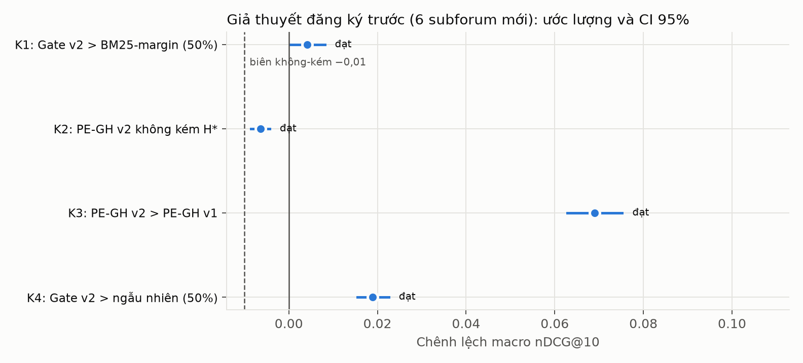
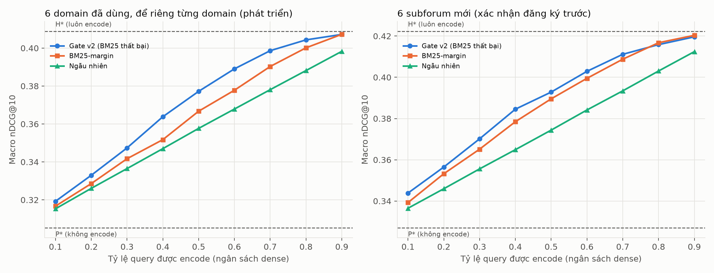
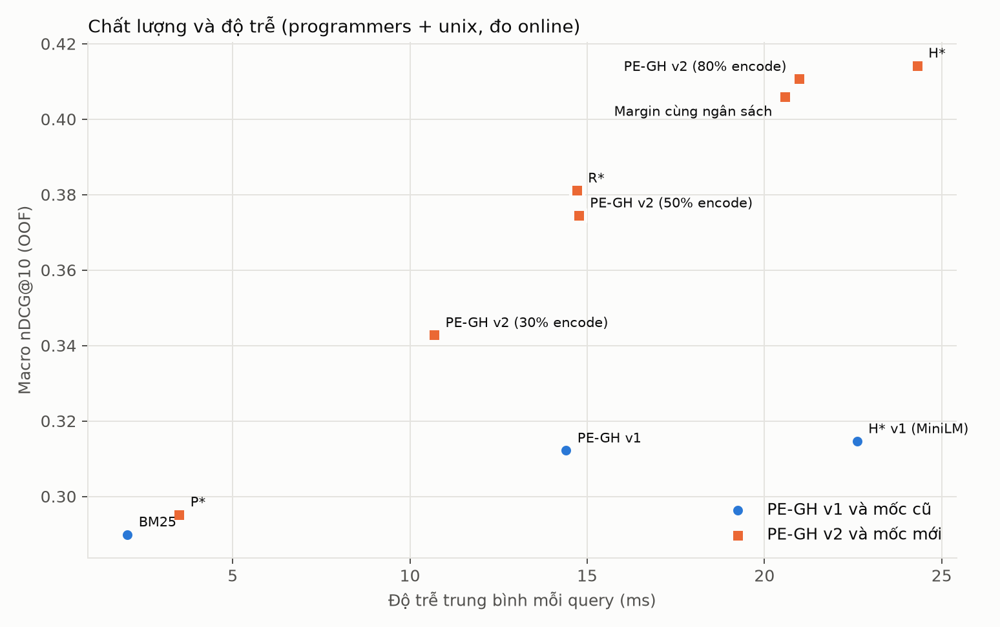

# PE-GH v2 (vòng v4) — 30/10/2026

**Tóm tắt.** PE-GH v2 giữ nguyên ý tưởng của PE-GH: chạy BM25 trước, gate rẻ quyết định, chỉ encode khi cần. Bốn thay đổi:

- gate học dự đoán **"BM25 có thất bại không"**, trên nhiều domain cùng lúc;
- encoder **arctic-embed-xs có prefix query** (cùng chi phí MiniLM);
- nhánh rẻ P\*;
- ngưỡng trở thành **núm chỉnh ngân sách encode**.

Kiểm chứng được đăng ký trước trên **6 subforum CQADupStack chưa từng dùng** (8.303 query, ≈ 282 nghìn tài liệu). **Cả 4 giả thuyết K1–K4 đều đạt** sau hiệu chỉnh Holm:

- **K1 — gate học hơn quy tắc BM25-margin** ở 50% encode: +0,0042 [0,0003; 0,0081], p = 0,017.
  - Lần đầu tiên trong đề tài gate học thắng heuristic này trên dữ liệu mới. Ở v1 và v3, gate chưa lần nào thắng.
  - Hiệu ứng nhỏ hơn trên dev (+0,0105), dương ở 5/6 domain.
  - AUC dự đoán "BM25 thất bại": 0,764 so với 0,670 của margin.
- **K2 — PE-GH v2 (80% encode) không kém H\*** (luôn encode), biên 0,01: −0,0064 [−0,0085; −0,0043].
- **K3 — PE-GH v2 hơn PE-GH v1** +0,069 [0,063; 0,075]. Phần lớn chênh lệch đến từ encoder.
- **K4 — gate v2 hơn định tuyến ngẫu nhiên** ở 50%: +0,019 [0,015; 0,023].

**Online** (programmers + unix, 97.400 request, 0 sai lệch ranking/route so với offline):

| Cấu hình | Độ trễ TB | nDCG@10 | Giảm so với H\* v2 |
|---|---:|---:|---:|
| H\* v2 | 24,3 ms | 0,414 | — |
| PE-GH v2, 30% encode | 10,7 ms | 0,343 | −56% |
| PE-GH v2, 50% encode | 14,8 ms | 0,374 | −39% |
| PE-GH v2, 80% encode | 21,0 ms | 0,411 | −14% |
| PE-GH v1 | 14,4 ms | 0,312 | — |

**Cùng độ trễ với PE-GH v1, PE-GH v2 (50%) cao hơn +0,062 nDCG@10.**

**Giới hạn:**

- Lợi thế của gate nằm ở ngân sách 10–70%. Ở 80–90% gate ngang margin.
- R\* (encode mọi query, chỉ chấm lại ứng viên BM25) ở 14,7 ms đạt 0,381, cao hơn PE-GH v2 50% ở cùng độ trễ.
- Trên domain mới, P\* ≈ BM25.
- Gate giảm độ trễ trung bình và trung vị, không giảm p95.

## 1. Vì sao có PE-GH v2

Ý tưởng của PE-GH giữ nguyên: **chạy BM25 trước, một gate rất rẻ chỉ nhìn query và danh sách BM25, rồi chỉ encode khi cần.** Vòng v3 cho thấy ba điểm yếu của bản v1:

1. **Gate học không hơn quy tắc BM25-margin** khi so ở cùng số lần encode. Gate v1 học *lợi ích của hybrid* (gain), nhưng gain phụ thuộc vào phía dense — thứ gate không nhìn thấy trước khi encode.
2. **Tiết kiệm ít.** Ngưỡng chọn theo luật C6 encode 81% (MiniLM) và 95,4% (bge-small) query.
3. **Gate học riêng từng domain** nên cần nhãn của chính domain đó. Trên domain mới với MiniLM, gate không có tín hiệu (AUC 0,503).

PE-GH v2 sửa đúng ba điểm đó, không đổi kiến trúc BM25 → gate → (có/không) encode.

## 2. PE-GH v2 khác v1 ở đâu

| | PE-GH v1 | PE-GH v2 |
|---|---|---|
| Gate dự đoán | lợi ích hybrid so với BM25 (Ridge) | **BM25 có thất bại không** (nDCG@10 BM25 = 0; logistic) |
| Đặc trưng | 21 đặc trưng v1 | 21 v1 + 7 QPP, **chuẩn hóa theo domain** bằng thống kê không nhãn |
| Dữ liệu huấn luyện | train fold của chính domain (cần nhãn) | **6 domain đã thấy gộp lại**; domain mới không cần nhãn |
| Nhánh rẻ (không encode) | BM25 | **P\*** = BM25 top-100 xếp hạng lại bằng proxy tĩnh (không chạy transformer) |
| Nhánh đắt (encode) | H\*: MiniLM + FAISS + fusion | H\*: **arctic-embed-xs + prefix query** + FAISS chính xác + CC fusion |
| Lựa chọn fusion | chọn trên validation của domain | **cố định từ domain huấn luyện** (H\* = CC 0,7; P\* = proxy CC 0,3) |
| Ngưỡng | luật C6 trên validation có nhãn | **phân vị điểm gate** trên query không nhãn = ngân sách encode chọn trước |

**Vì sao nhãn "BM25 thất bại".** Gate chỉ thấy query và danh sách BM25, nên bài toán nó làm được là *dự đoán chất lượng của chính BM25* (bài toán QPP kinh điển). Khi BM25 thất bại thì gần như chỉ dense cứu được; khi BM25 tốt thì P\* đã đủ. Nhãn này không phụ thuộc encoder, nên **cùng một gate dùng được cho mọi encoder**: encoder chỉ quyết định độ cao của H\* và mức ngân sách nên dùng.

**Vì sao chuẩn hóa theo domain.** Thang điểm BM25 và IDF khác nhau giữa các subforum. Mỗi domain được chuẩn hóa bằng trung bình/độ lệch chuẩn đặc trưng của chính các query của nó — chỉ cần query, không cần nhãn — nên gate học trên domain này áp dụng được sang domain khác.

**Ngân sách là núm vặn.** Người vận hành chọn tỷ lệ query được encode (ví dụ 50%). Ngưỡng là phân vị tương ứng của điểm gate trên các query đã có (không cần nhãn). Query không có token BM25 hoặc toàn OOV luôn được encode.

## 3. Tuần 1 — chọn encoder và chốt Gate v2

### 3.1 Encoder (programmers + unix, OOF, quy tắc định trước)

Quy tắc: H\* macro cao nhất; nếu chênh không quá 0,005 thì encoder rẻ hơn thắng. Thời gian encode: trung vị một query, 4 lõi đã pin.

| Encoder | Dense | H\* | Encode (ms) |
|---|---:|---:|---:|
| MiniLM (v1) | 0,2353 | 0,3146 | 8,78 |
| bge-small | 0,3683 | 0,3971 | 15,37 |
| bge-small + prefix | 0,3849 | 0,4018 | 15,94 |
| arctic-embed-xs | 0,2505 | 0,3469 | 8,31 |
| **arctic-embed-xs + prefix** | **0,4050** | **0,4133** | **8,72** |

Chọn **Snowflake/snowflake-arctic-embed-xs** (6 lớp, 384 chiều), có prefix query `Represent this sentence for searching relevant passages: ` (chỉ thêm vào query; vector tài liệu không đổi).

- H\* hơn MiniLM +0,0986 [0,087; 0,110], cùng chi phí encode.
- H\* hơn bge-small + prefix +0,0115 [0,0023; 0,0211], với khoảng một nửa thời gian encode.
- Không có prefix, arctic chỉ đạt dense 0,2505: prefix là một phần của cấu hình, không phải chi tiết phụ.

### 3.2 Gate v2 (6 domain đã thấy, leave-one-domain-out)

Mỗi lần để riêng một domain. Gate và lựa chọn fusion fit trên 5 domain còn lại, rồi định tuyến P\* → H\* trên domain để riêng ở các ngân sách 10–90%. Tiêu chí chọn định trước: trung bình macro nDCG@10 trên ngân sách 20–80%.

| Ứng viên | Diện tích 20–80% |
|---|---:|
| **fail, v1+QPP, chuẩn hóa theo domain (chọn)** | **0,3733** |
| fail, v1, theo domain | 0,3731 |
| fail, v1, toàn cục | 0,3729 |
| fail, v1+QPP, toàn cục | 0,3728 |
| low (−nDCG BM25, Ridge), 4 biến thể | 0,3712–0,3720 |
| BM25-margin (không học) | 0,3653 |
| Ngẫu nhiên (30 seed) | 0,3573 |
| Oracle theo từng query | 0,4304 |

Các biến thể "fail" gần như bằng nhau (chênh ≤ 0,0006). Đóng góp chính đến từ **nhãn mới và huấn luyện đa domain**, không đến từ QPP hay cách chuẩn hóa.

| Ngân sách encode | Gate v2 | BM25-margin | Ngẫu nhiên | Gate v2 − margin [CI 95%] |
|---:|---:|---:|---:|---|
| 30% | 0,3474 | 0,3417 | 0,3365 | +0,0057 [0,0009; 0,0104] |
| 50% | 0,3772 | 0,3667 | 0,3577 | +0,0105 [0,0061; 0,0148] |
| 70% | 0,3986 | 0,3903 | 0,3781 | +0,0083 [0,0048; 0,0117] |
| 80% | 0,4043 | 0,4002 | 0,3882 | |
| 100% (H\*) | 0,4088 | | | |
| 0% (P\*) | 0,3053 | | | |

Lần đầu tiên trong đề tài, **gate học hơn BM25-margin với CI loại trừ 0** ở mọi ngân sách kiểm tra. Ở v3, gate v1 với bge-small kém margin −0,0014.

**Ngân sách vận hành** theo quy tắc định trước (ngân sách nhỏ nhất ≥ 30% mà kém H\* không quá 0,005) là **80%**: 0,4043 so với H\* 0,4088. Với encoder mạnh, H\* hơn P\* tới 0,10, nên muốn giữ chất lượng của H\* thì phải encode phần lớn query. Muốn tiết kiệm nhiều hơn thì đổi chất lượng lấy chi phí theo đường cong ngân sách.

Gate cuối cùng fit trên cả 6 domain, lưu ở [configs/v4/gate_v2.json](../../configs/v4/gate_v2.json) (28 trọng số tuyến tính, `gate_sha256` 009e639d…). Các đặc trưng có trọng số lớn nhất là tỷ lệ điểm BM25 cuối/đầu (QPP), độ phân tán điểm top-10, điểm hạng 1 và khoảng cách hạng 1–2. Cả bốn đều là tín hiệu "BM25 có tự tin không".

## 4. Đăng ký trước

[configs/v4/preregistration.yaml](../../configs/v4/preregistration.yaml) được băm và ghi thời điểm (2026-10-30 01:40 UTC) **trước khi tải bất kỳ file nào** của sáu subforum mới: english, gaming, physics, stats, tex, wordpress (≈ 8.300 query, ≈ 282 nghìn tài liệu). Mã chặn mọi bước chạm vào domain mới cho đến khi có biên nhận này.

- **Cố định trước:** gate (hash), encoder, prefix, lựa chọn fusion, ngân sách 50% (so khớp) và 80% (vận hành), quy tắc ngưỡng, phân tích.
- **Phân tích:** bootstrap 10.000 lần theo nhóm trong từng domain (seed 20261019), Holm trên K1–K4, α = 0,05.

| Giả thuyết | Nội dung | Trên dev |
|---|---|---|
| K1 | Ở 50% encode, gate v2 hơn BM25-margin | +0,0105 |
| K2 | PE-GH v2 (80%) không kém H\* (biên 0,01) | −0,0045 |
| K3 | PE-GH v2 hơn PE-GH v1 (cả hệ thống; chủ yếu nhờ encoder) | — |
| K4 | Ở 50% encode, gate v2 hơn định tuyến ngẫu nhiên | +0,0195 |

PE-GH v1 được chạy đúng như cũ: MiniLM, và gate Ridge, H\*/S\* cùng ngưỡng C6 được chọn trên nhãn train/validation của chính domain mới. Như vậy v1 được dùng nhãn trong domain, còn v2 thì không.

## 5. Kết quả xác nhận trên 6 subforum mới

Dữ liệu được tải sau thời điểm đăng ký (01:40:48 UTC, 28 giây sau biên nhận). Gate, encoder, fusion, ngân sách và phân tích giữ đúng như đã đăng ký. Kết quả đầy đủ ở [facts/evaluation_new.json](facts/evaluation_new.json).

### 5.1 Giả thuyết

| Giả thuyết | Ước lượng | CI 95% | p (một phía) | Ngưỡng Holm | Kết luận |
|---|---:|---|---:|---:|---|
| K1: gate v2 > BM25-margin (50%) | +0,0042 | [0,0003; 0,0081] | 0,0171 | 0,05 | **đạt** |
| K2: PE-GH v2 (80%) không kém H\* | −0,0064 | [−0,0085; −0,0043] | 0,0009 | 0,025 | **đạt** |
| K3: PE-GH v2 > PE-GH v1 | +0,0690 | [0,0629; 0,0752] | < 0,0001 | 0,0125 | **đạt** |
| K4: gate v2 > ngẫu nhiên (50%) | +0,0190 | [0,0155; 0,0225] | < 0,0001 | 0,0167 | **đạt** |



### 5.2 Mặt bằng chất lượng (macro nDCG@10, 6 domain mới)

| Phương án | nDCG@10 | Tỷ lệ encode |
|---|---:|---:|
| BM25 | 0,3267 | 0% |
| P\* (BM25 + proxy tĩnh) | 0,3270 | 0% |
| Dense arctic (prefix) | 0,4031 | 100% |
| **H\*** (BM25 ⊕ dense arctic) | **0,4223** | 100% |
| **PE-GH v2, ngân sách vận hành** | **0,4159** | 80,0% |
| PE-GH v2, 50% | 0,3933 | 50% |
| BM25-margin, 50% | 0,3892 | 50% |
| Ngẫu nhiên, 50% | 0,3744 | 50% |
| PE-GH v1 (MiniLM, dùng nhãn trong domain) | 0,3469 | 81,8% |
| H\* MiniLM (tham khảo) | 0,3483 | 100% |

Ngưỡng phân vị lấy trên query không nhãn cho tỷ lệ encode thực tế 79,9–80,2% ở mọi domain. Núm ngân sách giữ đúng mức đặt ra trên dữ liệu mới.

### 5.3 Từng domain

| Domain | BM25 | H\* | PE-GH v2 (80%) | v2 − H\* | v2 50% | margin 50% | v2 − margin | AUC v2 / margin |
|---|---:|---:|---:|---:|---:|---:|---:|---|
| english | 0,3375 | 0,4590 | 0,4505 | −0,0086 | 0,4241 | 0,4227 | +0,0014 | 0,774 / 0,673 |
| gaming | 0,4675 | 0,5863 | 0,5815 | −0,0048 | 0,5583 | 0,5500 | +0,0082 | 0,796 / 0,681 |
| physics | 0,3266 | 0,4388 | 0,4310 | −0,0078 | 0,3993 | 0,3938 | +0,0055 | 0,735 / 0,646 |
| stats | 0,2883 | 0,3624 | 0,3571 | −0,0054 | 0,3475 | 0,3337 | +0,0139 | 0,748 / 0,682 |
| tex | 0,2490 | 0,3185 | 0,3179 | −0,0006 | 0,3006 | 0,2970 | +0,0035 | 0,760 / 0,653 |
| wordpress | 0,2914 | 0,3686 | 0,3574 | −0,0112 | 0,3303 | 0,3377 | −0,0074 | 0,772 / 0,685 |

Gate v2 dự đoán BM25 thất bại tốt hơn margin ở **cả 6 domain**: AUC 0,735–0,796 so với 0,646–0,685. Về chất lượng định tuyến ở 50%, gate hơn margin ở 5/6 domain; wordpress (domain nhỏ nhất, 541 query) là ngoại lệ.

### 5.4 Đường cong ngân sách (thống kê mô tả, không kiểm định)

| Ngân sách | 10% | 20% | 30% | 40% | 50% | 60% | 70% | 80% | 90% |
|---|---:|---:|---:|---:|---:|---:|---:|---:|---:|
| Gate v2 | 0,3439 | 0,3565 | 0,3702 | 0,3845 | 0,3928 | 0,4029 | 0,4112 | 0,4159 | 0,4196 |
| BM25-margin | 0,3393 | 0,3532 | 0,3651 | 0,3785 | 0,3896 | 0,3995 | 0,4088 | 0,4168 | 0,4204 |
| Ngẫu nhiên | 0,3365 | 0,3460 | 0,3556 | 0,3649 | 0,3744 | 0,3842 | 0,3934 | 0,4031 | 0,4124 |
| Oracle | 0,3964 | 0,4325 | 0,4474 | 0,4490 | 0,4490 | 0,4490 | 0,4490 | 0,4490 | 0,4490 |
| v2 − margin | +0,0046 | +0,0033 | +0,0050 | +0,0061 | +0,0033 | +0,0034 | +0,0024 | −0,0009 | −0,0007 |



### 5.5 Đọc kết quả

- **Gate học đã có giá trị riêng, nhưng nhỏ.**
  - Trên dev, gate hơn margin +0,0105; trên domain mới +0,0042. Hiệu ứng co lại khi sang dữ liệu mới là điều thường gặp; quan trọng là CI vẫn nằm trên 0.
  - Ở mức dự đoán, khoảng cách rõ hơn nhiều: AUC cao hơn 0,07–0,12 ở mọi domain.
  - Theo thăm dò trên dev, khác biệt so với v1/v3 chủ yếu đến từ **nhãn** (BM25 thất bại, thay vì gain). Huấn luyện đa domain là điều kiện để dùng gate trên domain mới mà không cần nhãn. QPP và cách chuẩn hóa gần như không đổi kết quả (§3.2).
- **Lợi thế tập trung ở ngân sách thấp và trung bình.**
  - Từ 10% đến 70%, gate luôn hơn margin 0,002–0,006.
  - Từ 80% trở lên, cả hai chỉ còn bỏ qua những query BM25 rất tự tin, nên gần như bỏ qua cùng một tập; khi đó gate ngang margin.
  - Ở ngân sách vận hành 80%, chọn gate hay margin không quan trọng. Gate có ích khi muốn tiết kiệm nhiều hơn.
- **Ngân sách vận hành 80% kém H\* một chút, nhưng kém có thật**: −0,0064, CI không chứa 0. Kết quả nằm trong biên không-kém 0,01, nhưng không phải "miễn phí". Đổi lại, số lần encode giảm 20%.
- **K3 chủ yếu là hiệu ứng encoder.** H\* arctic hơn H\* MiniLM 0,074, gần bằng toàn bộ chênh lệch v2 − v1 (0,069). Đây là bằng chứng rằng nâng cấp đúng encoder (cùng chi phí) đáng giá hơn mọi tinh chỉnh gate. Không nên trình bày K3 như đóng góp của gate.
- **P\* gần như không giúp trên domain mới** (+0,0003 so với BM25).
  - Proxy tĩnh của arctic yếu: tương quan Pearson với điểm của vector thật chỉ 0,28–0,39 trên cả 12 domain.
  - Ở v3, proxy bge-small từng tăng BM25 +0,0146.
  - Nhánh rẻ của PE-GH v2 vì vậy thực chất là BM25.
- **PE-GH v1** trên domain mới encode trung bình 81,8% query. Có 1/5 fold không tìm được điểm gated hợp lệ, phải lùi về S\*. Bản v1 vẫn được dùng nhãn trong domain mà vẫn thấp hơn v2 0,069.

## 6. Hiệu năng online (programmers + unix)

**Cách đo.**

- Cùng harness với v1/v3: worker cô lập, 4 lõi vật lý được pin, batch 1, 50 query khởi động. Mỗi phương án 9.740 request (1.948 query test của 5 fold × 5 lần lặp).
- Gate của mỗi domain được huấn luyện **không có domain đó** (LODO). Ngưỡng là phân vị điểm gate trên query train+validation, không nhãn.
- Kiểm tra từng request: **97.400 request, 0 sai lệch** ranking hay quyết định route so với kế hoạch offline.
- Số liệu ở [facts/online_report.json](facts/online_report.json).

| Phương án | TB (ms) | p50 | p95 | Encode | nDCG@10 (OOF) | Giảm TB so với H\* v2 [CI 95%] |
|---|---:|---:|---:|---:|---:|---|
| BM25 | 2,03 | 1,96 | 3,51 | 0% | 0,2899 | 91,6% |
| P\* | 3,49 | 3,41 | 5,06 | 0% | 0,2952 | 85,6% |
| R\* (encode, chấm lại BM25 top-100) | 14,70 | 14,53 | 17,66 | 100% | 0,3811 | 39,5% |
| **H\* v2** (arctic) | 24,31 | 24,17 | 28,95 | 100% | 0,4142 | — |
| **PE-GH v2, 30%** | 10,68 | 5,27 | 26,77 | 30,1% | 0,3428 | 56,1% [54,4; 57,7] |
| **PE-GH v2, 50%** | 14,76 | 18,73 | 28,14 | 50,1% | 0,3745 | 39,3% [37,5; 41,1] |
| **PE-GH v2, 80%** | 20,98 | 23,91 | 29,52 | 79,9% | 0,4107 | 13,7% [12,2; 15,2] |
| BM25-margin, 80% | 20,58 | 23,46 | 28,88 | 80,1% | 0,4060 | 15,3% [13,9; 16,8] |
| H\* v1 (MiniLM) | 22,61 | 22,34 | 27,76 | 100% | 0,3146 | 7,0% |
| PE-GH v1 | 14,40 | 19,75 | 27,12 | 57,8% | 0,3122 | 40,7% |



**Thời gian từng bước** (fold 0, một lần lặp, PE-GH v2 50%):

| Đường đi | Tổng | BM25 | Thống kê + đặc trưng + gate | Encode | FAISS | Fusion |
|---|---:|---:|---:|---:|---:|---:|
| Bỏ qua encode → P\* | 4,8 ms | 2,4 | 0,7 | — | — | 1,7 |
| Encode → H\* | 24,5 ms | 2,4 | 0,7 | 13,0 | 6,9 | 1,0 |

**Đọc kết quả:**

- **PE-GH v2 trội hẳn PE-GH v1 và H\* v1.**
  - Ở cùng độ trễ với PE-GH v1 (≈ 14,5 ms), PE-GH v2 50% đạt 0,3745 so với 0,3122.
  - PE-GH v2 30% đạt 0,3428 với 10,7 ms, vượt cả H\* v1 (0,3146, 22,6 ms) với chưa tới một nửa thời gian.
- **Núm ngân sách hoạt động online.** Tỷ lệ encode thực tế khớp mục tiêu (30,1 / 50,1 / 79,9%). Độ trễ trung bình giảm gần tuyến tính theo ngân sách. Chi phí gate ≈ 0,7 ms.
- **Gate giảm trung bình và trung vị, không giảm p95.** Query được encode vẫn tốn như H\* (≈ 24–30 ms). Nếu ràng buộc là đuôi độ trễ thì cần HNSW hoặc encoder nhỏ hơn, không phải gate.
- **R\* là mốc đáng lưu ý.** Ở cùng ≈ 14,7 ms, R\* (0,3811) hơn PE-GH v2 50% (0,3745): encode mọi query nhưng không tìm FAISS. R\* chưa được kiểm định trên domain mới, nên đây là quan sát trên dev.
- H\* v2 chậm hơn H\* v1 7,5%, đổi lại chất lượng cao hơn +0,10.

## 7. Demo

```powershell
python scripts_shared/demo_v4.py --domain unix --port 8765   # mở http://127.0.0.1:8765
```

Gõ một câu hỏi tiếng Anh. Trang hiển thị:

- quyết định của gate (**Bỏ qua encode → P\*** hoặc **Encode → H\***), điểm gate và ngưỡng;
- thời gian từng bước (BM25, đặc trưng, gate, encode, FAISS, fusion);
- top-10 của PE-GH v2, đặt cạnh top-10 của BM25.

Demo dùng đúng gate đã đóng băng; ngưỡng là phân vị ngân sách vận hành trên query của domain đó. `--budget 0.5` để xem gate ở ngân sách khác. Domain chọn được: 6 domain đã thấy.

## 8. Kết luận và giới hạn

**Được hỗ trợ trên dữ liệu chưa từng dùng, bằng giao thức đăng ký trước:**

1. **Gate học v2 hơn quy tắc BM25-margin** ở cùng ngân sách (K1) và hơn ngẫu nhiên (K4). Đây là điều v1 và v3 không đạt được.
   - Hiệu ứng nhỏ: +0,004 nDCG@10 ở 50%.
   - Rõ hơn ở mức dự đoán: AUC 0,76 so với 0,67.
2. **PE-GH v2 giữ chất lượng của H\* trong biên 0,01 mà bỏ 20% lượt encode** (K2). Có một mất mát nhỏ, đo được: −0,006.
3. **PE-GH v2 hơn PE-GH v1 +0,069** (K3), chủ yếu nhờ chọn encoder đúng với cùng chi phí. Online: cùng độ trễ, cao hơn 0,062.
4. **Ngân sách encode là núm chỉnh tin được.** Ngưỡng phân vị lấy trên query không nhãn cho đúng tỷ lệ encode trên domain mới (79,9–80,2%) và online (30,1 / 50,1 / 79,9%).

**Không được hỗ trợ hoặc cần nói rõ:**

1. Ở ngân sách cao (≥ 80%), gate ngang margin. Giá trị của gate nằm ở vùng muốn tiết kiệm 30–90% lượt encode.
2. P\* với proxy arctic không giúp trên domain mới. Nhánh rẻ thực chất là BM25.
3. Ở ≈ 15 ms, R\* cho chất lượng cao hơn PE-GH v2 50% (trên dev). Định tuyến không phải cách duy nhất để giảm chi phí.
4. Gate không giảm p95.
5. Oracle ở 50% đạt 0,449, gate đạt 0,393: vẫn còn khoảng cách lớn.

**Cách trình bày đóng góp.** Có thể nói PE-GH v2 là *gate học đầu tiên trong đề tài thắng heuristic không học trên dữ liệu mới*, với điều kiện nêu rõ ba điểm:

- **Nhỏ:** +0,004 nDCG@10.
- **Từ đâu mà có:** nhãn "BM25 thất bại" (đúng thứ gate quan sát được) và huấn luyện đa domain.
- **Nằm ở đâu:** vùng ngân sách 10–70%.

Định tuyến trước khi encode dựa trên dự báo chất lượng BM25 đã có trong tài liệu (Arabzadeh và cộng sự, CIKM 2021). Điểm riêng của đề tài nằm ở:

- gate tuyến tính 28 đặc trưng, chi phí ≈ 0,7 ms;
- so sánh ở cùng ngân sách với heuristic, có CI;
- đo độ trễ online thật, đối chiếu từng request;
- xác nhận đăng ký trước trên 6 domain mới.

**Phạm vi:**

- **Dữ liệu:** CQADupStack. Đến nay **cả 12 subforum đều đã dùng**: v1 2, v3 4, v4 6. Mọi kiểm chứng tiếp theo cần tập dữ liệu khác (ví dụ các tập BEIR có tương quan dense/BM25 khác).
- **Mô hình và máy:** một encoder 384 chiều chạy CPU; một máy Windows 4 lõi pin. Online chỉ đo trên programmers/unix.

**Hướng tiếp theo** (đều là thăm dò; muốn thành kết luận cần dữ liệu mới):

1. Bỏ P\*, dùng BM25 ở nhánh rẻ. Không mất chất lượng trên domain mới, nhanh hơn ≈ 1,5 ms ở nhánh bỏ qua.
2. Ba tầng BM25 → R\* → H\*: gate quyết định có encode hay không, rồi có tìm FAISS hay không. Mục tiêu là vượt R\* ở cùng độ trễ.
3. HNSW cho nhánh H\* để giảm p95 (v3: tìm nhanh hơn 2–10 lần, chất lượng giữ trong 0,001).

## 9. Cách chạy lại

Mặc định `--root ~/.cache/pegh/v4`. Các domain đã thấy được đọc chỉ-đọc từ v3 và v1. Không sửa mã trong lúc chạy `online`.

```powershell
$py = "python"; $s = "scripts_shared/experiment_v4.py"; $E = "arctic_xs_q"
$seen = "android","gis","mathematica","webmasters"     # programmers/unix đã có từ v1
$new  = "english","gaming","physics","stats","tex","wordpress"
# Tuần 1: chọn encoder trên dev, rồi chốt gate bằng LODO trên 6 domain đã thấy
& $py $s vectors --encoders arctic_xs --domains programmers unix   # MiniLM/bge-small đã có từ v1/v3
& $py $s quality --encoders bge_small_q arctic_xs arctic_xs_q --domains programmers unix
& $py $s encode-cost --encoders minilm bge_small bge_small_q arctic_xs arctic_xs_q
& $py $s compare --encoders minilm bge_small bge_small_q arctic_xs arctic_xs_q
& $py $s vectors --encoders $E --domains $seen; & $py $s quality --encoders $E --domains $seen
foreach ($st in "proxy","features","tiers","develop") { & $py $s $st --encoders $E }
& $py $s freeze                      # ghi configs/v4/gate_v2.json
& $py $s preregister                 # chỉ hợp lệ khi chưa có dữ liệu domain mới
# Tuần 2: dựng 6 subforum mới, chấm K1–K4
& $py $s fetch
& $py $s vectors --encoders minilm $E --domains $new
& $py $s quality --encoders minilm $E --domains $new
foreach ($st in "proxy","features","tiers") { & $py $s $st --encoders $E --domains $new }
& $py $s evaluate
# Tuần 3: online trên programmers/unix (gate train không có domain được đo)
& $py $s online-plan; & $py $s online; & $py $s online --detailed; & $py $s online-report
& $py $s report                      # sao chép facts + vẽ hình vào docs/v4
```
