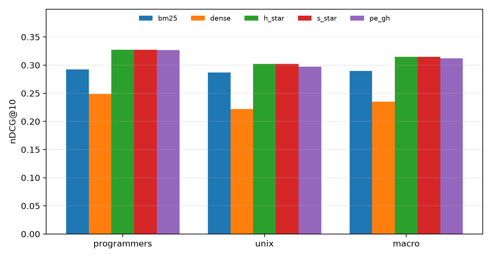
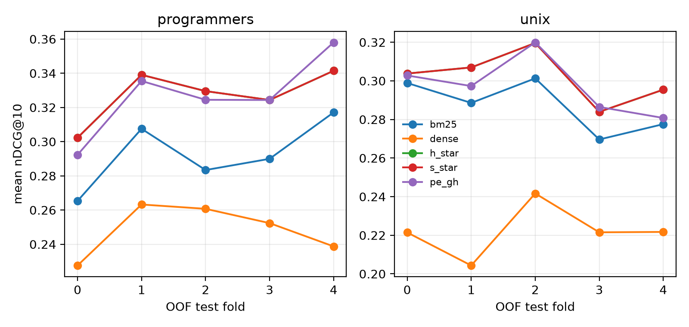
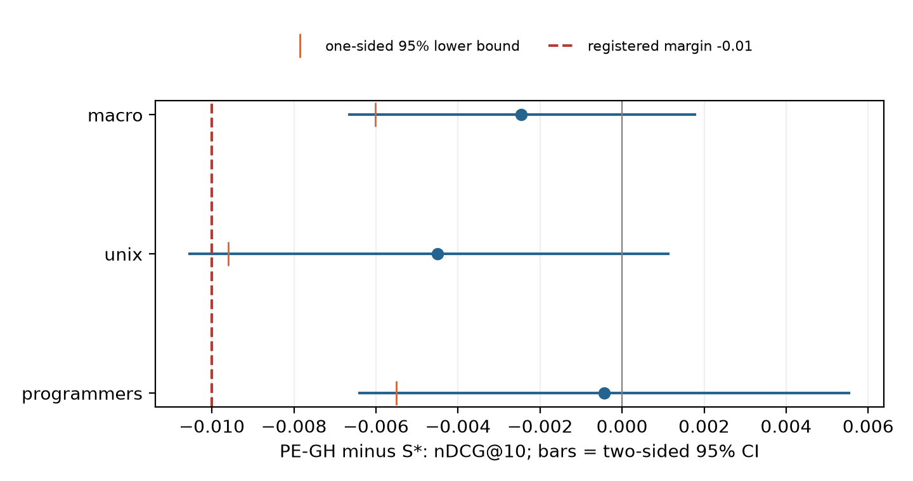

# Quality results

## Final five-fold OOF results, verified 30 October 2026

The table is generated from pinned real data and the exact five-fold OOF test-query
partition. Both frozen retrievers are unsupervised; slicing their complete caches by test
fold changes no score, but enforces the accounting contract required of learned systems.

| Method | Programmers nDCG@10 | Unix nDCG@10 | Macro nDCG@10 | Macro MRR@10 | Macro R@100 |
|---|---:|---:|---:|---:|---:|
| BM25 | 0.292620 | 0.287191 | 0.289906 | 0.292611 | 0.547713 |
| Dense MiniLM | 0.248497 | 0.222105 | 0.235301 | 0.229980 | 0.517783 |
| H* | 0.327311 | 0.301939 | 0.314625 | 0.315820 | 0.589594 |
| S* | 0.327311 | 0.301939 | 0.314625 | 0.315820 | 0.589594 |
| PE-GH | 0.326882 | 0.297444 | 0.312163 | 0.315880 | 0.576145 |

H* is the validation-selected hybrid and S* is the validation-selected best static
retriever. They coincide in all ten fold/domain combinations. PE-GH uses the frozen
Ridge gain model and validation threshold; 1,125 of 1,948 test queries invoke dense
retrieval (57.75%). Query coverage and all 29,220 online ranking sequences were verified
against the frozen OOF runs on 30 October. The experiment freeze is
`b22092218033d7b8d50ca866c1a0af205f2ed77de74d274b2fc31bfcca42cbd0`.

The [14-method table](figures/final-a/quality-final.csv) includes dense-call ratios,
per-domain nDCG, macro MRR and recall. Quality numbers reproduce the 26 October
integration; the [30 October release receipt](../docs/person_a/validation/2026-10-30/release.json)
records a separate runtime experiment on an AMD Ryzen 7 8745H, Windows 11, four logical
CPUs, Python 3.13.2 and the locked packages. Its mean latency reduction against H* is
33.80% [32.01%, 35.65%], conditional on the observed paired timing repetitions.
Programmers alone improves by 19.73% and has slightly worse p95 than H*/S*.
These latency results apply to this machine; they are not pooled with earlier i3/i7 runs.

## Registered noninferiority comparison and utility

| Scope | Mean PE-GH minus S* nDCG@10 | One-sided 95% lower bound | Lower bound > -0.01 |
|---|---:|---:|---|
| Programmers | -0.000429 | -0.005502 | Yes |
| Unix | -0.004495 | -0.009601 | Yes |
| Macro, equal domain weights | -0.002462 | -0.006009 | Yes |

The group bootstrap uses 10,000 samples and seed 20261019, preserving paired query
outcomes and stratifying the macro statistic by domain. The interval conditions on the
frozen models and selections; it does not include retraining uncertainty. Unix is close
to the registered margin. Noninferiority does not imply identical quality or superiority.
The [comparison receipt](../docs/person_a/validation/2026-10-30/comparison.json) retains
both one-sided bounds and two-sided intervals.

The [utility table](../docs/person_a/validation/2026-10-30/utility.csv) contains all 1,948
`U_H - U_B` and 1,948 `U_PE - U_S*` values, with domain and query identity. It is descriptive
test analysis; thresholds remain those selected before test. The matched-budget random
30-seed diagnostic averages 0.305685 macro nDCG@10 and the oracle reaches 0.336730,
versus 0.312163 for PE-GH. The oracle and exact batch-budget masks are diagnostics, not
deployable online policies. Relative gains among learned comparators are small and do
not establish that technical features outperform the LiteGator-style feature set at
matched latency or budget.

## Baseline complementarity and provenance

Pooled micro nDCG@10 is 0.289633 for BM25 and 0.233973 for dense. No ranking is missing
or empty among the 1,948 queries. Dense minus BM25 macro nDCG@10 is -0.054605. Dense helps
166 of 876 Programmers queries and 131 of 1,072 Unix queries, which leaves useful
query-dependent complementarity despite the lower standalone mean. These counts are
descriptive and must not be used to choose a test-time gate.

The dense indexes were rebuilt locally from the pinned model revision and canonical corpus.
Verifier checks passed for every vector, with dimension 384 and L2 norms within
`[0.99999988, 1.00000012]`. Model/config/corpus/ID-order hashes match B's registered
manifests. FAISS index bytes and ranking hashes differ from B's earlier machine-specific
artifacts, so these are explicitly labeled rebuilt runs rather than byte-identical copies.

The historical baseline failure audit contains the bottom 20 queries per method and domain (80
rows): 23 code/CLI, 53 natural-language, and 4 short queries under lexical heuristic labels.
These labels are descriptive, not causal diagnoses.

## Routing failure analysis

All 1,948 frozen decisions were classified using `delta_U = U_H - U_B`:

| Domain | Missed benefit: skip, delta > 0 | Wasted dense: dense, delta <= 0 | Useful dense: dense, delta > 0 | Safe skip: skip, delta <= 0 |
|---|---:|---:|---:|---:|
| Programmers | 29 | 508 | 146 | 193 |
| Unix | 67 | 413 | 58 | 534 |
| Total | 96 | 921 | 204 | 727 |

The gate misses 96 positive-gain queries and invokes dense for 921 queries with zero or
negative measured gain. "Wasted" refers to this fixed nDCG@10 outcome; zero gain can
coexist with improvements at other cutoffs. These counts explain remaining headroom and
are not evidence that a new policy could learn the oracle decisions.

The deterministic [40-case audit](figures/final-a/gate-cases.csv) selects five queries per
domain/outcome: largest missed gains; largest dense harms; large useful gains plus one
median; and fixed-hash safe skips. Ties use query ID. The
[complete case records](figures/final-a/gate-cases.jsonl) include features, score/threshold,
decision, all four utilities, top document IDs, positive non-self qrels and five raw request
times. Detailed stage times exist only in the separate Programmers fold-0 sample; other
cases explicitly report unavailable stages. The main benchmark disables stage timers.
Selection uses the published categories and explicit rules after freeze; no model or
threshold is fitted to these cases. See the [failure protocol](figures/final-a/FAILURE_ANALYSIS.md).

## Reproduction

From the completed experiment artifacts, run
`python scripts_a/finalize_report.py --output results/paper/final-a-20261030`.
The script verifies report/freeze hashes, source identities recorded in all benchmark
receipts, raw receipt checksums, every online ranking, query coverage and gate policy,
then writes tables, figures and cases. It performs post-freeze analysis and does not
rewrite the experiment source identity. Input/output SHA-256 values and analysis-code
hashes are in [the final analysis manifest](figures/final-a/report.json).
