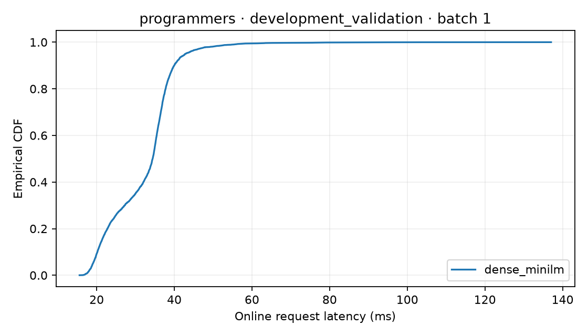
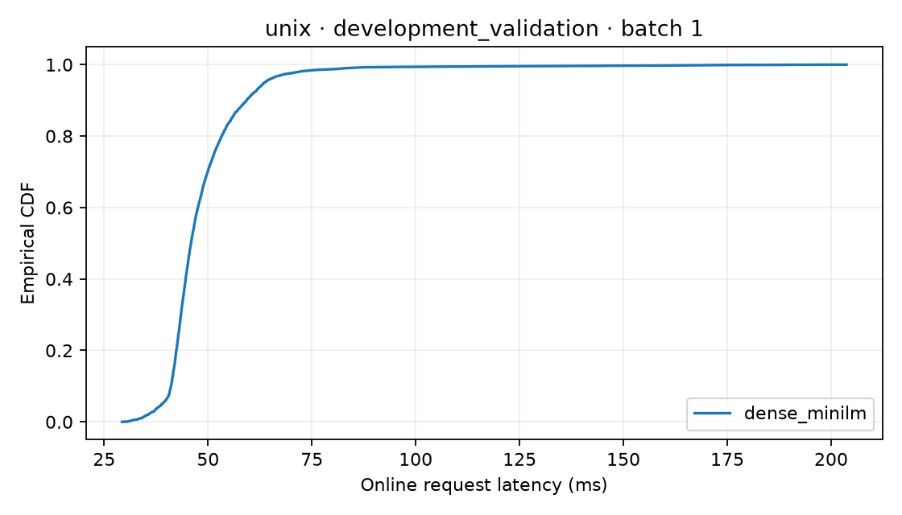
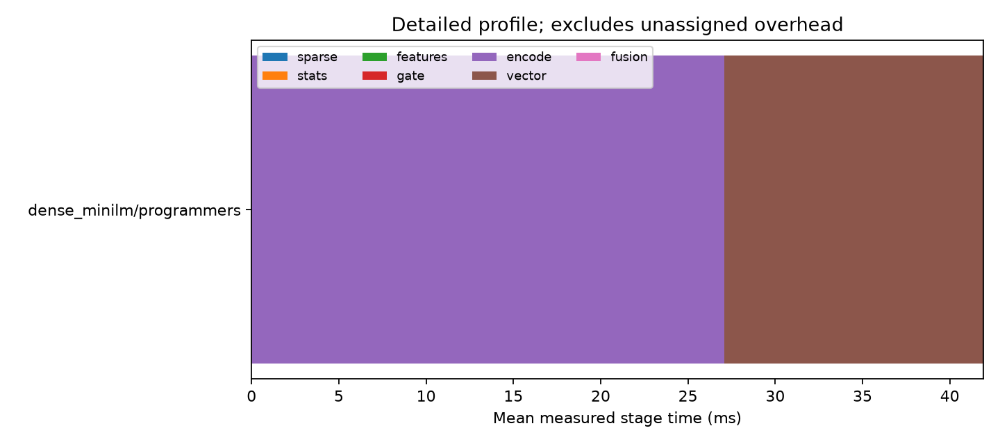
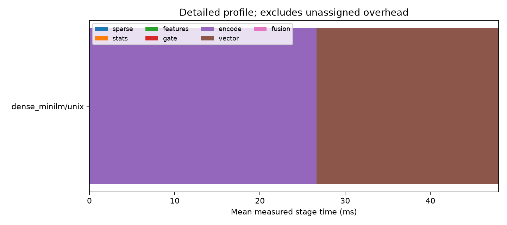

# Kết quả hiệu năng phần B

Lượt PE-GH tích hợp đầy đủ ngày 26/10/2026 nằm ở [báo cáo mới](../docs/integration/2026-10-26/README.md). Phần dưới là nghiệm thu **dense-only B ngày 20/10**, được giữ nguyên để truy vết; các phát biểu “chưa có A/C/gate” chỉ áp dụng cho lượt lịch sử này.

**Đã chạy và audit ngày 20/10/2026.** Dense backend đã build đủ hai corpus, xuất
top100 cho 1.948 public queries và đo đủ năm repetitions mỗi domain. Audit kiểm
9.996 requests gồm 9.740 main samples và 256 detailed samples; mọi ranking online
khớp offline. [Biên bản máy đọc được](../docs/person_b/validation/FINAL_AUDIT.json)
chứa hashes và đường dẫn raw artifacts để kiểm lại.

Phạm vi đợt này là **dense-only development validation**, không phải final test
PE-GH. Chưa có BM25/hybrid/gate hoặc protected splits từ A/C, nên các số dưới đây
chưa xác định speedup hoặc chất lượng/non-inferiority của gate.

## Cấu hình thực chạy

- Intel Core i7-9850H @ 2.60 GHz, 6 physical cores/12 logical processors, Windows 11,
  Python 3.12.14, power scheme Balanced quan sát trước timing. CPU affinity
  `[0,2,4,6]` chọn một SMT thread trên mỗi trong bốn core khác nhau.
- Torch 2.14.1+cpu / FAISS 1.15.1, 4 threads; NumPy 2.5.4,
  sentence-transformers 5.7.0, transformers 4.57.6. Phiên bản đầy đủ trong receipts
  và `uv.lock`. CUDA không dùng.
- Memory cap 8.000.000.000 bytes dùng Windows Job Object **per-process commit**;
  đây không phải RSS cap/container cgroup. RSS đo riêng bằng psutil/OS high-water.
- MSMARCO MiniLM revision `14ca9be4bbcf1402eac0f43a2e2ccb6e0f994ba3`, CPU float32,
  384 chiều, L2-normalized, max_length=256, exact FlatIP, k=100, self-filter/tie policy
  theo background section. Không có query embedding cache.
- Online batch/concurrency=1, 50 warmup/process, 5 repeats, seed=42. Mỗi method/repeat
  process mới; request timer ngoài model/index load và disk logging, bao toàn bộ
  `search`. Detailed stages tắt ở main. Warmup là câu tự viết disjoint, phù hợp
  nghiệm thu B; final A/C run cần train/validation warmup của nhóm.
- Benchmark executable source tại commit `6d25720`, combined source SHA256
  `befbf15fca472b278b72ca350b1308c2826caacae6cb9671b2e9137f742c8bf2` giống nhau
  ở toàn bộ 12 workers. Script audit được thêm **sau khi timing kết thúc**; không
  sửa backend hoặc resource profile trong lúc đo. Source snapshots trong manifest
  là bằng chứng chính xác hơn tên branch/HEAD của bản bàn giao cuối.

## Index và chi phí build quan sát

| Domain | Documents | File FAISS bytes | Vector raw bytes | Truncated >256 | Indexing wall s | Process CPU s | Peak RSS MiB |
|---|---:|---:|---:|---:|---:|---:|---:|
| programmers |32.176|49.422.381|49.422.336|32,93%|1.213,80|4.710,84|646,00|
| unix |47.382|72.778.797|72.778.752|28,85%|1.612,98|6.324,05|675,22|

Nguồn: [programmers manifest](../docs/person_b/validation/indices/programmers-manifest.json),
[unix manifest](../docs/person_b/validation/indices/unix-manifest.json), kèm
build-profile/verification ở cùng thư mục. Tổng 79.558 documents. Process khác đã
kiểm checksum, count/mapping, IndexFlatIP/384d và **mọi** persisted vector finite,
norm trong khoảng 0,99999988–1,00000012. FAISS/NumPy agreement, cutoff ties và
save/load/resume được kiểm riêng bằng fixture/model tests.

Wall/CPU là tổng indexing sessions, gồm token-length audit và resume reconstruction,
không gồm model load. Programmers có 3.584 docs đầu trên `[0,1,2,3]`, sau checkpoint
chuyển profile physical4; local tests cũng diễn ra trong một phần development build.
Vì vậy đây là **chi phí build đã quan sát**, không phải phép so speedup có điều kiện
đồng nhất. Lịch sử invocation được giữ nguyên, không gộp rồi suy lợi ích affinity.

Model-load time quan sát gần nhất 11,11 s ở programmer resume và 145,59 s ở unix.
Chúng có thể gồm chờ HTTP checks; v1 không bật HF_HUB_OFFLINE. Không coi đây là
cold-load benchmark ổn định. Sau khi cache đầy đủ, có thể chạy offline như README.

Tỷ lệ truncation 32,93%/28,85% là giới hạn cần công bố: max_length=256 giảm tài nguyên
nhưng không tự chứng minh chất lượng đủ tốt. A cần chấm relevance trước khi nhóm
chốt kết luận; nếu làm sensitivity max_length khác thì tạo config/artifact mới.

## Main online results

Split `development_validation`, fold=null; programmers 876 query × 5 = 4.380 samples,
unix 1.072 query × 5 = 5.360 samples. Tất cả query nonempty gọi encoder **đúng 1 lần**
và FAISS **đúng 1 lần**, trả 100 hits, không self-hit/fallback. Không bỏ query chậm/lỗi.

| Domain | Mean ms | 95% CI mean ms | p50 ms | p95 ms | Process CPU mean ms | Peak RSS MiB |
|---|---:|---|---:|---:|---:|---:|
| programmers |32,120|[31,861;32,371]|34,420|42,860|123,566|497,89|
| unix |48,584|[48,233;48,938]|45,903|63,650|184,188|522,96|

Nguồn: [programmers summary](../docs/person_b/validation/online/programmers-main-v1/summary.json)
và [unix summary](../docs/person_b/validation/online/unix-main-v1/summary.json).
Mean CI bootstrap 1.000 query clusters, giữ cả 5 repeats cùng query; CI này chỉ cho
mean latency, không phải p95 CI hoặc quality test. CPU time là công việc toàn bộ
threads process, vì thế có thể lớn hơn wall latency. RSS gồm load và warmup.

Các CDF giữ cả tail quan sát. Hai domain có corpus và phân bố query khác nhau;
chênh mean giữa domain không phải một phép ước lượng độc lập tác động corpus size.
Máy desktop không có CPU reservation độc quyền; power/thermal/tải nền có thể ảnh
hưởng số đo. Không chuyển các số Windows này thành latency Linux hoặc paper khác.

## Detailed profile riêng

Chạy 128 query đầu mỗi domain, 1 repeat, 50 warmup, cùng retrieval/resource config,
thêm stage timers. Đây là tập con và operating run khác, không gộp vào main.

| Domain | Total mean ms | Encode mean ms | Vector mean ms | Phần còn lại ms |
|---|---:|---:|---:|---:|
| programmers |42,499|27,082|14,839|0,578|
| unix |48,534|26,659|21,335|0,540|

Phần còn lại là total trừ encode/vector, gồm orchestration/validation/ranking/
instrumentation ngoài stage. Không suy overhead từ chênh mean giữa detailed subset
và main full query set. Vector stage bao gồm FAISS và xử lý candidate/self-filter/
tie trong backend; không phải thời gian kernel dot product thuần.

Vector retrieval chiếm phần đáng kể trong profile này, bên cạnh encoder. Khi C
đánh giá gate, cần xét cả hai; skip encoder/vector có thể giảm compute nhưng
model/index thường vẫn resident. Mean giảm cũng không đảm bảo p95/RSS giảm.

## Quality và bước tích hợp chung

Đã xuất đủ 876/1.072 rankings, mỗi query 100 hits; hashes và metadata ở
[quality artifacts](../docs/person_b/validation/quality). Audit đối chiếu từng
online ranking ID hash với offline output và tất cả đều khớp, nhưng **chưa chấm
nDCG/MRR/Recall** vì B không lấy qrels hay tự chia split của A.

Script Pareto có sẵn và đã kiểm bằng fixture; chưa tạo figure quality–latency từ
số nDCG tự điền. A chấm đúng query/method/retriever hashes rồi xuất quality CSV
gắn run_id; C cung cấp frozen BM25/hybrid/gate factories để B chạy cùng harness.
Full protected experiments và kết luận PE-GH thuộc bước tích hợp chung đó.

## Tái lập và truy xuất

- [README B](../docs/person_b/README.md): cài dependency, build/resume/STOP,
  quality exporter, benchmark và report commands.
- [Protocol](../docs/person_b/VALIDATION_PROTOCOL.md): input/run IDs và acceptance
  trước khi full online results xuất hiện.
- [Local tests](../docs/person_b/validation/TESTS.md): 37 passed gồm model thật;
  hosted GitHub CI chưa chạy trong phiên này.
- [Final audit/catalog](../docs/person_b/validation/FINAL_AUDIT.json): checksum,
  original raw paths, copied reports/receipts. Model/index/raw requests ở
  `C:/Users/quang/.cache/pegh`, ngoài Git; small provenance/figures trong repo.

Chạy `scripts_b/audit_delivery.py --cache-root <cache> --output <delivery>` để
audit lại toàn bộ standalone local protocol và thu small artifacts. Chạy
`scripts_b/report_efficiency.py --run <original-raw-run-dir>` để dựng lại bảng/
figures. Thư mục copied report chỉ có provenance/summary/figures, không đủ raw
requests để report lại nếu chưa mang theo các original paths trong catalog.
