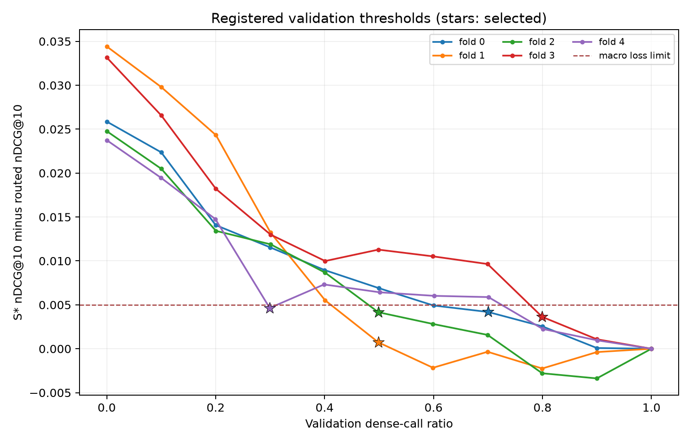
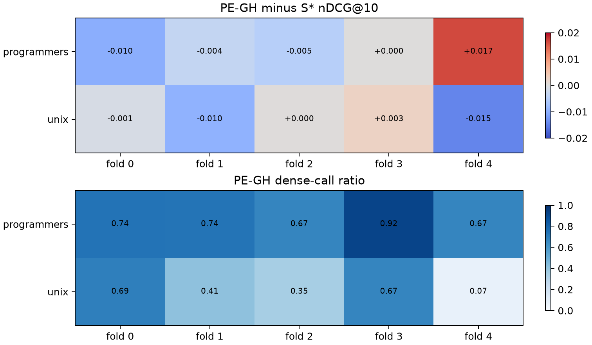
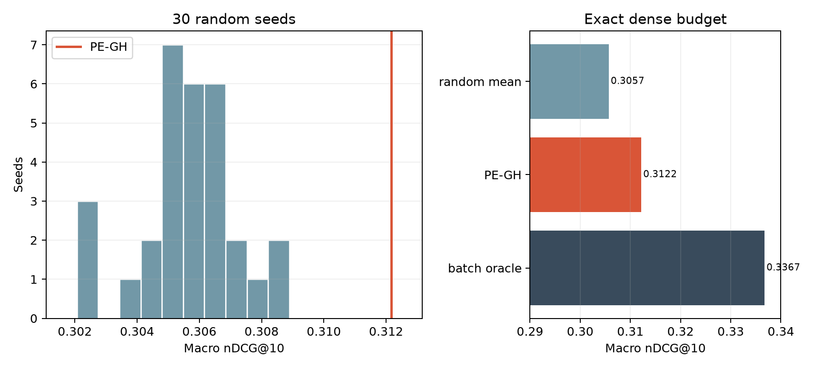

# Gate analysis and C-side results

All quality numbers in this section come from the strict five-fold OOF evaluator, with one test prediction for each of 1,948 queries across Programmers and Unix. The primary frozen comparison is S* versus PE-GH; H* and S* happen to coincide in every fold/domain. The tracked [C7 facts](../docs/person_c/validation/C7_FACTS.json) record method scores, input hashes, freeze identity, and figure hashes; full raw receipts remain under the ignored `results/` directory. Timing evidence is reported separately below.

## Quality at the selected operating points

| Method | Macro nDCG@10 | Dense-call ratio on test |
|---|---:|---:|
| BM25 | 0.28991 | 0.000 |
| Dense only | 0.23530 | 1.000 |
| CC, dense weight 0.5 | 0.31426 | 1.000 |
| RRF, (k=60) | 0.29481 | 1.000 |
| H* / S* | 0.31463 | 1.000 |
| **PE-GH: Ridge gain, 21 features** | **0.31216** | **0.578** |
| Logistic gain, 21 features | 0.31342 | 0.629 |
| Logistic sparse-success, 21 features | 0.31209 | 0.619 |
| LinearSVC gain, eight features | 0.31049 | 0.555 |
| Ridge gain, eight features | 0.31131 | 0.620 |
| BM25 margin rule | 0.31299 | 0.698 |
| Identifier + margin | 0.31463 | 1.000 |
| Query-ID random gate, seed 0 | 0.30956 | 0.729 |

The identifier rule has no feasible gated validation point in any fold. Its recorded policy is **always H***, which explains its 1.000 dense ratio and H* quality; it is not evidence of successful routing. The learned comparators form a quality–compute trade-off: Logistic gain is slightly higher quality than PE-GH while using more dense calls, whereas the eight-feature LinearSVC uses fewer dense calls at lower quality. Dense-call ratio is an observed count, not a latency estimate. All control thresholds were chosen on validation before test.

## Primary comparison and fold behavior

PE-GH makes 1,125 dense calls on 1,948 queries (57.75%). Its macro nDCG@10 is 0.31216 versus 0.31463 for S*, a paired mean difference of −0.00246. The preregistered one-sided 95% group-bootstrap lower bound is −0.00601, above the noninferiority margin of −0.01. Domain-level differences are −0.00043 on Programmers and −0.00450 on Unix; their lower bounds are −0.00550 and −0.00960, respectively. This supports the registered quality noninferiority statement for the fixed OOF predictions. The bootstrap does not include retraining or operating-point selection uncertainty.

Five validation-selected PE-GH budget points target 0.7, 0.5, 0.5, 0.8, and 0.3 dense ratio by fold. Test ratios vary by domain: the Unix fold-4 gate calls dense for only 16/214 queries, while Programmers fold 3 calls it for 161/175. The shared numeric threshold is applied to separately trained domain models; differing score scales may contribute to these route-rate gaps, but that cause is an inference rather than a measured finding. The corresponding quality outcomes are not uniformly favorable. Programmers fold 0 loses about 0.010 nDCG@10 relative to S*; Unix fold 4 loses about 0.0147. Programmers fold 4 gains about 0.0166. We retain all fold outcomes in the macro comparison and do not retune any threshold on test.

## Post-freeze diagnostics

At the exact PE-GH dense count in each fold/domain, 30 query-ID hash random seeds have mean macro nDCG@10 of 0.30569. PE-GH reaches 0.31216; the batch oracle that picks the largest observed H*–BM25 gains reaches 0.33673. The oracle reads test utility and is an upper-bound diagnostic, not a deployable gate. The random experiment uses all registered seeds and reports their distribution; no seed is selected from test outcomes. The gap to the oracle shows remaining routing headroom within this fixed fusion system, without implying that the observed gap can be learned from the current features.

## Online execution and limits

The verified integration benchmark of 26 October covers all 1,948 test queries across ten fold/domain runs, five repetitions each, for H*, S*, and PE-GH: 29,220 measured requests on an Intel i7-9850H pinned to four physical cores. Every method uses the same exact in-memory BM25 backend (bit-identical to the SQLite reference on all 1,948 queries), and H*/S* use the sequential or parallel branch schedule chosen on validation per fold. All 29,220 online ranking-ID sequences match the frozen OOF rankings and encoder-call totals match the frozen gate decisions. Means and p95 pool raw request timings; repeats are correlated observations of the same queries. Peak RSS includes loading and warmup. Full receipts: [integration report](../docs/integration/2026-10-26/README.md).

| Domain | Method | Dense % | Mean ms | p95 ms | CPU mean ms | Peak RSS MiB |
|---|---|---:|---:|---:|---:|---:|
| Programmers | H* | 100.0 | 23.51 | 29.73 | 91.61 | 559.6 |
| Programmers | S* | 100.0 | 23.18 | 27.81 | 90.12 | 560.0 |
| Programmers | PE-GH | 74.7 | 19.24 | 29.65 | 74.03 | 559.4 |
| Unix | H* | 100.0 | 26.85 | 31.81 | 103.96 | 639.3 |
| Unix | S* | 100.0 | 26.70 | 31.66 | 103.22 | 639.5 |
| Unix | PE-GH | 43.9 | 14.32 | 31.41 | 54.91 | 638.0 |
| Both domains | H* | 100.0 | 25.35 | 31.36 | 98.41 | 639.3 |
| Both domains | S* | 100.0 | 25.11 | 30.66 | 97.33 | 639.5 |
| Both domains | PE-GH | 57.8 | 16.54 | 30.97 | 63.51 | 638.0 |

PE-GH lowers pooled mean latency by 34.8% relative to H* (query-bootstrap 95% CI [32.9%, 36.7%]) and process CPU time by 35.5%. The saving follows the dense-call ratio: 18.2% on Programmers, where the shared threshold routes 74.7% of queries to dense, and 46.7% on Unix (43.9%). p95 does not improve, as expected when more than 5% of requests still take the dense branch, and is about 1% above S* pooled (6.6% on Programmers). Peak RSS is unchanged because the encoder and index stay resident. A separate stage sample (Programmers, H*) attributes about 2.3 ms to BM25, 11.3 ms to query encoding, 7.0 ms to exact FAISS search and 1.0 ms to fusion.

A later refinement replaced per-query scikit-learn validation in the gate with the same NumPy arithmetic (48,700 scores bit-identical); in a fresh same-session run it lowered PE-GH's mean by 2.09%, with a process-repetition CI that includes zero ([refinement report](../docs/refinement/inference-2026-10-26/README.md)). An earlier five-repeat run on an i3 machine with the SQLite sparse backend showed no reliable wall-clock saving because sparse retrieval dominated; it is kept as a historical receipt in [C7 facts](../docs/person_c/validation/C7_FACTS.json) and is not pooled with the numbers above. The study uses two technical-question domains, one pinned dense model and one host; broader hardware or workload claims need new measurements.
